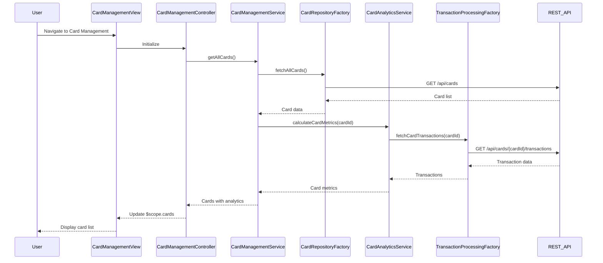

# Low-Level Design: Credit Card Management and Tracking
**Epic ID:** QE-7796  
**Technology Stack:** AngularJS 1.x, JavaScript ES6, HTML5, CSS3, Bootstrap, REST APIs, MVC Architecture

---

## a. Architecture Mapping

- **User Interface - Card Management** → AngularJS Module (`cardManagementModule`) + Controller (`CardManagementController`) + View Template (`card-management.html`)
- **Card Management Service** → AngularJS Service (`CardManagementService`) for managing card operations
- **Credit Card Data Repository** → REST API integration via AngularJS Factory (`CardRepositoryFactory`)
- **Transaction Processing Service** → REST API integration via AngularJS Factory (`TransactionProcessingFactory`)
- **Card-wise Analytics Module** → AngularJS Service (`CardAnalyticsService`) for computing card-level metrics

**Recommended Folder Structure:**
```
/app
  /modules
    /card-management
      card-management.module.js
      card-management.controller.js
      card-management.html
      card-detail.html
  /services
    cardManagement.service.js
    cardAnalytics.service.js
  /factories
    cardRepository.factory.js
    transactionProcessing.factory.js
  /models
    card.model.js
```

---

## b. Component Specifications

| **Component Name** | **Artifact Type** | **Responsibility** | **Key Dependencies** |
|--------------------|-------------------|--------------------|----------------------|
| `cardManagementModule` | Module | Defines the card management feature module | `ngRoute`, `ui.bootstrap` |
| `CardManagementController` | Controller | Manages card listing view, handles card selection, navigates to card details | `CardManagementService`, `$scope`, `$location` |
| `CardManagementService` | Service | Orchestrates card data retrieval, manages card state | `CardRepositoryFactory`, `CardAnalyticsService` |
| `CardRepositoryFactory` | Factory | Fetches and persists credit card data from REST API | `$http`, `API_ENDPOINTS` |
| `TransactionProcessingFactory` | Factory | Fetches card-wise transaction and spend data from REST API | `$http`, `API_ENDPOINTS` |
| `CardAnalyticsService` | Service | Computes card-wise analytics (spend, utilization, balance) | `TransactionProcessingFactory` |
| `cardModel` | Model | Defines credit card data structure | None |

---

## c. Data Model

**Card Model (`cardModel`):**
```javascript
{
  cardId: String,
  cardNumber: String,           // Masked format (e.g., **** **** **** 1234)
  cardType: String,             // Visa, MasterCard, Amex, etc.
  cardHolderName: String,
  expiryDate: String,           // MM/YY format
  creditLimit: Number,
  availableCredit: Number,
  outstandingBalance: Number,
  utilizationPercent: Number,   // (outstandingBalance / creditLimit) * 100
  monthlySpend: Number,
  isActive: Boolean
}
```

---

## d. Data Flow

User navigates to the card management view, triggering `CardManagementController` initialization. The controller calls `CardManagementService.getAllCards()`, which invokes `CardRepositoryFactory.fetchAllCards()` to retrieve card data from the REST API. For each card, `CardAnalyticsService.calculateCardMetrics(cardId)` is called, which uses `TransactionProcessingFactory.fetchCardTransactions(cardId)` to compute card-wise spend and utilization. The aggregated card data with analytics is returned to the controller, bound to `$scope.cards`, and rendered in the view as a Bootstrap card grid. User can click on a card to view detailed information, triggering navigation to the card detail view.

---

## e. Primary Sequence Diagram



---

## f. Implementation Notes

- Use AngularJS `ng-repeat` directive to iterate over `$scope.cards` array and render each card as a Bootstrap card component.
- Implement card detail view as a separate route with `$routeParams` to pass `cardId`; use `CardManagementService.getCardById(cardId)` to fetch details.
- Use ES6 template literals for dynamic card number masking and formatting in the view layer.
- Implement lazy loading for card-wise analytics; compute metrics on-demand when user expands card details to optimize initial load time.
- Use AngularJS filters for formatting currency values and percentages in the view (e.g., `{{ card.creditLimit | currency }}`).

---

## g. Error Handling

HTTP interceptor with retry logic for transient failures; user notified via toast notifications on persistent errors; graceful degradation with partial data display.

---

## h. Security Notes

Standard input validation and secure API calls assumed; card numbers masked in UI and API responses.

---