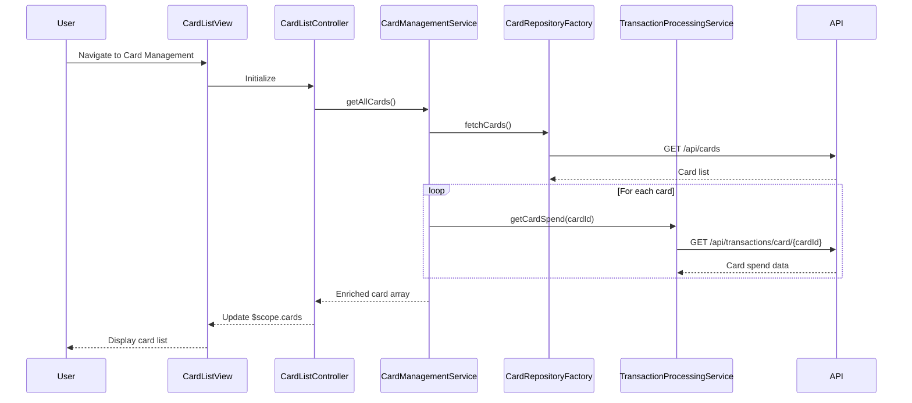

# Low-Level Design: Credit Card Management and Tracking
**Epic ID:** QE-7796  
**Epic Title:** PERFTEST20261109161809-Credit Card Management and Tracking

---

## a. Architecture Mapping

- **Card Tracking UI** → AngularJS Module (`cardManagementModule`) with Controller (`CardListController`) and View template
- **Card Management Service** → AngularJS Service (`CardManagementService`) for card operations and state management
- **Credit Card Data Repository** → AngularJS Factory (`CardRepositoryFactory`) for CRUD operations via REST API
- **Transaction Processing Service** → AngularJS Service (`TransactionProcessingService`) for card-wise spend calculations

**Recommended Folder Structure:**
```
app/
├── modules/card-management/
│   ├── card-management.module.js
│   ├── card-list.controller.js
│   ├── card-list.view.html
├── services/
│   ├── card-management.service.js
│   ├── transaction-processing.service.js
├── factories/
│   ├── card-repository.factory.js
├── models/
│   ├── credit-card.model.js
```

---

## b. Component Specifications

| Component Name | Artifact Type | Responsibility | Key Dependencies |
|---|---|---|---|
| CardListController | Controller | Manages card list display, handles card selection and filtering | CardManagementService, $scope |
| CardManagementService | Service | Orchestrates card retrieval, manages card state, coordinates with repository and transaction services | CardRepositoryFactory, TransactionProcessingService, $http |
| CardRepositoryFactory | Factory | Performs CRUD operations on credit card data via REST API | $http, $q |
| TransactionProcessingService | Service | Calculates card-wise spending and balance aggregations | $http, $q |
| CardListView | View/Template | Displays list of credit cards with individual details, balances, and utilization metrics | Bootstrap, ng-repeat directive |

---

## c. Data Model

**Credit Card Model (`credit-card.model.js`):**
```javascript
{
  cardId: String,                 // Unique card identifier
  cardNumber: String,             // Masked card number (last 4 digits)
  cardHolderName: String,
  cardType: String,               // Visa, MasterCard, Amex, etc.
  bankName: String,
  creditLimit: Number,
  availableBalance: Number,
  outstandingBalance: Number,
  utilizationPercent: Number,     // (outstandingBalance / creditLimit) * 100
  lastTransactionDate: Date,
  isActive: Boolean
}
```

---

## d. Data Flow

User navigates to card management page → CardListController initializes and calls CardManagementService.getAllCards() → CardManagementService invokes CardRepositoryFactory.fetchCards() to retrieve card list from API → For each card, TransactionProcessingService.getCardSpend(cardId) is called to fetch card-specific spending data → Results are merged and enriched (utilization % calculated) → CardManagementService returns array of enriched card objects → CardListController binds to $scope.cards → CardListView renders card list using ng-repeat with Bootstrap card components, displaying card details, balances, and utilization.

---

## e. Primary Sequence Diagram



---

## f. Implementation Notes

- Use AngularJS Service pattern for CardManagementService to maintain singleton state across controllers and enable card data sharing.
- Implement lazy loading for card-specific transaction data using $q promises to avoid blocking UI rendering during initial load.
- Apply ng-repeat with track by cardId in CardListView to optimize DOM rendering and prevent unnecessary re-renders.
- Use Bootstrap card components with responsive grid (col-md-4, col-sm-6) to display multiple cards in a grid layout.
- Implement client-side filtering and sorting using AngularJS filters (orderBy, filter) for enhanced user experience.

---

## g. Error Handling

HTTP interceptor-based error handling with user notifications via toastr; graceful degradation if card-specific spend data fails (display card with "N/A" for spend metrics).

---

## h. Security Notes

Standard input validation and secure API calls assumed; card numbers masked on client-side; token-based auth via existing SSO.

---