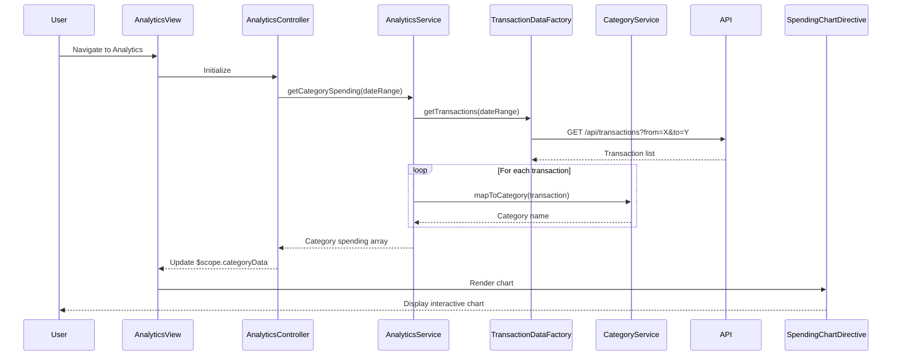

# Low-Level Design: Spending Analytics and Insights
**Epic ID:** QE-7797  
**Epic Title:** PERFTEST20261109161809-Spending Analytics and Insights

---

## a. Architecture Mapping

- **Analytics UI** → AngularJS Module (`analyticsModule`) with Controller (`AnalyticsController`) and View template with chart directives
- **Analytics Service** → AngularJS Service (`AnalyticsService`) for data aggregation and analytics computation
- **Transaction Data Service** → AngularJS Factory (`TransactionDataFactory`) for fetching raw transaction data via REST API
- **Categorization Engine** → Backend service (consumed via REST API); client-side representation via `CategoryService`
- **Dashboard Service** → AngularJS Service (`DashboardIntegrationService`) for embedding analytics into main dashboard

**Recommended Folder Structure:**
```
app/
├── modules/analytics/
│   ├── analytics.module.js
│   ├── analytics.controller.js
│   ├── analytics.view.html
├── services/
│   ├── analytics.service.js
│   ├── category.service.js
│   ├── dashboard-integration.service.js
├── factories/
│   ├── transaction-data.factory.js
├── directives/
│   ├── spending-chart.directive.js
```

---

## b. Component Specifications

| Component Name | Artifact Type | Responsibility | Key Dependencies |
|---|---|---|---|
| AnalyticsController | Controller | Manages analytics view state, fetches spending data, handles chart interactions | AnalyticsService, $scope |
| AnalyticsService | Service | Aggregates transaction data by category, computes monthly trends, prepares chart data | TransactionDataFactory, CategoryService, $http |
| TransactionDataFactory | Factory | Fetches raw transaction data from REST API with filtering by date range | $http, $q |
| CategoryService | Service | Provides category definitions and mapping logic for the 9 spending categories | None (static config) |
| SpendingChartDirective | Directive | Renders interactive category-wise spending chart using Chart.js or D3.js | Chart.js library |
| DashboardIntegrationService | Service | Exposes analytics summary for embedding in main dashboard | AnalyticsService |

---

## c. Data Model

**Transaction Model:**
```javascript
{
  transactionId: String,
  cardId: String,
  amount: Number,
  category: String,              // One of 9 categories
  merchantName: String,
  transactionDate: Date,
  description: String
}
```

**Category Spending Model:**
```javascript
{
  category: String,              // e.g., "Food & Dining"
  totalSpend: Number,
  transactionCount: Number,
  percentageOfTotal: Number
}
```

**Monthly Trend Model:**
```javascript
{
  month: String,                 // e.g., "2024-01"
  totalSpend: Number,
  categoryBreakdown: Array       // Array of Category Spending Models
}
```

---

## d. Data Flow

User navigates to analytics page → AnalyticsController initializes and calls AnalyticsService.getCategorySpending(dateRange) → AnalyticsService invokes TransactionDataFactory.getTransactions(dateRange) to fetch transaction data → Transactions are grouped by category using CategoryService.mapToCategory() → Aggregations computed (total spend per category, percentage of total) → AnalyticsService returns array of CategorySpending objects → AnalyticsController binds data to $scope.categoryData → SpendingChartDirective watches $scope.categoryData and renders interactive pie/bar chart → User interacts with chart (hover, click) to drill down into category details.

---

## e. Primary Sequence Diagram



---

## f. Implementation Notes

- Use AngularJS custom directive (SpendingChartDirective) to encapsulate Chart.js integration for reusable, interactive charts.
- Implement date range picker using AngularJS UI Bootstrap datepicker to allow users to filter analytics by custom date ranges.
- Use $watch in SpendingChartDirective to automatically re-render chart when $scope.categoryData changes.
- Apply ES6 array methods (map, reduce, filter) in AnalyticsService for efficient transaction aggregation and category grouping.
- Cache transaction data in AnalyticsService using $cacheFactory with 5-minute TTL to reduce redundant API calls during user interactions.

---

## g. Error Handling

HTTP interceptor captures API failures; user notified via toastr; chart displays "No data available" message if transaction fetch fails.

---

## h. Security Notes

Standard input validation and secure API calls assumed; date range inputs sanitized to prevent injection attacks.

---