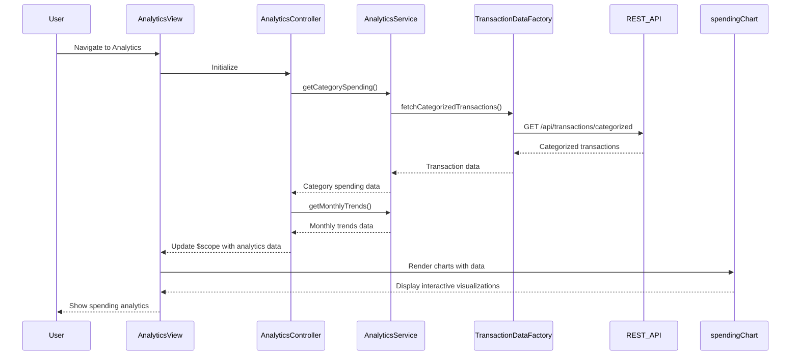

# Low-Level Design: Spending Analytics and Insights
**Epic ID:** QE-7797  
**Technology Stack:** AngularJS 1.x, JavaScript ES6, HTML5, CSS3, Bootstrap, REST APIs, MVC Architecture

---

## a. Architecture Mapping

- **User Interface - Analytics Dashboard** → AngularJS Module (`analyticsModule`) + Controller (`AnalyticsController`) + View Template (`analytics.html`)
- **Analytics Service** → AngularJS Service (`AnalyticsService`) for orchestrating analytics data retrieval and processing
- **Transaction Data Service** → REST API integration via AngularJS Factory (`TransactionDataFactory`)
- **Categorization Engine** → Server-side logic; client consumes categorized transaction data via REST endpoints
- **Visualization Generator** → AngularJS Directive (`spendingChart`) wrapping Chart.js or D3.js for interactive visualizations

**Recommended Folder Structure:**
```
/app
  /modules
    /analytics
      analytics.module.js
      analytics.controller.js
      analytics.html
  /services
    analytics.service.js
  /factories
    transactionData.factory.js
  /directives
    spendingChart.directive.js
  /models
    spending.model.js
```

---

## b. Component Specifications

| **Component Name** | **Artifact Type** | **Responsibility** | **Key Dependencies** |
|--------------------|-------------------|--------------------|----------------------|
| `analyticsModule` | Module | Defines the analytics feature module | `ngRoute`, `ui.bootstrap`, `chart.js` |
| `AnalyticsController` | Controller | Manages analytics view state, fetches spending data, prepares chart data | `AnalyticsService`, `$scope`, `$filter` |
| `AnalyticsService` | Service | Orchestrates transaction data retrieval, aggregates category-wise and monthly spending | `TransactionDataFactory` |
| `TransactionDataFactory` | Factory | Fetches categorized transaction data from REST API | `$http`, `API_ENDPOINTS` |
| `spendingChart` | Directive | Renders interactive charts (pie, bar, line) for spending visualization | `chart.js`, `$scope` |
| `spendingModel` | Model | Defines spending analytics data structure | None |

---

## c. Data Model

**Spending Model (`spendingModel`):**
```javascript
{
  categorySpending: [
    {
      category: String,        // Food & Dining, Fuel, Shopping, etc.
      amount: Number,
      transactionCount: Number,
      percentage: Number       // Percentage of total spend
    }
  ],
  monthlyTrends: [
    {
      month: String,           // YYYY-MM format
      totalSpend: Number,
      categoryBreakdown: Object // { category: amount }
    }
  ],
  totalSpend: Number,
  periodStart: Date,
  periodEnd: Date
}
```

**Transaction Model (`transactionModel`):**
```javascript
{
  transactionId: String,
  cardId: String,
  amount: Number,
  category: String,
  merchant: String,
  transactionDate: Date,
  description: String
}
```

---

## d. Data Flow

User navigates to the analytics view, triggering `AnalyticsController` initialization. The controller calls `AnalyticsService.getCategorySpending()` and `AnalyticsService.getMonthlyTrends()`, which invoke `TransactionDataFactory.fetchCategorizedTransactions()` to retrieve categorized transaction data from the REST API. The service aggregates transactions by category and month, computing totals and percentages. The processed data is returned to the controller, bound to `$scope.categorySpending` and `$scope.monthlyTrends`, and passed to the `spendingChart` directive. The directive renders interactive pie charts for category-wise spending and line charts for monthly trends using Chart.js, allowing users to explore spending patterns visually.

---

## e. Primary Sequence Diagram



---

## f. Implementation Notes

- Use AngularJS custom directive `spendingChart` to encapsulate Chart.js integration; pass chart data and configuration via directive attributes.
- Implement category filtering using AngularJS `$filter` service; allow users to toggle categories on/off to dynamically update charts.
- Use ES6 `Array.reduce()` and `Array.map()` for efficient aggregation of transaction data by category and month in `AnalyticsService`.
- Leverage AngularJS `$watch` to detect changes in date range filters and trigger re-fetching of analytics data.
- Implement responsive chart sizing using Chart.js responsive configuration and Bootstrap container classes to ensure charts adapt to different screen sizes.

---

## g. Error Handling

API errors caught via HTTP interceptor; fallback to empty state with user-friendly message; retry mechanism for failed chart data loads.

---

## h. Security Notes

Standard input validation and secure API calls assumed; transaction data filtered server-side to ensure users only access their own data.

---