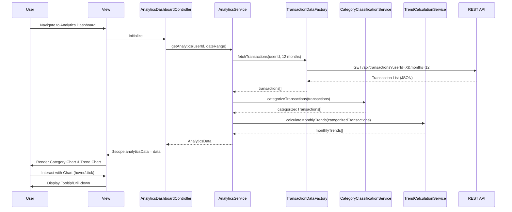

# Low-Level Design: QE-7816 - Spending Analytics and Trend Visualization

## a. Architecture Mapping

**HLD to AngularJS Artifact Mapping:**
- User Interface → AngularJS Module: `spendingAnalytics.module` with Controller: `AnalyticsDashboardController`
- Analytics Dashboard Service → AngularJS Service: `AnalyticsService`
- Transaction Data Service → AngularJS Factory: `TransactionDataFactory` (REST API wrapper)
- Category Classification Service → AngularJS Service: `CategoryClassificationService`
- Data Analytics Engine → AngularJS Service: `TrendCalculationService`

**Recommended Folder Structure:**
```
/app
  /modules
    /spending-analytics
      /controllers
        analytics-dashboard.controller.js
      /services
        analytics.service.js
        category-classification.service.js
        trend-calculation.service.js
      /factories
        transaction-data.factory.js
      /directives
        category-chart.directive.js
        trend-chart.directive.js
      /views
        analytics-dashboard.html
      spending-analytics.module.js
```

## b. Component Specifications

| Component Name | Artifact Type | Responsibility | Key Dependencies |
|----------------|---------------|----------------|------------------|
| spendingAnalytics.module | Module | Root module for analytics feature, configures routes and dependencies | ui.router, chart.js |
| AnalyticsDashboardController | Controller | Manages analytics view state, user interactions, and data binding | AnalyticsService, $scope |
| AnalyticsService | Service | Orchestrates data retrieval, categorization, and trend calculation | TransactionDataFactory, CategoryClassificationService, TrendCalculationService |
| TransactionDataFactory | Factory | Fetches transaction data from REST API with 12-month history | $http, $q |
| CategoryClassificationService | Service | Categorizes transactions into 9 predefined categories | None |
| TrendCalculationService | Service | Computes monthly spending trends and aggregates category totals | None |
| categoryChartDirective | Directive | Renders interactive category-wise spending pie/bar chart | chart.js |
| trendChartDirective | Directive | Renders interactive monthly trend line chart | chart.js |

## c. Data Model

```javascript
// Transaction Model
class Transaction {
  id: String
  cardId: String
  amount: Number
  date: Date
  merchantName: String
  category: String  // One of 9 categories
  description: String
}

// Category Spending Model
class CategorySpending {
  category: String  // Food & Dining, Fuel, Shopping, Travel, Entertainment, Utilities, Healthcare, Education, Miscellaneous
  totalAmount: Number
  transactionCount: Number
  percentage: Number
}

// Monthly Trend Model
class MonthlyTrend {
  month: String  // YYYY-MM format
  totalSpend: Number
  categoryBreakdown: Array<CategorySpending>
}

// Analytics Data Model
class AnalyticsData {
  transactions: Array<Transaction>
  categorySpending: Array<CategorySpending>
  monthlyTrends: Array<MonthlyTrend>
  dateRange: { startDate: Date, endDate: Date }
}
```

## d. Data Flow

User navigates to Analytics Dashboard → AnalyticsDashboardController initializes and calls AnalyticsService.getAnalytics() → AnalyticsService invokes TransactionDataFactory to fetch 12-month transaction history via REST API → CategoryClassificationService categorizes each transaction into one of 9 categories → TrendCalculationService aggregates data by month and category → AnalyticsService returns AnalyticsData object to Controller → Controller binds data to $scope → categoryChartDirective and trendChartDirective render interactive charts within 2 seconds using chart.js → User interacts with charts (hover, click) triggering chart.js event handlers that update tooltips and drill-down views.

## e. Primary Sequence Diagram



## f. Implementation Notes

- Use AngularJS 1.x with ES6 modules and classes for service/factory implementation; transpile with Babel if needed.
- Leverage AngularJS Dependency Injection for all services, factories, and controllers; register via module.service() and module.factory().
- Integrate chart.js library via angular-chart.js wrapper for declarative chart directives with two-way data binding.
- Implement REST API calls using $http service with promise-based error handling; cache transaction data using $cacheFactory for 5 minutes to optimize performance.
- Use $q.all() to parallelize independent API calls if category rules or metadata need separate endpoints.

## g. Error Handling

HTTP interceptor captures API errors; display user-friendly notifications via toastr; retry failed requests once with exponential backoff.

## h. Security Notes

Requires token-based authentication via existing SSO; all API calls include JWT in Authorization header; standard input validation applied.