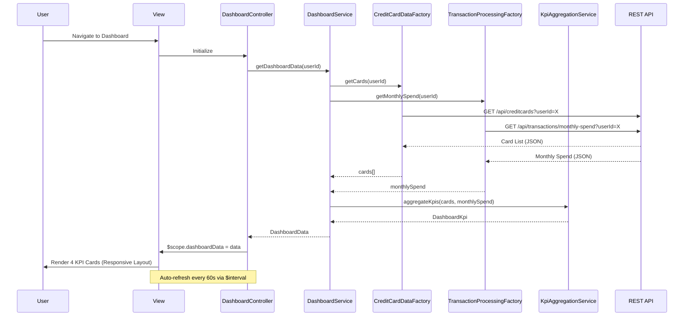

# Low-Level Design: QE-7817 - Credit Card Dashboard and KPI Management

## a. Architecture Mapping

**HLD to AngularJS Artifact Mapping:**
- User Interface → AngularJS Module: `dashboard.module` with Controller: `DashboardController`
- Dashboard Service → AngularJS Service: `DashboardService`
- Credit Card Data Service → AngularJS Factory: `CreditCardDataFactory` (REST API wrapper)
- Transaction Processing Service → AngularJS Factory: `TransactionProcessingFactory` (REST API wrapper)
- Data Aggregation Layer → AngularJS Service: `KpiAggregationService`

**Recommended Folder Structure:**
```
/app
  /modules
    /dashboard
      /controllers
        dashboard.controller.js
      /services
        dashboard.service.js
        kpi-aggregation.service.js
      /factories
        credit-card-data.factory.js
        transaction-processing.factory.js
      /directives
        kpi-card.directive.js
      /views
        dashboard.html
      dashboard.module.js
```

## b. Component Specifications

| Component Name | Artifact Type | Responsibility | Key Dependencies |
|----------------|---------------|----------------|------------------|
| dashboard.module | Module | Root module for dashboard feature, configures routes and dependencies | ui.router, ngAnimate |
| DashboardController | Controller | Manages dashboard view state, KPI data binding, and refresh logic | DashboardService, $scope, $interval |
| DashboardService | Service | Orchestrates KPI data retrieval and aggregation across all user cards | CreditCardDataFactory, TransactionProcessingFactory, KpiAggregationService |
| CreditCardDataFactory | Factory | Fetches credit card details and balances from REST API | $http, $q |
| TransactionProcessingFactory | Factory | Fetches monthly spend and outstanding amounts from REST API | $http, $q |
| KpiAggregationService | Service | Aggregates multi-card data into consolidated KPIs (total limit, available credit, etc.) | None |
| kpiCardDirective | Directive | Renders individual KPI card with value, label, and trend indicator | None |

## c. Data Model

```javascript
// Credit Card Model
class CreditCard {
  cardId: String
  cardNumber: String  // Masked, e.g., "**** **** **** 1234"
  cardType: String    // Visa, MasterCard, etc.
  creditLimit: Number
  availableCredit: Number
  outstandingAmount: Number
}

// KPI Data Model
class DashboardKpi {
  monthlySpend: Number
  totalCreditLimit: Number
  totalAvailableCredit: Number
  totalOutstandingAmount: Number
  cardCount: Number
  lastUpdated: Date
}

// Aggregated Dashboard Model
class DashboardData {
  kpis: DashboardKpi
  cards: Array<CreditCard>
}
```

## d. Data Flow

User navigates to Dashboard → DashboardController initializes and calls DashboardService.getDashboardData() → DashboardService invokes CreditCardDataFactory.getCards() and TransactionProcessingFactory.getMonthlySpend() in parallel via $q.all() → Both factories make REST API calls to retrieve card details, balances, and transaction summaries → KpiAggregationService receives raw data and calculates consolidated KPIs (sum of credit limits, available credit, outstanding amounts, and current month spend across all cards) → DashboardService returns DashboardData object to Controller → Controller binds data to $scope → View renders four KPI cards (Monthly Spend, Total Credit Limit, Available Credit, Outstanding Amount) using kpiCardDirective → $interval triggers auto-refresh every 60 seconds, repeating the data flow to update KPIs in near-real-time.

## e. Primary Sequence Diagram



## f. Implementation Notes

- Use AngularJS 1.x with ES6 syntax; implement services and factories as ES6 classes registered via angular.module().
- Leverage AngularJS Dependency Injection for all components; use $http for REST API calls with promise chaining.
- Implement responsive layout using Bootstrap 4 grid system (col-md-3 for desktop, col-sm-6 for tablet, col-xs-12 for mobile).
- Use $interval service for near-real-time KPI refresh (60-second interval); cancel interval on $scope.$destroy to prevent memory leaks.
- Apply $q.all() to parallelize independent API calls (cards and transactions) for optimized page load time.

## g. Error Handling

HTTP interceptor-based approach with try/catch blocks in services; display user-friendly error notifications using Angular toastr.

## h. Security Notes

Requires token-based auth via existing SSO; JWT included in all API request headers; card numbers masked on client side.