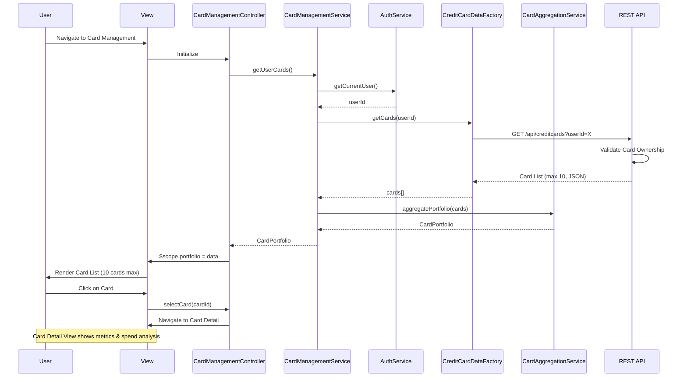

# Low-Level Design: QE-7818 - Multiple Credit Card Management

## a. Architecture Mapping

**HLD to AngularJS Artifact Mapping:**
- User Interface → AngularJS Module: `cardManagement.module` with Controller: `CardManagementController`
- Card Management Service → AngularJS Service: `CardManagementService`
- User Authentication Service → AngularJS Service: `AuthService` (existing/shared)
- Credit Card Data Service → AngularJS Factory: `CreditCardDataFactory` (REST API wrapper)
- Data Aggregation Service → AngularJS Service: `CardAggregationService`

**Recommended Folder Structure:**
```
/app
  /modules
    /card-management
      /controllers
        card-management.controller.js
        card-detail.controller.js
      /services
        card-management.service.js
        card-aggregation.service.js
      /factories
        credit-card-data.factory.js
      /directives
        card-list-item.directive.js
        card-metrics.directive.js
      /views
        card-list.html
        card-detail.html
      card-management.module.js
```

## b. Component Specifications

| Component Name | Artifact Type | Responsibility | Key Dependencies |
|----------------|---------------|----------------|------------------|
| cardManagement.module | Module | Root module for card management feature, configures routes and state management | ui.router |
| CardManagementController | Controller | Manages card list view, card selection, and navigation to card details | CardManagementService, AuthService, $scope, $state |
| CardDetailController | Controller | Manages individual card detail view and card-specific metrics | CardManagementService, $scope, $stateParams |
| CardManagementService | Service | Orchestrates card data retrieval, validation, and aggregation for multi-card views | CreditCardDataFactory, AuthService, CardAggregationService |
| CreditCardDataFactory | Factory | Fetches card information from REST API with ownership validation | $http, $q |
| CardAggregationService | Service | Aggregates card-specific metrics and calculates portfolio-level summaries | None |
| cardListItemDirective | Directive | Renders individual card in list view with summary info (card number, limit, balance) | None |
| cardMetricsDirective | Directive | Renders card-specific metrics and spend analysis chart | chart.js |

## c. Data Model

```javascript
// Credit Card Model
class CreditCard {
  cardId: String
  userId: String
  cardNumber: String  // Masked
  cardType: String    // Visa, MasterCard, Amex, etc.
  cardHolderName: String
  expiryDate: String  // MM/YY
  creditLimit: Number
  availableCredit: Number
  outstandingAmount: Number
  currentMonthSpend: Number
  isActive: Boolean
}

// Card Metrics Model
class CardMetrics {
  cardId: String
  utilizationRate: Number  // (outstandingAmount / creditLimit) * 100
  monthlySpendTrend: Array<{month: String, amount: Number}>
  categoryBreakdown: Array<{category: String, amount: Number}>
}

// Card Portfolio Model
class CardPortfolio {
  cards: Array<CreditCard>
  totalCards: Number
  totalCreditLimit: Number
  totalAvailableCredit: Number
  totalOutstanding: Number
}
```

## d. Data Flow

User navigates to Card Management view → CardManagementController initializes and calls CardManagementService.getUserCards() → CardManagementService invokes AuthService.getCurrentUser() to retrieve userId and validate session → CreditCardDataFactory.getCards(userId) makes REST API call to fetch all cards owned by user → API validates card ownership and returns card list (max 10 cards) → CardAggregationService calculates portfolio-level metrics → CardManagementService returns CardPortfolio object to Controller → Controller binds data to $scope → View renders card list using cardListItemDirective for each card → User clicks on a card → $state.go('cardDetail', {cardId: X}) navigates to detail view → CardDetailController loads and calls CardManagementService.getCardDetails(cardId) → Service fetches card-specific metrics and spend analysis → cardMetricsDirective renders interactive chart showing card-wise spending over time.

## e. Primary Sequence Diagram



## f. Implementation Notes

- Use AngularJS 1.x with ui-router for state-based navigation between card list and card detail views.
- Implement CardManagementService as singleton service to maintain card data cache; use $cacheFactory for 5-minute cache to reduce API calls.
- Leverage AngularJS Dependency Injection for AuthService integration; ensure token validation occurs before card data retrieval.
- Use ng-repeat with track by cardId for efficient card list rendering; limit to 10 cards as per NFR.
- Implement card selection using ui-router state params; pass cardId via $stateParams to CardDetailController.

## g. Error Handling

HTTP interceptor captures authentication and authorization errors; display user notifications via toastr; retry transient failures once.

## h. Security Notes

Requires token-based auth via existing SSO; card ownership validated server-side before returning data; card numbers masked (last 4 digits only).