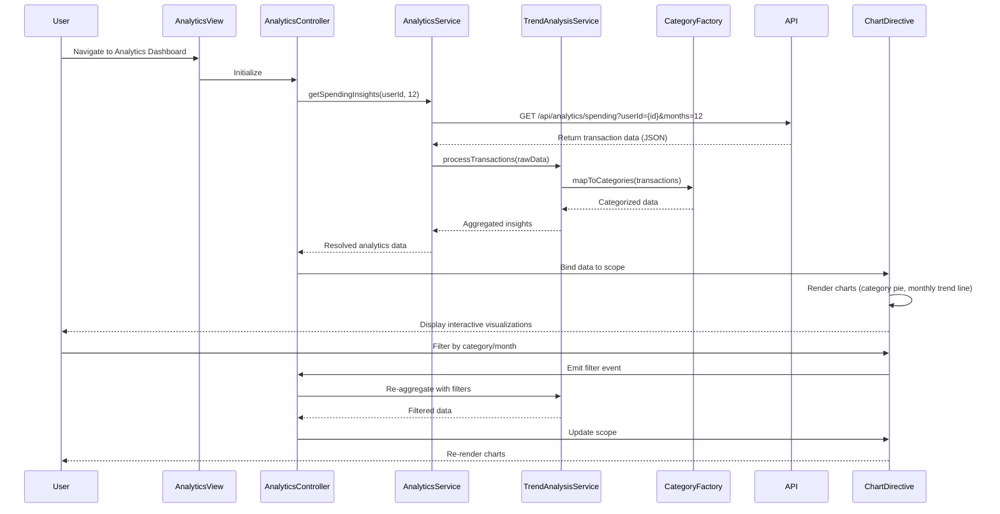

# Low-Level Design: QE-7819 - Analytics and Spending Insights

## a. Architecture Mapping

**HLD Component → AngularJS Artifact:**
- Analytics UI Component → AngularJS Module (`app.analytics`) + Controller (`AnalyticsController`)
- Analytics API → Service (`AnalyticsService`) for REST API communication
- Categorization Engine → Factory (`CategoryFactory`) for category mapping and logic
- Visualization Renderer → Directive (`spendingChart`) for chart rendering using Chart.js/D3.js
- Data Analytics Service → Service (`TrendAnalysisService`) for aggregation and calculation

**Recommended Folder Structure:**
```
app/
├── modules/
│   └── analytics/
│       ├── analytics.module.js
│       ├── controllers/
│       │   └── analytics.controller.js
│       ├── services/
│       │   ├── analytics.service.js
│       │   └── trend-analysis.service.js
│       ├── factories/
│       │   └── category.factory.js
│       ├── directives/
│       │   └── spending-chart.directive.js
│       └── views/
│           └── analytics.html
```

## b. Component Specifications

| Component Name | Artifact Type | Responsibility | Key Dependencies |
|----------------|---------------|----------------|------------------|
| AnalyticsController | Controller | Orchestrates analytics view, handles user interactions, manages chart data binding | AnalyticsService, TrendAnalysisService, CategoryFactory, $scope |
| AnalyticsService | Service | Fetches transaction data and spending insights from REST API | $http, $q, API_CONFIG |
| TrendAnalysisService | Service | Calculates monthly trends, aggregates spending data, identifies patterns | CategoryFactory, $filter |
| CategoryFactory | Factory | Provides category definitions, maps transactions to 9 categories, maintains category metadata | None |
| spendingChart | Directive | Renders interactive charts (pie, bar, line) for category-wise and trend visualization | Chart.js/D3.js library |

## c. Data Model

```javascript
// SpendingCategory
{
  categoryId: String,
  categoryName: String, // Food & Dining, Fuel, Shopping, Travel, Entertainment, Utilities, Healthcare, Education, Miscellaneous
  totalAmount: Number,
  transactionCount: Number,
  percentage: Number
}

// MonthlyTrend
{
  month: String, // YYYY-MM format
  totalSpend: Number,
  categoryBreakdown: Array<SpendingCategory>
}

// AnalyticsData
{
  userId: String,
  dateRange: { startDate: Date, endDate: Date },
  categorySummary: Array<SpendingCategory>,
  monthlyTrends: Array<MonthlyTrend>,
  lastUpdated: Date
}
```

## d. Data Flow

User navigates to Analytics view → AnalyticsController initializes and calls AnalyticsService.getSpendingInsights() → Service sends GET request to `/api/analytics/spending?userId={id}&months=12` → Backend returns categorized transaction data → TrendAnalysisService processes raw data, aggregates by category and month → CategoryFactory maps transactions to 9 predefined categories → Processed data bound to $scope → spendingChart directive watches data changes and renders interactive visualizations → User interacts with charts (filter, drill-down) → Controller updates filters, triggers data re-aggregation, and chart re-render.

## e. Primary Sequence Diagram



## f. Implementation Notes

- Use AngularJS dependency injection to inject AnalyticsService, TrendAnalysisService, and CategoryFactory into AnalyticsController.
- Leverage ES6 classes for services and factories; transpile with Babel if needed for browser compatibility.
- Implement REST API calls using $http with promise chaining; use $q for aggregating multiple API calls if required.
- Integrate Chart.js or D3.js via custom directive with isolated scope for reusability; watch data changes using $scope.$watch.
- Cache analytics data in service layer using $cacheFactory to avoid redundant API calls; set 5-minute TTL for cache entries.

## g. Error Handling

HTTP interceptor captures API errors; display user-friendly notifications via toastr/ngToast; log errors to console for debugging.

## h. Security Notes

Requires token-based authentication via existing SSO; validate userId in API requests to prevent unauthorized data access.