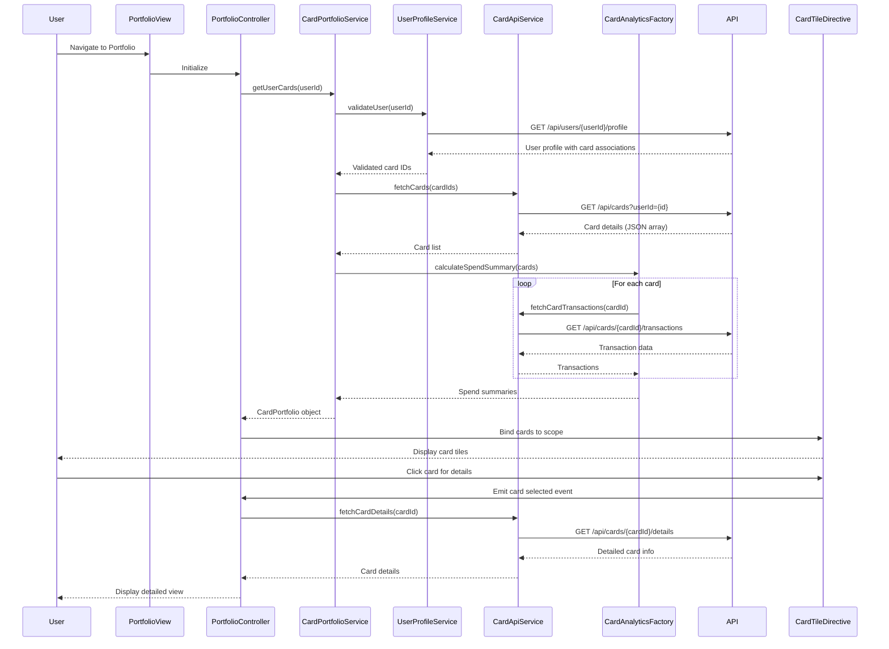

# Low-Level Design: QE-7820 - Multiple Credit Card Portfolio Management

## a. Architecture Mapping

**HLD Component → AngularJS Artifact:**
- User Interface → AngularJS Module (`app.portfolio`) + Controller (`PortfolioController`)
- Card Portfolio Manager → Service (`CardPortfolioService`) for card management logic
- API Layer → Service (`CardApiService`) for REST API communication
- User Profile Service → Service (`UserProfileService`) for card ownership validation
- Card Data Repository → Backend REST endpoints consumed by CardApiService
- Card Analytics Engine → Factory (`CardAnalyticsFactory`) for card-wise spend calculations

**Recommended Folder Structure:**
```
app/
├── modules/
│   └── portfolio/
│       ├── portfolio.module.js
│       ├── controllers/
│       │   └── portfolio.controller.js
│       ├── services/
│       │   ├── card-portfolio.service.js
│       │   ├── card-api.service.js
│       │   └── user-profile.service.js
│       ├── factories/
│       │   └── card-analytics.factory.js
│       ├── directives/
│       │   └── card-tile.directive.js
│       └── views/
│           └── portfolio.html
```

## b. Component Specifications

| Component Name | Artifact Type | Responsibility | Key Dependencies |
|----------------|---------------|----------------|------------------|
| PortfolioController | Controller | Manages card portfolio view, handles card selection, filters, and comparison | CardPortfolioService, CardAnalyticsFactory, $scope |
| CardPortfolioService | Service | Orchestrates card retrieval, caching, and portfolio-level operations | CardApiService, UserProfileService, $q, $cacheFactory |
| CardApiService | Service | Fetches card details and transaction data from REST API | $http, API_CONFIG |
| UserProfileService | Service | Validates card ownership and retrieves user-card associations | $http, $sessionStorage |
| CardAnalyticsFactory | Factory | Calculates card-wise spend, outstanding balance, and comparison metrics | $filter |
| cardTile | Directive | Renders individual card tile with details (limit, balance, spend) | None |

## c. Data Model

```javascript
// CreditCard
{
  cardId: String,
  cardNumber: String, // Masked (e.g., "**** **** **** 1234")
  cardType: String, // Visa, MasterCard, Amex
  cardHolderName: String,
  creditLimit: Number,
  outstandingBalance: Number,
  availableCredit: Number, // Calculated: creditLimit - outstandingBalance
  expiryDate: String, // MM/YY
  issuer: String
}

// CardSpendSummary
{
  cardId: String,
  monthlySpend: Number,
  transactionCount: Number,
  topCategory: String,
  lastTransactionDate: Date
}

// CardPortfolio
{
  userId: String,
  cards: Array<CreditCard>,
  totalCreditLimit: Number,
  totalOutstanding: Number,
  totalAvailableCredit: Number,
  cardSpendSummaries: Array<CardSpendSummary>
}
```

## d. Data Flow

User navigates to Portfolio view → PortfolioController initializes and calls CardPortfolioService.getUserCards() → Service checks cache; if miss, calls UserProfileService.validateUser() for ownership → CardApiService sends GET request to `/api/cards?userId={id}` → Backend returns card list → Service caches cards in $cacheFactory → CardAnalyticsFactory.calculateSpendSummary() called for each card via `/api/cards/{cardId}/transactions` → Aggregated portfolio data bound to $scope → cardTile directive renders each card with details → User selects card for detailed view → Controller fetches card-specific transactions and updates view → User compares cards → CardAnalyticsFactory computes comparison metrics and displays side-by-side.

## e. Primary Sequence Diagram



## f. Implementation Notes

- Use AngularJS DI to inject CardPortfolioService, CardApiService, UserProfileService, and CardAnalyticsFactory into PortfolioController.
- Implement client-side caching using $cacheFactory with session-level persistence; cache card list after first retrieval to meet 1-second requirement.
- Use $http for REST API calls with promise chaining; handle multiple card fetches using $q.all() for parallel execution.
- Create reusable cardTile directive with isolated scope and two-way binding for card selection; use ng-repeat for rendering card list.
- Implement card comparison feature using ng-show/ng-hide to toggle comparison view; use CardAnalyticsFactory to compute side-by-side metrics.

## g. Error Handling

HTTP interceptor captures API failures; display error notifications using ngToast; retry failed requests once before showing error to user.

## h. Security Notes

Requires token-based auth via existing SSO; mask sensitive card numbers (show last 4 digits only); validate card ownership on every API call server-side.