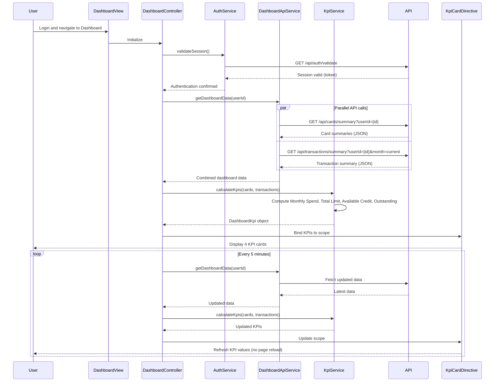

# Low-Level Design: QE-7821 - Dashboard and KPI Management

## a. Architecture Mapping

**HLD Component → AngularJS Artifact:**
- Dashboard UI Layer → AngularJS Module (`app.dashboard`) + Controller (`DashboardController`)
- API Gateway → Service (`DashboardApiService`) for REST API communication
- Dashboard Service → Service (`KpiService`) for KPI calculation and aggregation
- Credit Card Data Service → Backend REST endpoints consumed by DashboardApiService
- Transaction Processing System → Backend REST endpoints consumed by DashboardApiService
- User Authentication Service → Service (`AuthService`) for secure access validation

**Recommended Folder Structure:**
```
app/
├── modules/
│   └── dashboard/
│       ├── dashboard.module.js
│       ├── controllers/
│       │   └── dashboard.controller.js
│       ├── services/
│       │   ├── dashboard-api.service.js
│       │   ├── kpi.service.js
│       │   └── auth.service.js
│       ├── directives/
│       │   └── kpi-card.directive.js
│       └── views/
│           └── dashboard.html
```

## b. Component Specifications

| Component Name | Artifact Type | Responsibility | Key Dependencies |
|----------------|---------------|----------------|------------------|
| DashboardController | Controller | Orchestrates dashboard view, manages KPI data binding, handles real-time refresh | KpiService, DashboardApiService, $scope, $interval |
| DashboardApiService | Service | Fetches card and transaction data from REST API endpoints | $http, $q, API_CONFIG |
| KpiService | Service | Calculates Monthly Spend, Total Credit Limit, Available Credit, Outstanding Amount | $filter |
| AuthService | Service | Validates user authentication, manages session tokens | $http, $sessionStorage |
| kpiCard | Directive | Renders individual KPI card with value, label, and icon | None |

## c. Data Model

```javascript
// DashboardKpi
{
  monthlySpend: Number,
  totalCreditLimit: Number,
  availableCredit: Number,
  outstandingAmount: Number,
  lastUpdated: Date
}

// CreditCardSummary
{
  cardId: String,
  creditLimit: Number,
  outstandingBalance: Number
}

// TransactionSummary
{
  currentMonthSpend: Number,
  transactionCount: Number
}

// DashboardData
{
  userId: String,
  kpis: DashboardKpi,
  cards: Array<CreditCardSummary>,
  transactions: TransactionSummary
}
```

## d. Data Flow

User logs in and navigates to Dashboard → DashboardController initializes and calls AuthService.validateSession() → If valid, calls DashboardApiService.getDashboardData() → Service sends parallel GET requests to `/api/cards/summary?userId={id}` and `/api/transactions/summary?userId={id}&month=current` using $q.all() → Backend returns card summaries and transaction data → KpiService.calculateKpis() aggregates data to compute Monthly Spend (sum of current month transactions), Total Credit Limit (sum of all card limits), Available Credit (Total Limit - Outstanding), Outstanding Amount (sum of all card balances) → Calculated KPIs bound to $scope → kpiCard directive renders each KPI → $interval triggers refresh every 5 minutes → Controller re-fetches data without page reload and updates KPIs.

## e. Primary Sequence Diagram



## f. Implementation Notes

- Use AngularJS DI to inject DashboardApiService, KpiService, and AuthService into DashboardController.
- Implement parallel API calls using $q.all() to fetch card and transaction data simultaneously; ensures sub-2-second load time.
- Use $interval service to trigger automatic data refresh every 5 minutes; cancel interval on $scope.$destroy to prevent memory leaks.
- Create reusable kpiCard directive with isolated scope accepting kpi object (value, label, icon); use ng-repeat to render 4 KPI cards.
- Leverage Bootstrap grid system (col-md-3) for responsive layout; use CSS3 media queries for mobile optimization.

## g. Error Handling

HTTP interceptor captures API errors; display error toast notifications; retry failed requests once; log errors to console for debugging.

## h. Security Notes

Requires token-based authentication via existing SSO; validate session token on every API call; implement CSRF protection for state-changing operations.