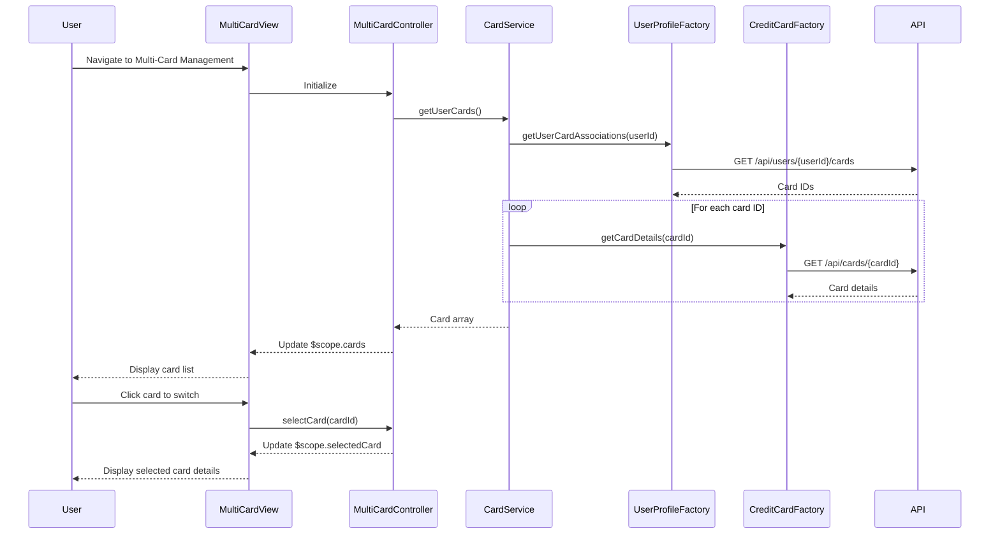

# Low-Level Design: Multiple Credit Card Management
**Epic ID:** QE-7847  
**Epic Title:** PERFTEST20261109161809-Multiple Credit Card Management

---

## a. Architecture Mapping

- **Card Management UI** → AngularJS Module (`multiCardModule`) with Controller (`MultiCardController`) and View template
- **Card Management Service** → AngularJS Service (`CardService`) for multi-card operations and state management
- **User Profile Service** → AngularJS Factory (`UserProfileFactory`) for user-card association validation via REST API
- **Credit Card Data Service** → AngularJS Factory (`CreditCardFactory`) for fetching individual and aggregated card data

**Recommended Folder Structure:**
```
app/
├── modules/multi-card/
│   ├── multi-card.module.js
│   ├── multi-card.controller.js
│   ├── multi-card.view.html
│   ├── card-detail.view.html
├── services/
│   ├── card.service.js
├── factories/
│   ├── user-profile.factory.js
│   ├── credit-card.factory.js
├── models/
│   ├── card.model.js
```

---

## b. Component Specifications

| Component Name | Artifact Type | Responsibility | Key Dependencies |
|---|---|---|---|
| MultiCardController | Controller | Manages multi-card view, handles card selection/switching, displays card-specific metrics | CardService, $scope, $state |
| CardService | Service | Orchestrates multi-card data retrieval, manages selected card state, coordinates with factories | UserProfileFactory, CreditCardFactory, $http |
| UserProfileFactory | Factory | Validates user-card ownership and retrieves user-card associations from REST API | $http, $q |
| CreditCardFactory | Factory | Fetches individual card details and aggregated portfolio data via REST API | $http, $q |
| MultiCardView | View/Template | Displays card list with card switcher, shows selected card details and metrics | Bootstrap, ng-click, ng-class directives |

---

## c. Data Model

**Card Model (`card.model.js`):**
```javascript
{
  cardId: String,
  userId: String,
  cardNumber: String,             // Masked
  cardHolderName: String,
  cardType: String,
  bankName: String,
  creditLimit: Number,
  availableCredit: Number,
  outstandingBalance: Number,
  currentMonthSpend: Number,
  utilizationRate: Number,        // Percentage
  lastTransactionDate: Date,
  isSelected: Boolean             // UI state for selected card
}
```

**User Card Association Model:**
```javascript
{
  userId: String,
  cardIds: Array                  // Array of card IDs owned by user
}
```

---

## d. Data Flow

User navigates to multi-card management page → MultiCardController initializes and calls CardService.getUserCards() → CardService first invokes UserProfileFactory.getUserCardAssociations() to validate ownership → With validated card IDs, CardService calls CreditCardFactory.getCardDetails(cardId) for each card (up to 10+ cards) → Card data enriched with utilization rate and current month spend → CardService returns array of Card objects with first card marked as selected → MultiCardController binds to $scope.cards and $scope.selectedCard → MultiCardView renders card list with switcher; user clicks a card → MultiCardController updates $scope.selectedCard → View displays selected card's detailed metrics.

---

## e. Primary Sequence Diagram



---

## f. Implementation Notes

- Use AngularJS $state service (UI Router) to manage card selection state and enable deep linking to specific cards via URL parameters.
- Implement card switching with ng-click and ng-class to highlight selected card in the card list with visual feedback (e.g., border color change).
- Use $q.all() to parallelize API calls for fetching multiple card details, ensuring 1-second rendering NFR is met.
- Apply virtual scrolling or pagination if user has more than 10 cards to maintain UI performance and responsiveness.
- Store selected card ID in CardService as singleton state to persist selection across controller reloads within the same session.

---

## g. Error Handling

HTTP interceptor-based error handling; if a card fetch fails, display card with "Data unavailable" message; user notified via toastr for critical failures.

---

## h. Security Notes

Requires token-based auth via existing SSO; user-card associations validated server-side; card numbers masked on client-side.

---