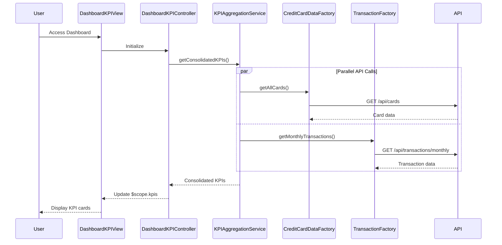

# Low-Level Design: Credit Card Dashboard and KPI Overview
**Epic ID:** QE-7848  
**Epic Title:** PERFTEST20261109161809-Credit Card Dashboard and KPI Overview

---

## a. Architecture Mapping

- **Dashboard UI** → AngularJS Module (`dashboardModule`) with Controller (`DashboardKPIController`) and View template
- **KPI Aggregation Service** → AngularJS Service (`KPIAggregationService`) for computing consolidated KPIs
- **Credit Card Data Service** → AngularJS Factory (`CreditCardDataFactory`) for retrieving card details and balances via REST API
- **Transaction Service** → AngularJS Factory (`TransactionFactory`) for fetching monthly spend metrics via REST API

**Recommended Folder Structure:**
```
app/
├── modules/dashboard/
│   ├── dashboard.module.js
│   ├── dashboard-kpi.controller.js
│   ├── dashboard-kpi.view.html
├── services/
│   ├── kpi-aggregation.service.js
├── factories/
│   ├── credit-card-data.factory.js
│   ├── transaction.factory.js
├── models/
│   ├── dashboard-kpi.model.js
```

---

## b. Component Specifications

| Component Name | Artifact Type | Responsibility | Key Dependencies |
|---|---|---|---|
| DashboardKPIController | Controller | Manages dashboard KPI view, fetches aggregated KPIs, handles refresh actions | KPIAggregationService, $scope, $interval |
| KPIAggregationService | Service | Aggregates data from multiple sources, computes KPIs (monthly spend, total limit, available credit, outstanding) | CreditCardDataFactory, TransactionFactory, $http, $q |
| CreditCardDataFactory | Factory | Fetches all credit card details, limits, and balances from REST API | $http, $q |
| TransactionFactory | Factory | Retrieves monthly transaction data and calculates monthly spend | $http, $q |
| DashboardKPIView | View/Template | Displays 4 KPI cards in responsive grid layout with real-time updates | Bootstrap grid, ng-repeat |

---

## c. Data Model

**Dashboard KPI Model (`dashboard-kpi.model.js`):**
```javascript
{
  monthlySpend: Number,           // Total spend for current month across all cards
  totalCreditLimit: Number,       // Sum of credit limits of all cards
  availableCredit: Number,        // Sum of available credit across all cards
  outstandingAmount: Number,      // Total outstanding balance across all cards
  lastRefreshed: Date             // Timestamp of last data refresh
}
```

**Card Summary Model:**
```javascript
{
  cardId: String,
  creditLimit: Number,
  availableCredit: Number,
  outstandingBalance: Number
}
```

---

## d. Data Flow

User accesses dashboard → DashboardKPIController initializes and calls KPIAggregationService.getConsolidatedKPIs() → KPIAggregationService makes parallel calls: CreditCardDataFactory.getAllCards() and TransactionFactory.getMonthlyTransactions() → CreditCardDataFactory fetches card data from GET /api/cards; TransactionFactory fetches monthly transactions from GET /api/transactions/monthly → KPIAggregationService aggregates: totalCreditLimit = sum of all card limits, availableCredit = sum of available balances, outstandingAmount = sum of outstanding balances, monthlySpend = sum of current month transactions → Aggregated KPI object returned to DashboardKPIController → Controller updates $scope.kpis → DashboardKPIView renders 4 KPI cards using Bootstrap responsive grid with data-binding.

---

## e. Primary Sequence Diagram



---

## f. Implementation Notes

- Use $q.all() in KPIAggregationService to parallelize API calls to CreditCardDataFactory and TransactionFactory, meeting 2-second load time NFR.
- Implement real-time updates using $interval to refresh KPIs every 30 seconds without full page reload.
- Apply Bootstrap responsive grid (col-xs-12, col-sm-6, col-md-3) to KPI cards for mobile and desktop compatibility.
- Use AngularJS filters (currency, number) in view to format KPI values for better readability.
- Cache aggregated KPI data in KPIAggregationService using $cacheFactory with 30-second TTL to reduce API load during rapid navigation.

---

## g. Error Handling

HTTP interceptor-based error handling with retry logic for transient failures; user notified via toastr on persistent errors; KPI cards show "--" if data unavailable.

---

## h. Security Notes

Requires token-based auth via existing SSO; all API calls include auth token in headers; input validation on client-side for date ranges.

---