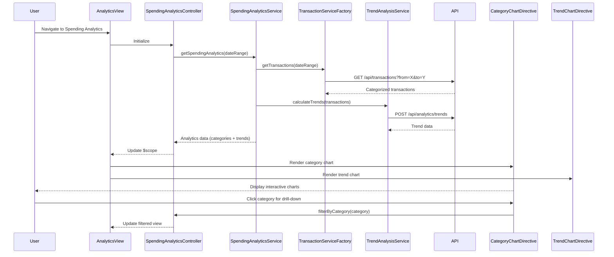

# Low-Level Design: Spending Analytics and Insights
**Epic ID:** QE-7849  
**Epic Title:** PERFTEST20261109161809-Spending Analytics and Insights

---

## a. Architecture Mapping

- **User Interface** → AngularJS Module (`spendingAnalyticsModule`) with Controller (`SpendingAnalyticsController`) and View template
- **Analytics Service** → AngularJS Service (`SpendingAnalyticsService`) for data aggregation and trend analysis
- **Transaction Service** → AngularJS Factory (`TransactionServiceFactory`) for fetching transaction data and categorization via REST API
- **Analytics Engine** → Backend service (consumed via REST API); client-side representation via `TrendAnalysisService`

**Recommended Folder Structure:**
```
app/
├── modules/spending-analytics/
│   ├── spending-analytics.module.js
│   ├── spending-analytics.controller.js
│   ├── spending-analytics.view.html
├── services/
│   ├── spending-analytics.service.js
│   ├── trend-analysis.service.js
├── factories/
│   ├── transaction-service.factory.js
├── directives/
│   ├── category-chart.directive.js
│   ├── trend-chart.directive.js
```

---

## b. Component Specifications

| Component Name | Artifact Type | Responsibility | Key Dependencies |
|---|---|---|---|
| SpendingAnalyticsController | Controller | Manages analytics view, fetches spending data, handles user interactions with charts | SpendingAnalyticsService, $scope |
| SpendingAnalyticsService | Service | Aggregates transaction data by 9 categories, computes monthly trends, prepares chart datasets | TransactionServiceFactory, TrendAnalysisService, $http, $q |
| TransactionServiceFactory | Factory | Fetches transaction data with categorization from REST API, supports date range filtering | $http, $q |
| TrendAnalysisService | Service | Consumes Analytics Engine API for trend calculation and pattern recognition | $http, $q |
| CategoryChartDirective | Directive | Renders interactive category-wise spending pie/bar chart using Chart.js | Chart.js library |
| TrendChartDirective | Directive | Renders monthly spend trend line chart with drill-down capability | Chart.js library |

---

## c. Data Model

**Transaction Model:**
```javascript
{
  transactionId: String,
  cardId: String,
  amount: Number,
  category: String,              // One of 9: Food & Dining, Fuel, Shopping, Travel, Entertainment, Utilities, Healthcare, Education, Miscellaneous
  merchantName: String,
  transactionDate: Date,
  description: String
}
```

**Category Spending Model:**
```javascript
{
  category: String,
  totalAmount: Number,
  transactionCount: Number,
  percentageOfTotal: Number
}
```

**Monthly Trend Model:**
```javascript
{
  month: String,                 // Format: "YYYY-MM"
  totalSpend: Number,
  categoryBreakdown: Array       // Array of Category Spending Models
}
```

---

## d. Data Flow

User navigates to spending analytics page → SpendingAnalyticsController initializes and calls SpendingAnalyticsService.getSpendingAnalytics(dateRange) → SpendingAnalyticsService invokes TransactionServiceFactory.getTransactions(dateRange) to fetch categorized transactions from API → Transactions grouped by category and month → TrendAnalysisService.calculateTrends(transactions) called to compute monthly trends and patterns → SpendingAnalyticsService returns object containing categorySpending array and monthlyTrends array → SpendingAnalyticsController updates $scope.categoryData and $scope.trendData → CategoryChartDirective and TrendChartDirective watch scope variables and render interactive charts → User interacts with charts (hover, click category) to view detailed breakdowns.

---

## e. Primary Sequence Diagram



---

## f. Implementation Notes

- Use AngularJS custom directives (CategoryChartDirective, TrendChartDirective) to encapsulate Chart.js integration for reusable, interactive visualizations.
- Implement date range picker using AngularJS UI Bootstrap datepicker with default range of last 12 months to meet historical data NFR.
- Use $watch in chart directives to automatically re-render charts when $scope data changes, enabling interactive filtering.
- Apply ES6 array methods (reduce, map, filter) in SpendingAnalyticsService for efficient transaction aggregation by category and month.
- Cache transaction data in TransactionServiceFactory using $cacheFactory with 5-minute TTL to meet 3-second chart rendering NFR.

---

## g. Error Handling

HTTP interceptor captures API errors; user notified via toastr; charts display "No data available" message if transaction fetch fails or returns empty dataset.

---

## h. Security Notes

Standard input validation and secure API calls assumed; date range inputs sanitized; token-based auth via existing SSO integrated in $http interceptor.

---