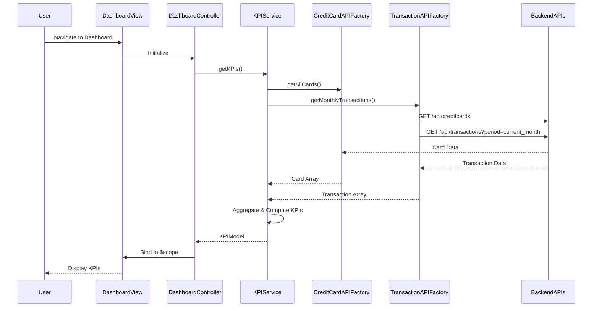

# Low-Level Design: QE-7856 - Credit Card Dashboard and KPI Management

## a. Architecture Mapping

- **Dashboard UI Module** → AngularJS Module (`app.dashboard`) with Controller (`DashboardController`) and View template
- **KPI Calculation Service** → AngularJS Service (`KPIService`) for aggregating and computing KPI metrics
- **Credit Card Data Service Integration** → AngularJS Factory (`CreditCardAPIFactory`) for REST API calls
- **Transaction Service Integration** → AngularJS Factory (`TransactionAPIFactory`) for transaction data retrieval
- **Real-time Data Refresh** → AngularJS Service (`DataRefreshService`) using `$interval` or WebSocket wrapper

**Recommended Folder Structure:**
```
app/
├── modules/
│   └── dashboard/
│       ├── dashboard.module.js
│       ├── dashboard.controller.js
│       ├── dashboard.html
│       └── dashboard.css
├── services/
│   ├── kpi.service.js
│   ├── data-refresh.service.js
├── factories/
│   ├── creditcard-api.factory.js
│   └── transaction-api.factory.js
└── models/
    └── kpi.model.js
```

## b. Component Specifications

| Component Name | Artifact Type | Responsibility | Key Dependencies |
|----------------|---------------|----------------|------------------|
| DashboardController | Controller | Orchestrates dashboard view, binds KPI data to UI, handles user interactions | KPIService, $scope, DataRefreshService |
| KPIService | Service | Aggregates data from API factories, computes monthly spend, total credit limit, available credit, outstanding amount | CreditCardAPIFactory, TransactionAPIFactory, $q |
| CreditCardAPIFactory | Factory | Makes REST API calls to Credit Card Data Service, returns card information and balances | $http, API_CONFIG |
| TransactionAPIFactory | Factory | Makes REST API calls to Transaction Service, retrieves transaction data for monthly spend calculation | $http, API_CONFIG |
| DataRefreshService | Service | Manages periodic data refresh using $interval or WebSocket for real-time updates | $interval, $rootScope, KPIService |
| KPIDashboardDirective | Directive | Encapsulates KPI visualization components (cards/widgets) for reusability | None |

## c. Data Model

```javascript
// KPI Model
class KPIModel {
  constructor() {
    this.monthlySpend = 0;        // Number (currency)
    this.totalCreditLimit = 0;    // Number (currency)
    this.availableCredit = 0;     // Number (currency)
    this.outstandingAmount = 0;   // Number (currency)
    this.lastUpdated = null;      // Date
  }
}

// Credit Card Model
class CreditCard {
  constructor() {
    this.cardId = '';             // String
    this.cardNumber = '';         // String (masked)
    this.creditLimit = 0;         // Number
    this.currentBalance = 0;      // Number
    this.availableCredit = 0;     // Number
  }
}

// Transaction Summary Model
class TransactionSummary {
  constructor() {
    this.totalSpend = 0;          // Number
    this.transactionCount = 0;    // Number
    this.period = '';             // String (e.g., 'YYYY-MM')
  }
}
```

## d. Data Flow

User navigates to the dashboard → DashboardController initializes and calls KPIService.getKPIs() → KPIService concurrently invokes CreditCardAPIFactory.getAllCards() and TransactionAPIFactory.getMonthlyTransactions() using $q.all() → API factories make REST calls to backend services → KPIService aggregates responses, computes KPIs (monthly spend from transactions, total/available credit from card data, outstanding amount as sum of balances) → Computed KPIModel is returned to DashboardController → Controller binds data to $scope → View renders KPI widgets using Bootstrap grid and AngularJS bindings → DataRefreshService triggers periodic refresh via $interval, updating $scope and triggering digest cycle for UI update.

## e. Primary Sequence Diagram



## f. Implementation Notes

- Use AngularJS 1.x module pattern with dependency injection for all services, factories, and controllers.
- Leverage `$q.all()` for parallel API calls to meet 2-second load time requirement.
- Implement responsive layout using Bootstrap grid system (col-xs, col-sm, col-md, col-lg) for multi-device support.
- Use `$http` interceptors for centralized API error handling and loading state management.
- Employ `$interval` service for periodic data refresh (e.g., every 30 seconds) or integrate WebSocket service for real-time push updates.

## g. Error Handling

HTTP interceptor-based error handling with user-friendly toast notifications for API failures and retry logic in KPIService.

## h. Security Notes

Requires token-based authentication via existing SSO; all API calls include auth headers managed by $http interceptor.