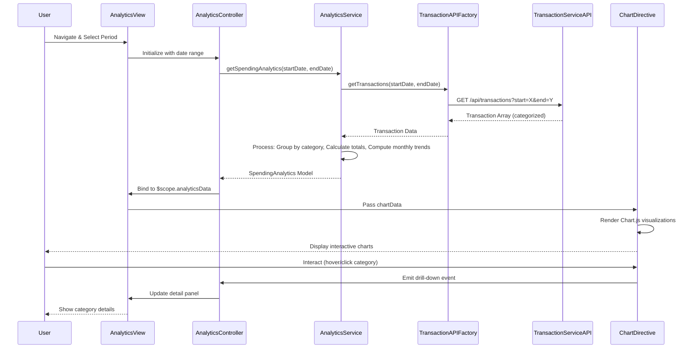

# Low-Level Design: QE-7857 - Spending Analytics and Category Insights

## a. Architecture Mapping

- **Analytics Dashboard Module** → AngularJS Module (`app.analytics`) with Controller (`AnalyticsController`) and View template
- **Analytics Engine Integration** → AngularJS Service (`AnalyticsService`) for trend calculation and pattern analysis
- **Transaction Service Integration** → AngularJS Factory (`TransactionAPIFactory`) for fetching categorized transaction data
- **Visualization Component** → AngularJS Directive (`spendingChartDirective`) wrapping Chart.js or D3.js for interactive charts
- **Category Management** → AngularJS Constant (`SPENDING_CATEGORIES`) defining nine predefined categories

**Recommended Folder Structure:**
```
app/
├── modules/
│   └── analytics/
│       ├── analytics.module.js
│       ├── analytics.controller.js
│       ├── analytics.html
│       └── analytics.css
├── services/
│   └── analytics.service.js
├── factories/
│   └── transaction-api.factory.js
├── directives/
│   └── spending-chart.directive.js
├── constants/
│   └── spending-categories.constant.js
└── models/
    └── spending-analytics.model.js
```

## b. Component Specifications

| Component Name | Artifact Type | Responsibility | Key Dependencies |
|----------------|---------------|----------------|------------------|
| AnalyticsController | Controller | Manages analytics view, handles time period selection, triggers data refresh, binds chart data to scope | AnalyticsService, $scope, $filter |
| AnalyticsService | Service | Processes transaction data, calculates category-wise totals, computes monthly trends, aggregates spending patterns | TransactionAPIFactory, $q, SPENDING_CATEGORIES |
| TransactionAPIFactory | Factory | Retrieves transaction data with category classification from Transaction Service via REST API | $http, API_CONFIG |
| spendingChartDirective | Directive | Renders interactive charts (pie/bar/line) using Chart.js, handles user interactions on visualizations | Chart.js library |
| SPENDING_CATEGORIES | Constant | Defines nine spending categories: Food & Dining, Fuel, Shopping, Travel, Entertainment, Utilities, Healthcare, Education, Miscellaneous | None |
| CategoryFilterFilter | Filter | Filters transactions by selected category for detailed drill-down analysis | None |

## c. Data Model

```javascript
// Spending Analytics Model
class SpendingAnalytics {
  constructor() {
    this.categoryBreakdown = [];     // Array<CategorySpend>
    this.monthlyTrends = [];         // Array<MonthlyTrend>
    this.totalSpend = 0;             // Number
    this.analysisStartDate = null;   // Date
    this.analysisEndDate = null;     // Date
  }
}

// Category Spend Model
class CategorySpend {
  constructor() {
    this.category = '';              // String (one of SPENDING_CATEGORIES)
    this.amount = 0;                 // Number
    this.percentage = 0;             // Number (0-100)
    this.transactionCount = 0;       // Number
  }
}

// Monthly Trend Model
class MonthlyTrend {
  constructor() {
    this.month = '';                 // String (YYYY-MM format)
    this.totalSpend = 0;             // Number
    this.categoryBreakdown = [];     // Array<CategorySpend>
  }
}

// Transaction Model
class Transaction {
  constructor() {
    this.transactionId = '';         // String
    this.amount = 0;                 // Number
    this.category = '';              // String
    this.date = null;                // Date
    this.description = '';           // String
    this.cardId = '';                // String
  }
}
```

## d. Data Flow

User navigates to analytics page and selects time period (default: last 12 months) → AnalyticsController calls AnalyticsService.getSpendingAnalytics(startDate, endDate) → AnalyticsService invokes TransactionAPIFactory.getTransactions(startDate, endDate) → Factory makes REST call to Transaction Service → Service returns categorized transaction array → AnalyticsService processes data: groups by category, calculates totals and percentages, computes monthly trends by iterating through transactions and aggregating by month and category → Service returns SpendingAnalytics model to Controller → Controller binds data to $scope.analyticsData and $scope.chartData → spendingChartDirective watches chartData, initializes Chart.js with category breakdown (pie chart) and monthly trends (line chart) → User interacts with charts (hover, click) triggering directive event handlers that update $scope with drill-down details → View updates via AngularJS digest cycle.

## e. Primary Sequence Diagram



## f. Implementation Notes

- Use AngularJS 1.x with ES6 classes for models; transpile with Babel if needed.
- Integrate Chart.js via custom directive with isolated scope for reusability; pass data via two-way binding.
- Implement date range picker using AngularJS UI Bootstrap datepicker component for period selection.
- Cache processed analytics data in AnalyticsService using a simple object cache keyed by date range to avoid redundant calculations.
- Use AngularJS `$filter` service for date formatting and currency display in views and chart tooltips.

## g. Error Handling

Try/catch blocks in AnalyticsService with promise rejection handling; HTTP interceptor displays error toasts for API failures.

## h. Security Notes

Standard input validation and secure API calls assumed; authentication token included in all API requests via HTTP interceptor.