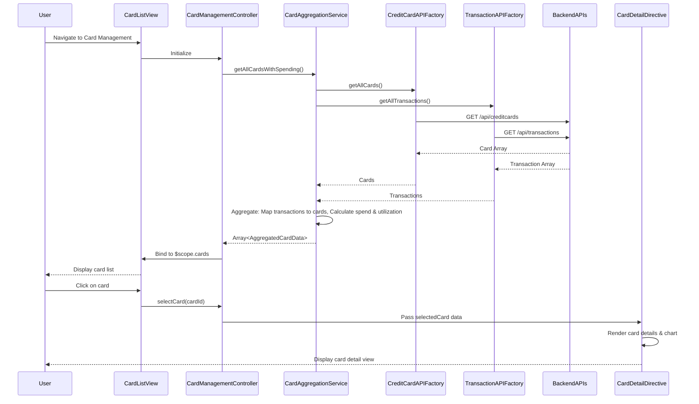

# Low-Level Design: QE-7858 - Multi-Card Management and Monitoring

## a. Architecture Mapping

- **User Interface** → AngularJS Module (`app.cardManagement`) with Controller (`CardManagementController`) and View template
- **Card Management Module** → AngularJS Controller (`CardManagementController`) orchestrating card list and detail views
- **Data Aggregation Layer** → AngularJS Service (`CardAggregationService`) for concurrent data fetching and caching
- **Credit Card Data Service Integration** → AngularJS Factory (`CreditCardAPIFactory`) for card information REST API calls
- **Transaction Service Integration** → AngularJS Factory (`TransactionAPIFactory`) for card-specific spending data
- **Card Detail View** → AngularJS Directive (`cardDetailDirective`) for reusable card detail component

**Recommended Folder Structure:**
```
app/
├── modules/
│   └── card-management/
│       ├── card-management.module.js
│       ├── card-management.controller.js
│       ├── card-list.html
│       ├── card-detail.html
│       └── card-management.css
├── services/
│   └── card-aggregation.service.js
├── factories/
│   ├── creditcard-api.factory.js
│   └── transaction-api.factory.js
├── directives/
│   └── card-detail.directive.js
└── models/
    └── card.model.js
```

## b. Component Specifications

| Component Name | Artifact Type | Responsibility | Key Dependencies |
|----------------|---------------|----------------|------------------|
| CardManagementController | Controller | Manages card list view, handles card selection, filtering, comparison, navigates to card details | CardAggregationService, $scope, $state |
| CardAggregationService | Service | Fetches card data and spending data concurrently, aggregates card-wise spend, caches results for performance | CreditCardAPIFactory, TransactionAPIFactory, $q, $cacheFactory |
| CreditCardAPIFactory | Factory | Makes REST API calls to Credit Card Data Service to retrieve card information, limits, balances | $http, API_CONFIG |
| TransactionAPIFactory | Factory | Retrieves card-specific transaction and spending data from Transaction Service via REST API | $http, API_CONFIG |
| cardDetailDirective | Directive | Displays detailed card information including utilization chart, recent transactions, spend analysis | None |
| CardFilterFilter | Filter | Filters card list by card type, status, or search term for quick card selection | None |
| CardComparisonService | Service | Compares multiple selected cards side-by-side for utilization, limits, and spending patterns | CardAggregationService |

## c. Data Model

```javascript
// Card Model
class Card {
  constructor() {
    this.cardId = '';                // String
    this.cardNumber = '';            // String (masked, e.g., '**** **** **** 1234')
    this.cardType = '';              // String (e.g., 'Visa', 'MasterCard')
    this.cardName = '';              // String (e.g., 'Platinum Rewards')
    this.creditLimit = 0;            // Number
    this.currentBalance = 0;         // Number
    this.availableCredit = 0;        // Number
    this.utilizationPercentage = 0;  // Number (0-100)
    this.status = '';                // String (e.g., 'Active', 'Blocked')
    this.expiryDate = null;          // Date
  }
}

// Card Spending Summary Model
class CardSpendingSummary {
  constructor() {
    this.cardId = '';                // String
    this.monthlySpend = 0;           // Number
    this.yearlySpend = 0;            // Number
    this.categoryBreakdown = [];     // Array<{category: String, amount: Number}>
    this.recentTransactions = [];    // Array<Transaction>
  }
}

// Aggregated Card Data Model
class AggregatedCardData {
  constructor() {
    this.card = null;                // Card
    this.spendingSummary = null;     // CardSpendingSummary
    this.lastUpdated = null;         // Date
  }
}
```

## d. Data Flow

User navigates to card management page → CardManagementController initializes and calls CardAggregationService.getAllCardsWithSpending() → Service uses $q.all() to concurrently invoke CreditCardAPIFactory.getAllCards() and TransactionAPIFactory.getAllTransactions() → Both factories make REST calls to their respective backend services → CardAggregationService receives card array and transaction array, iterates through cards, maps transactions to each card by cardId, calculates monthly/yearly spend and utilization percentage → Service returns array of AggregatedCardData objects, stores in $cacheFactory for 5-minute TTL → Controller binds data to $scope.cards → View renders card list using ng-repeat with Bootstrap card components → User clicks on a card → Controller updates $scope.selectedCard and displays card detail view (or navigates via $state) → cardDetailDirective renders detailed card information including Chart.js utilization chart and transaction table → User can filter or compare cards, triggering controller methods that update $scope and re-render filtered/compared views.

## e. Primary Sequence Diagram



## f. Implementation Notes

- Use AngularJS 1.x module with lazy-loaded states via UI-Router for card detail navigation.
- Implement $cacheFactory in CardAggregationService with 5-minute TTL to meet 1-second rendering requirement for cached data.
- Use $q.all() for parallel API calls to optimize load time; handle partial failures gracefully by filtering out failed card data.
- Employ Bootstrap responsive grid and card components for multi-device layout; use ng-if for conditional rendering of card details.
- Implement card filtering using AngularJS custom filter and ng-model binding on search input for real-time filtering.

## g. Error Handling

HTTP interceptor for API errors with user notification; CardAggregationService includes try/catch with promise rejection for graceful degradation.

## h. Security Notes

Requires token-based auth via existing SSO; card numbers are masked by backend; all API calls secured via authentication headers.