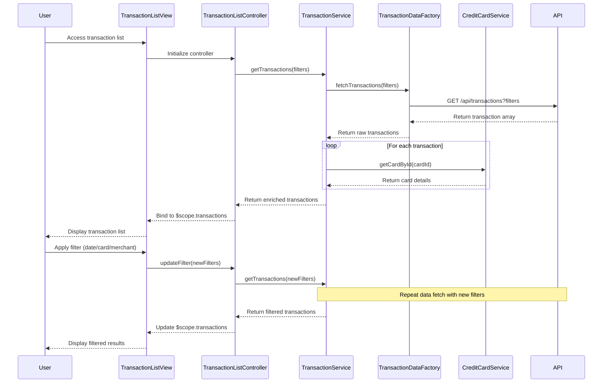

# Low-Level Design: Transaction Management and Tracking
**Epic ID:** QE-7870

## a. Architecture Mapping

| HLD Component | AngularJS Artifact | Mapping |
|---------------|-------------------|----------|
| User Interface Transaction View | Module: `transactionModule` | Main module for transaction features |
| Transaction Management Service | Service: `TransactionService` | Business logic for transaction operations |
| Transaction Data Service | Factory: `TransactionDataFactory` | REST API calls for transaction data |
| Credit Card Service | Service: `CreditCardService` | Card mapping and card data retrieval |
| Date Time Service | Factory: `DateTimeFactory` | Date formatting and timezone handling |
| Transaction View Controller | Controller: `TransactionListController` | Manages transaction list view and filters |
| Transaction Detail Controller | Controller: `TransactionDetailController` | Manages individual transaction details |

**Recommended Folder Structure:**
```
app/
├── modules/
│   └── transaction/
│       ├── transaction.module.js
│       ├── controllers/
│       │   ├── transaction-list.controller.js
│       │   └── transaction-detail.controller.js
│       ├── services/
│       │   ├── transaction.service.js
│       │   └── credit-card.service.js
│       ├── factories/
│       │   ├── transaction-data.factory.js
│       │   └── datetime.factory.js
│       ├── views/
│       │   ├── transaction-list.html
│       │   └── transaction-detail.html
│       └── directives/
│           └── transaction-filter.directive.js
```

## b. Component Specifications

| Component Name | Artifact Type | Responsibility | Key Dependencies |
|----------------|---------------|----------------|------------------|
| transactionModule | Module | Encapsulates all transaction-related features | ngRoute, ui.bootstrap |
| TransactionListController | Controller | Handles transaction list display, filtering, sorting, pagination | TransactionService, $scope, $filter |
| TransactionDetailController | Controller | Displays detailed view of a single transaction | TransactionService, $routeParams, $scope |
| TransactionService | Service | Orchestrates transaction retrieval, filtering, and card mapping logic | TransactionDataFactory, CreditCardService, DateTimeFactory |
| TransactionDataFactory | Factory | Makes REST API calls to retrieve transaction records | $http, $q |
| CreditCardService | Service | Maps transactions to credit cards and retrieves card metadata | $http, $q |
| DateTimeFactory | Factory | Formats transaction timestamps and handles date range queries | moment.js or native Date |
| transactionFilter | Directive | Provides UI for filtering transactions by date, card, merchant, category | $scope, TransactionService |

## c. Data Model

**Transaction Object:**
```javascript
{
  transactionId: String,
  cardId: String,
  merchantName: String,
  amount: Number,
  currency: String,
  transactionDate: Date,
  category: String, // Food & Dining, Fuel, Shopping, Travel, Entertainment, Utilities, Healthcare, Education, Miscellaneous
  status: String, // Posted, Pending
  description: String
}
```

**TransactionFilter Object:**
```javascript
{
  startDate: Date,
  endDate: Date,
  cardIds: Array<String>,
  merchants: Array<String>,
  categories: Array<String>,
  minAmount: Number,
  maxAmount: Number
}
```

**CreditCard Object:**
```javascript
{
  cardId: String,
  cardNumber: String, // masked
  cardType: String,
  issuer: String
}
```

## d. Data Flow

User accesses the transaction list view, which initializes TransactionListController. The controller calls TransactionService.getTransactions() with default or user-selected filters (date range, card, merchant, category). TransactionService invokes TransactionDataFactory to make a GET request to `/api/transactions` with query parameters. The API returns a JSON array of transaction objects. TransactionService enriches each transaction with card details by calling CreditCardService.getCardById() and formats timestamps using DateTimeFactory. The enriched transaction list is bound to $scope and rendered in the view. User interactions (filter changes, sort, pagination) trigger controller methods that update filters and re-fetch data. Clicking a transaction navigates to TransactionDetailController, which fetches full transaction details via TransactionService.getTransactionById() and displays them.

## e. Primary Sequence Diagram



## f. Implementation Notes

- Use AngularJS dependency injection to inject services and factories into controllers; register all components with the transactionModule.
- Implement pagination using ui.bootstrap pagination directive to handle large transaction datasets efficiently.
- Use $http interceptors for global error handling and loading indicators during API calls.
- Leverage AngularJS $filter service for client-side filtering and sorting when dataset is small; use server-side filtering for large datasets.
- Apply ES6 features: arrow functions for callbacks, template literals for dynamic URLs, const/let for variable declarations.

## g. Error Handling

Use $http interceptor to catch API errors globally; display user-friendly error messages via a notification service (e.g., toastr); wrap critical operations in try/catch blocks.

## h. Security Notes

Requires token-based authentication via existing SSO; all API calls include auth token in headers; mask sensitive card data in UI and logs.