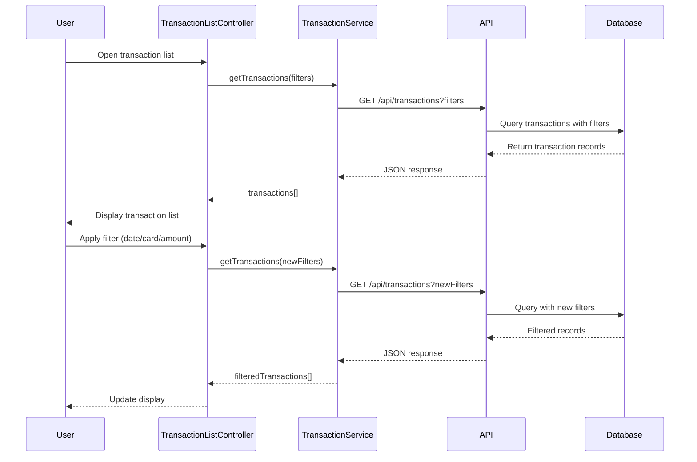

# Low-Level Design: Transaction Management and Tracking
**Epic ID:** QE-7870

## a. Architecture Mapping

- **Module:** `transactionModule` - Main AngularJS module for transaction management
- **Controller:** `TransactionListController` - Handles transaction listing, filtering, and search UI logic
- **Service:** `TransactionService` - Fetches transaction data from REST API and manages state
- **Service:** `CreditCardService` - Retrieves card details and validates card ownership
- **Service:** `SearchFilterService` - Handles search/filter logic and query parameter construction
- **Directive:** `transactionCard` - Reusable component for displaying individual transaction details

**Folder Structure:**
```
/app
  /modules
    /transactions
      /controllers
        transaction-list.controller.js
      /services
        transaction.service.js
        credit-card.service.js
        search-filter.service.js
      /directives
        transaction-card.directive.js
      /views
        transaction-list.html
        transaction-detail.html
```

## b. Component Specifications

| Name | Artifact Type | Responsibility | Key Dependencies |
|------|---------------|----------------|------------------|
| transactionModule | Module | Root module for transaction management features | ngRoute, ngResource |
| TransactionListController | Controller | Manages transaction list view, filters, pagination | TransactionService, SearchFilterService, $scope |
| TransactionService | Service | REST API calls to fetch/filter transactions | $http, $q, API_ENDPOINTS |
| CreditCardService | Service | Fetches card details and validates ownership | $http, $q, API_ENDPOINTS |
| SearchFilterService | Factory | Constructs query params for search/filter operations | $filter |
| transactionCard | Directive | Renders individual transaction card with details | None |

## c. Data Model

**Transaction Object:**
```javascript
{
  transactionId: String,
  cardId: String,
  merchantName: String,
  category: String,
  amount: Number,
  currency: String,
  timestamp: Date,
  status: String, // 'posted', 'pending'
  description: String
}
```

**Card Object:**
```javascript
{
  cardId: String,
  cardNumber: String, // masked
  cardType: String,
  cardHolderName: String
}
```

**SearchFilter Object:**
```javascript
{
  cardId: String,
  dateFrom: Date,
  dateTo: Date,
  minAmount: Number,
  maxAmount: Number,
  merchantName: String,
  category: String
}
```

## d. Data Flow

User opens transaction list view → TransactionListController initializes and calls TransactionService.getTransactions() → Service sends GET request to /api/transactions with user token → API Gateway validates token and routes to Transaction Data Service → Search and Filter Engine applies query parameters and retrieves transactions from Database → Transaction records enriched with card details via Credit Card Service → JSON response returned to TransactionService → Controller updates $scope.transactions → View renders transaction list using transactionCard directive → User applies filters → SearchFilterService constructs query params → TransactionService refetches with new params → UI updates with filtered results.

## e. Primary Sequence Diagram



## f. Implementation Notes

- Use AngularJS Dependency Injection for all services and controllers; register with module.controller() and module.service()
- Implement ES6 classes for services with constructor-based DI: `class TransactionService { constructor($http, $q) {...} }`
- Use $http interceptors for token-based authentication and global error handling
- Implement debouncing on search input using $timeout to avoid excessive API calls
- Use ng-repeat with track by transactionId for optimal rendering performance

## g. Error Handling

HTTP interceptor captures API errors; display user-friendly messages via toastr/notification service; retry logic for network failures with exponential backoff.

## h. Security Notes

Requires token-based auth via existing SSO; all API calls include Authorization header with JWT token.