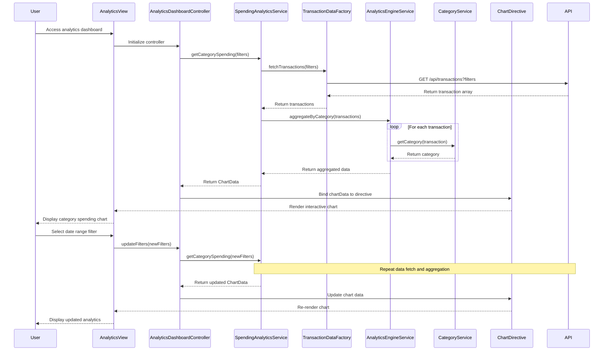

# Low-Level Design: Spending Analytics and Insights
**Epic ID:** QE-7871

## a. Architecture Mapping

| HLD Component | AngularJS Artifact | Mapping |
|---------------|-------------------|----------|
| User Interface Analytics Dashboard | Module: `analyticsModule` | Main module for analytics features |
| Spending Analytics Service | Service: `SpendingAnalyticsService` | Business logic for analytics and aggregation |
| Transaction Data Service | Factory: `TransactionDataFactory` | REST API calls for transaction data |
| Analytics Engine | Service: `AnalyticsEngineService` | Client-side data aggregation and calculations |
| Category Classification Service | Service: `CategoryService` | Category mapping and classification logic |
| Visualization Library | Directive: `chartDirective` | Wraps Chart.js or D3.js for interactive charts |
| Analytics Dashboard Controller | Controller: `AnalyticsDashboardController` | Manages analytics view and user interactions |

**Recommended Folder Structure:**
```
app/
├── modules/
│   └── analytics/
│       ├── analytics.module.js
│       ├── controllers/
│       │   └── analytics-dashboard.controller.js
│       ├── services/
│       │   ├── spending-analytics.service.js
│       │   ├── analytics-engine.service.js
│       │   └── category.service.js
│       ├── factories/
│       │   └── transaction-data.factory.js
│       ├── directives/
│       │   ├── chart.directive.js
│       │   └── category-filter.directive.js
│       └── views/
│           └── analytics-dashboard.html
```

## b. Component Specifications

| Component Name | Artifact Type | Responsibility | Key Dependencies |
|----------------|---------------|----------------|------------------|
| analyticsModule | Module | Encapsulates all analytics and visualization features | ngRoute, chart.js or angular-chart.js |
| AnalyticsDashboardController | Controller | Manages analytics dashboard, filters, and chart interactions | SpendingAnalyticsService, $scope, $filter |
| SpendingAnalyticsService | Service | Orchestrates data retrieval, aggregation, and chart data preparation | TransactionDataFactory, AnalyticsEngineService, CategoryService |
| AnalyticsEngineService | Service | Performs client-side aggregation by category, month, and card | lodash or native Array methods |
| CategoryService | Service | Provides category definitions and maps transactions to categories | None |
| TransactionDataFactory | Factory | Makes REST API calls to retrieve transaction data for analytics | $http, $q |
| chartDirective | Directive | Renders interactive charts (bar, pie, line) using Chart.js or D3.js | Chart.js library |
| categoryFilter | Directive | Provides UI for selecting categories and date ranges | $scope |

## c. Data Model

**CategorySpending Object:**
```javascript
{
  category: String, // Food & Dining, Fuel, Shopping, Travel, Entertainment, Utilities, Healthcare, Education, Miscellaneous
  totalAmount: Number,
  transactionCount: Number,
  percentage: Number
}
```

**MonthlyTrend Object:**
```javascript
{
  month: String, // YYYY-MM
  totalSpend: Number,
  categoryBreakdown: Array<CategorySpending>
}
```

**AnalyticsFilter Object:**
```javascript
{
  startDate: Date,
  endDate: Date,
  cardIds: Array<String>,
  categories: Array<String>
}
```

**ChartData Object:**
```javascript
{
  labels: Array<String>,
  datasets: Array<{
    label: String,
    data: Array<Number>,
    backgroundColor: Array<String>
  }>
}
```

## d. Data Flow

User accesses the analytics dashboard, initializing AnalyticsDashboardController. The controller calls SpendingAnalyticsService.getCategorySpending() with selected filters (date range, card, categories). SpendingAnalyticsService invokes TransactionDataFactory to fetch transactions via GET `/api/transactions`. The service passes raw transactions to AnalyticsEngineService, which aggregates spending by category using CategoryService for classification. Aggregated data is transformed into ChartData format and returned to the controller. The controller binds ChartData to $scope, and chartDirective renders interactive visualizations (pie chart for category breakdown, line chart for monthly trends). User interactions (filter changes, drill-down) trigger controller methods that update filters, re-aggregate data, and refresh charts.

## e. Primary Sequence Diagram



## f. Implementation Notes

- Use AngularJS DI to inject services into controllers; register all components with analyticsModule.
- Integrate Chart.js via angular-chart.js wrapper for declarative chart rendering with two-way data binding.
- Implement client-side aggregation using lodash _.groupBy and _.sumBy for efficient category and monthly calculations.
- Use $q promises for asynchronous data fetching and chaining multiple API calls if needed.
- Apply ES6: const/let for variables, arrow functions for array operations, template literals for dynamic labels.

## g. Error Handling

Use $http interceptor for global API error handling; display error notifications using toastr or custom notification service; gracefully handle empty datasets by showing "No data available" message.

## h. Security Notes

Requires token-based auth via existing SSO; all API calls include auth token; ensure transaction data is filtered by authenticated user ID on the backend.