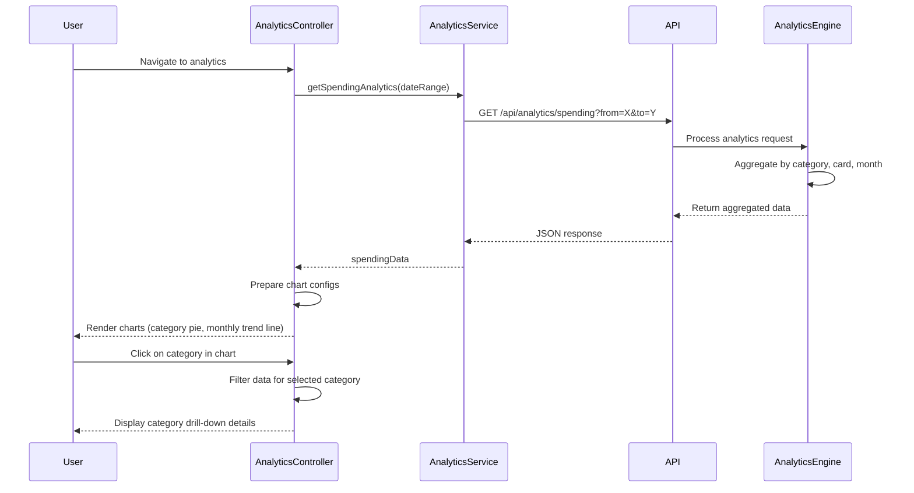

# Low-Level Design: Spending Analytics and Insights
**Epic ID:** QE-7871

## a. Architecture Mapping

- **Module:** `analyticsModule` - Main AngularJS module for spending analytics
- **Controller:** `AnalyticsController` - Manages analytics view, chart interactions, and data presentation
- **Service:** `AnalyticsService` - Fetches aggregated spending data from REST API
- **Service:** `CategoryService` - Handles category classification and mapping
- **Factory:** `ChartConfigFactory` - Provides chart.js/D3 configuration objects for visualizations
- **Directive:** `spendingChart` - Renders interactive charts for category and trend analysis

**Folder Structure:**
```
/app
  /modules
    /analytics
      /controllers
        analytics.controller.js
      /services
        analytics.service.js
        category.service.js
      /factories
        chart-config.factory.js
      /directives
        spending-chart.directive.js
      /views
        analytics-dashboard.html
```

## b. Component Specifications

| Name | Artifact Type | Responsibility | Key Dependencies |
|------|---------------|----------------|------------------|
| analyticsModule | Module | Root module for analytics features | ngRoute, chart.js or angular-chart.js |
| AnalyticsController | Controller | Manages analytics dashboard, chart interactions, filters | AnalyticsService, ChartConfigFactory, $scope |
| AnalyticsService | Service | Fetches aggregated spending data from API | $http, $q, API_ENDPOINTS |
| CategoryService | Service | Maps transactions to 9 predefined categories | $filter |
| ChartConfigFactory | Factory | Generates chart.js config for pie/bar/line charts | None |
| spendingChart | Directive | Renders interactive chart with drill-down capability | ChartConfigFactory, $timeout |

## c. Data Model

**SpendingAnalytics Object:**
```javascript
{
  userId: String,
  period: String, // 'monthly', 'yearly'
  categoryBreakdown: Array<CategorySpend>,
  cardWiseBreakdown: Array<CardSpend>,
  monthlyTrends: Array<MonthlySpend>
}
```

**CategorySpend Object:**
```javascript
{
  category: String, // 'Food & Dining', 'Fuel', etc.
  totalAmount: Number,
  transactionCount: Number,
  percentage: Number
}
```

**MonthlySpend Object:**
```javascript
{
  month: String, // 'YYYY-MM'
  totalSpend: Number,
  categoryBreakdown: Array<CategorySpend>
}
```

## d. Data Flow

User navigates to analytics dashboard → AnalyticsController initializes and calls AnalyticsService.getSpendingAnalytics() → Service sends GET request to /api/analytics/spending with date range → API Gateway routes to Analytics Engine → Engine queries Transaction Data Service for user transactions → Category Classification Service categorizes transactions into 9 categories → Analytics Engine aggregates by category, card, and month → Returns aggregated JSON → AnalyticsService passes data to Controller → Controller uses ChartConfigFactory to prepare chart configurations → spendingChart directive renders interactive visualizations using chart.js → User interacts with chart (click category) → Directive emits event → Controller updates view with drill-down details.

## e. Primary Sequence Diagram



## f. Implementation Notes

- Use AngularJS DI to inject AnalyticsService and ChartConfigFactory into AnalyticsController
- Implement ES6 arrow functions for chart event handlers to maintain lexical scope
- Use chart.js with angular-chart.js wrapper for declarative chart rendering in templates
- Leverage $q.all() to parallelize multiple API calls if fetching category and trend data separately
- Implement client-side caching with $cacheFactory for analytics data to reduce API load

## g. Error Handling

HTTP interceptor-based error handling; display error notifications via toastr; fallback to cached data if API fails.

## h. Security Notes

Standard input validation and secure API calls assumed; token-based auth via existing SSO.