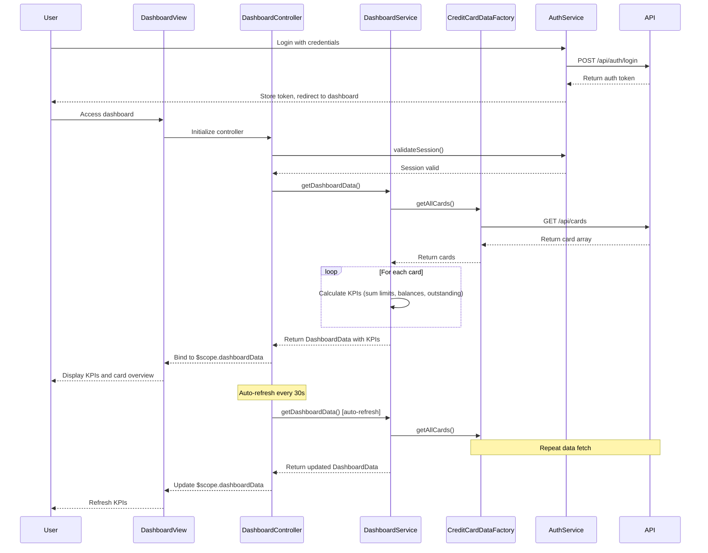

# Low-Level Design: Dashboard KPIs and Credit Card Overview
**Epic ID:** QE-7872

## a. Architecture Mapping

| HLD Component | AngularJS Artifact | Mapping |
|---------------|-------------------|----------|
| User Interface Dashboard | Module: `dashboardModule` | Main module for dashboard features |
| KPI Dashboard Service | Service: `DashboardService` | Business logic for KPI calculation and aggregation |
| Credit Card Data Service | Factory: `CreditCardDataFactory` | REST API calls for credit card data |
| User Authentication Service | Service: `AuthService` | User authentication and session management |
| Dashboard Controller | Controller: `DashboardController` | Manages dashboard view and KPI display |
| KPI Card Directive | Directive: `kpiCard` | Reusable component for displaying individual KPIs |

**Recommended Folder Structure:**
```
app/
├── modules/
│   └── dashboard/
│       ├── dashboard.module.js
│       ├── controllers/
│       │   └── dashboard.controller.js
│       ├── services/
│       │   ├── dashboard.service.js
│       │   └── auth.service.js
│       ├── factories/
│       │   └── credit-card-data.factory.js
│       ├── directives/
│       │   └── kpi-card.directive.js
│       └── views/
│           ├── dashboard.html
│           └── kpi-card.template.html
```

## b. Component Specifications

| Component Name | Artifact Type | Responsibility | Key Dependencies |
|----------------|---------------|----------------|------------------|
| dashboardModule | Module | Encapsulates all dashboard and KPI features | ngRoute, ui.bootstrap |
| DashboardController | Controller | Manages dashboard initialization, KPI refresh, and user interactions | DashboardService, AuthService, $scope, $interval |
| DashboardService | Service | Orchestrates KPI calculation (monthly spend, credit limit, available credit, outstanding) | CreditCardDataFactory, $q |
| CreditCardDataFactory | Factory | Makes REST API calls to retrieve credit card balances, limits, and transactions | $http, $q |
| AuthService | Service | Handles user authentication, token management, and session validation | $http, $window |
| kpiCard | Directive | Renders individual KPI with label, value, and optional trend indicator | None |

## c. Data Model

**KPI Object:**
```javascript
{
  label: String, // "Monthly Spend", "Total Credit Limit", "Available Credit", "Outstanding Amount"
  value: Number,
  currency: String,
  trend: String, // "up", "down", "neutral"
  trendPercentage: Number
}
```

**CreditCardSummary Object:**
```javascript
{
  cardId: String,
  cardNumber: String, // masked
  balance: Number,
  creditLimit: Number,
  availableCredit: Number,
  outstandingAmount: Number
}
```

**DashboardData Object:**
```javascript
{
  kpis: Array<KPI>,
  cards: Array<CreditCardSummary>,
  lastUpdated: Date
}
```

## d. Data Flow

User logs in via AuthService, which validates credentials and stores the auth token. User navigates to the dashboard, initializing DashboardController. The controller calls DashboardService.getDashboardData() to fetch KPIs. DashboardService invokes CreditCardDataFactory.getAllCards() to retrieve all linked credit cards via GET `/api/cards`. For each card, the service calculates aggregated KPIs: sum of all credit limits, sum of available credit, sum of outstanding amounts, and monthly spend from transactions. The service returns a DashboardData object containing KPI array and card summaries. The controller binds DashboardData to $scope, and kpiCard directives render each KPI. The controller sets up $interval to auto-refresh KPIs every 30 seconds by re-calling DashboardService.getDashboardData().

## e. Primary Sequence Diagram



## f. Implementation Notes

- Use AngularJS DI to inject services and factories into controllers; register all components with dashboardModule.
- Implement auto-refresh using $interval service with 30-second interval; cancel interval on $scope.$destroy to prevent memory leaks.
- Use $http interceptor to attach auth token to all API requests and handle 401 unauthorized responses by redirecting to login.
- Apply responsive design using Bootstrap grid system (col-md-3 for KPI cards) to ensure mobile compatibility.
- Use ES6: const/let for variables, arrow functions for callbacks, template literals for dynamic API URLs.

## g. Error Handling

Use $http interceptor to catch API errors; display error notifications using toastr; handle session expiration by redirecting to login page.

## h. Security Notes

Requires token-based auth via existing SSO; all API calls include auth token in Authorization header; validate session on dashboard load and before each API call.