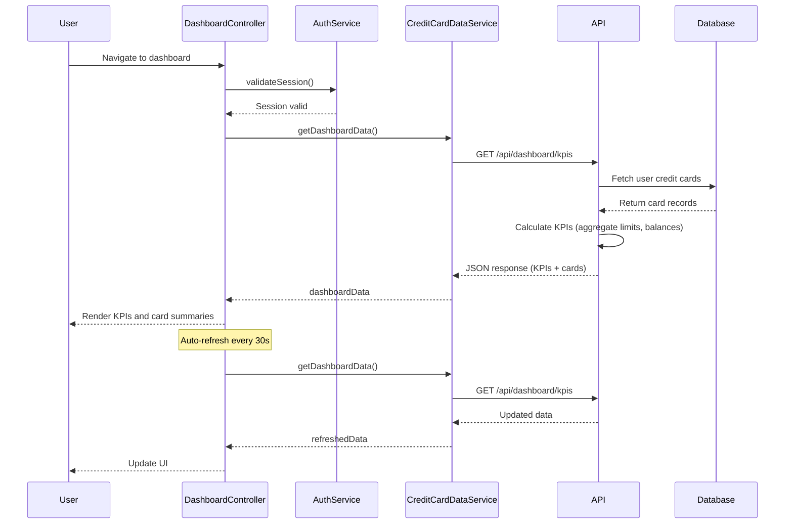

# Low-Level Design: Dashboard KPIs and Credit Card Overview
**Epic ID:** QE-7872

## a. Architecture Mapping

- **Module:** `dashboardModule` - Main AngularJS module for dashboard features
- **Controller:** `DashboardController` - Manages KPI display and card overview logic
- **Service:** `CreditCardDataService` - Fetches aggregated credit card data and KPIs from REST API
- **Service:** `AuthService` - Handles user authentication and session validation
- **Directive:** `kpiCard` - Reusable component for displaying individual KPI metrics
- **Directive:** `cardSummary` - Displays individual credit card summary information

**Folder Structure:**
```
/app
  /modules
    /dashboard
      /controllers
        dashboard.controller.js
      /services
        credit-card-data.service.js
        auth.service.js
      /directives
        kpi-card.directive.js
        card-summary.directive.js
      /views
        dashboard.html
```

## b. Component Specifications

| Name | Artifact Type | Responsibility | Key Dependencies |
|------|---------------|----------------|------------------|
| dashboardModule | Module | Root module for dashboard features | ngRoute, ngResource |
| DashboardController | Controller | Manages dashboard view, KPI display, data refresh | CreditCardDataService, AuthService, $scope, $interval |
| CreditCardDataService | Service | Fetches aggregated card data and KPIs from API | $http, $q, API_ENDPOINTS |
| AuthService | Service | Validates user session and manages authentication state | $http, $window, $q |
| kpiCard | Directive | Renders individual KPI with icon, label, and value | None |
| cardSummary | Directive | Displays credit card summary with limit, balance, available credit | None |

## c. Data Model

**DashboardKPI Object:**
```javascript
{
  monthlySpend: Number,
  totalCreditLimit: Number,
  availableCredit: Number,
  outstandingAmount: Number,
  utilizationPercentage: Number
}
```

**CreditCard Object:**
```javascript
{
  cardId: String,
  cardNumber: String, // masked
  cardType: String, // 'Visa', 'Mastercard'
  creditLimit: Number,
  currentBalance: Number,
  availableCredit: Number,
  outstandingAmount: Number,
  dueDate: Date
}
```

## d. Data Flow

User logs in and navigates to dashboard → AuthService validates session token → DashboardController initializes and calls CreditCardDataService.getDashboardData() → Service sends GET request to /api/dashboard/kpis with auth token → API Gateway validates token with User Authentication Service → Credit Card Data Service retrieves all user cards from Database → Service calculates aggregated KPIs (total limit, available credit, monthly spend, outstanding) → Returns JSON response → DashboardController updates $scope with KPIs and card list → View renders KPI cards using kpiCard directive and card summaries using cardSummary directive → $interval triggers auto-refresh every 30 seconds for near real-time updates.

## e. Primary Sequence Diagram



## f. Implementation Notes

- Use AngularJS DI to inject services into DashboardController; register all components with dashboardModule
- Implement ES6 class syntax for services with constructor-based injection pattern
- Use $interval service for auto-refresh with 30-second interval; cancel interval on $scope.$on('$destroy')
- Implement responsive grid layout using Bootstrap 3/4 grid system with col-xs/sm/md/lg classes
- Use ng-repeat with track by cardId for card list rendering performance

## g. Error Handling

HTTP interceptor captures API errors; display user-friendly error messages via notification service; implement retry with exponential backoff for transient failures.

## h. Security Notes

Requires token-based auth via existing SSO; all API calls include Authorization header with JWT token; session validation on dashboard load.