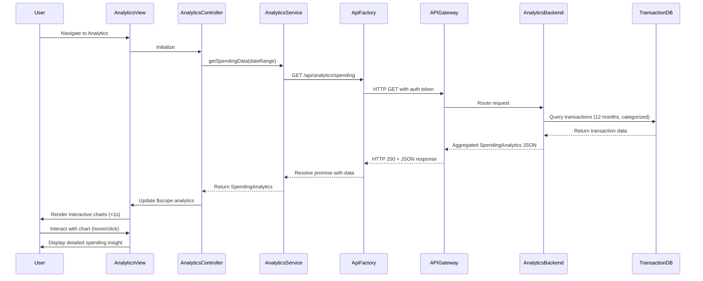

# Low-Level Design: QE-7873 - Spending Analytics and Insights

## a. Architecture Mapping

- **Analytics Module** → AngularJS Module (`app.analytics`)
- **Analytics UI** → AngularJS Controller (`AnalyticsController`) + HTML5 View Template
- **Analytics Service** → AngularJS Service (`AnalyticsService`) for data aggregation and API calls
- **Visualization Engine** → AngularJS Directive (`spendingChart`) wrapping Chart.js or D3.js library
- **Category Filter** → AngularJS Filter (`categoryFilter`) for transaction categorization display
- **API Gateway Communication** → AngularJS Factory (`ApiFactory`) for REST API integration

**Recommended Folder Structure:**
```
app/
├── modules/
│   └── analytics/
│       ├── analytics.module.js
│       ├── controllers/
│       │   └── analytics.controller.js
│       ├── services/
│       │   └── analytics.service.js
│       ├── directives/
│       │   └── spending-chart.directive.js
│       ├── filters/
│       │   └── category.filter.js
│       └── views/
│           └── analytics.html
├── shared/
│   └── factories/
│       └── api.factory.js
└── assets/
    └── css/
        └── analytics.css
```

## b. Component Specifications

| Name | Artifact Type | Responsibility | Key Dependencies |
|------|---------------|----------------|------------------|
| `app.analytics` | Module | Root module for analytics feature, declares dependencies and routes | `ngRoute`, `chart.js`, `app.shared` |
| `AnalyticsController` | Controller | Manages analytics view state, user interactions, date range selection, and chart data binding | `AnalyticsService`, `$scope`, `$filter` |
| `AnalyticsService` | Service | Fetches transaction data from API, aggregates by category/month/card, caches results | `ApiFactory`, `$q`, `$http` |
| `spendingChart` | Directive | Renders interactive charts (pie, bar, line) for category, monthly, and card-wise spending | `Chart.js` or `D3.js`, `$timeout` |
| `categoryFilter` | Filter | Formats and displays transaction category names with icons | None |
| `ApiFactory` | Factory | Handles REST API calls to `/api/transactions`, `/api/analytics/spending` with token auth | `$http`, `$q` |

## c. Data Model

**Transaction Model:**
```javascript
class Transaction {
  id: String
  userId: String
  cardId: String
  amount: Number
  category: String // One of: Food & Dining, Fuel, Shopping, Travel, Entertainment, Utilities, Healthcare, Education, Miscellaneous
  merchant: String
  date: Date
  description: String
}
```

**Analytics Aggregation Model:**
```javascript
class SpendingAnalytics {
  categoryBreakdown: Array<{category: String, amount: Number, percentage: Number, count: Number}>
  monthlyTrends: Array<{month: String, amount: Number, transactionCount: Number}>
  cardWiseSpending: Array<{cardId: String, cardName: String, amount: Number, percentage: Number}>
  totalSpend: Number
  dateRange: {start: Date, end: Date}
}
```

## d. Data Flow

User navigates to analytics view → `AnalyticsController` initializes and calls `AnalyticsService.getSpendingData(dateRange)` → `AnalyticsService` invokes `ApiFactory` to GET `/api/analytics/spending?startDate=X&endDate=Y` with auth token → API Gateway routes request to Analytics Service backend → Backend queries Transaction Database (up to 12 months, 1000+ transactions), applies Category Classification Engine, aggregates by category/month/card → JSON response with `SpendingAnalytics` object returned → `AnalyticsService` caches data and resolves promise → `AnalyticsController` updates `$scope.analytics` → `spendingChart` directive watches data changes and renders interactive Chart.js visualizations (category pie chart, monthly line chart, card-wise bar chart) within 1 second → User interacts with charts (hover, click) to drill down into spending insights.

## e. Primary Sequence Diagram



## f. Implementation Notes

- Use AngularJS Dependency Injection to inject `AnalyticsService` into `AnalyticsController` and `ApiFactory` into services
- Implement Chart.js via custom directive with isolated scope and two-way data binding for responsive, interactive visualizations
- Use `$http` interceptor pattern for automatic auth token injection and global error handling
- Cache analytics data in `AnalyticsService` using `$cacheFactory` with 5-minute TTL to reduce API calls
- Apply ES6 classes for model definitions and arrow functions for promise chains to improve code readability

## g. Error Handling

HTTP interceptor-based error handling with `$http` interceptor catching 4xx/5xx responses, displaying user-friendly notifications via Bootstrap modal/alert, and logging errors to console.

## h. Security Notes

Requires token-based authentication via existing SSO; auth token included in Authorization header for all API requests; transaction data filtered server-side by authenticated userId.