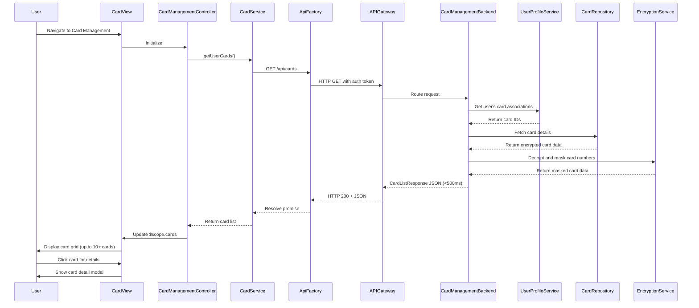

# Low-Level Design: QE-7874 - Multiple Credit Card Management

## a. Architecture Mapping

- **Card Management Module** → AngularJS Module (`app.cardManagement`)
- **Card Management UI** → AngularJS Controller (`CardManagementController`) + HTML5 View Template
- **Card Management Service** → AngularJS Service (`CardService`) for CRUD operations and API integration
- **Card List Display** → AngularJS Directive (`cardList`) for rendering card grid/list with Bootstrap styling
- **Card Detail Modal** → AngularJS Directive (`cardDetailModal`) for displaying individual card details
- **API Communication** → AngularJS Factory (`ApiFactory`) for REST API calls

**Recommended Folder Structure:**
```
app/
├── modules/
│   └── card-management/
│       ├── card-management.module.js
│       ├── controllers/
│       │   └── card-management.controller.js
│       ├── services/
│       │   └── card.service.js
│       ├── directives/
│       │   ├── card-list.directive.js
│       │   └── card-detail-modal.directive.js
│       └── views/
│           ├── card-management.html
│           └── card-detail.html
├── shared/
│   └── factories/
│       └── api.factory.js
└── assets/
    └── css/
        └── card-management.css
```

## b. Component Specifications

| Name | Artifact Type | Responsibility | Key Dependencies |
|------|---------------|----------------|------------------|
| `app.cardManagement` | Module | Root module for card management feature, declares routes and dependencies | `ngRoute`, `ui.bootstrap`, `app.shared` |
| `CardManagementController` | Controller | Manages card list state, add/view/organize operations, handles user interactions | `CardService`, `$scope`, `$uibModal` |
| `CardService` | Service | Fetches card list, retrieves card details, adds/updates/deletes cards via API | `ApiFactory`, `$q`, `$http` |
| `cardList` | Directive | Renders responsive card grid with Bootstrap cards, displays masked card numbers, limits, balances | `CardService`, `$filter` |
| `cardDetailModal` | Directive | Opens Bootstrap modal showing full card details (masked number, limit, balance, usage) | `$uibModal` |
| `ApiFactory` | Factory | Handles REST API calls to `/api/cards`, `/api/cards/{id}` with encryption and auth | `$http`, `$q` |

## c. Data Model

**CreditCard Model:**
```javascript
class CreditCard {
  id: String
  userId: String
  cardNumber: String // Stored encrypted, displayed masked (e.g., "**** **** **** 1234")
  cardHolderName: String
  issuer: String
  cardType: String // Visa, Mastercard, Amex, etc.
  creditLimit: Number
  availableCredit: Number
  outstandingBalance: Number
  expiryDate: String // MM/YY format
  status: String // Active, Inactive, Blocked
  addedDate: Date
}
```

**CardListResponse Model:**
```javascript
class CardListResponse {
  cards: Array<CreditCard>
  totalCards: Number
  userId: String
}
```

## d. Data Flow

User navigates to card management view → `CardManagementController` initializes and calls `CardService.getUserCards()` → `CardService` invokes `ApiFactory` to GET `/api/cards` with auth token → API Gateway routes to Card Management Service → Card Management Service queries User Profile Service to get user's associated card IDs → Card Management Service fetches card details from Credit Card Repository → Data Encryption Service decrypts card data and applies masking (last 4 digits visible) → Card Management Service returns `CardListResponse` JSON (latency <500ms) → `CardService` caches and resolves promise → `CardManagementController` updates `$scope.cards` → `cardList` directive renders Bootstrap card grid with masked numbers, limits, and balances → User clicks card to view details → `cardDetailModal` opens Bootstrap modal with full card information → User can add new card via form, triggering POST `/api/cards` with encrypted payload.

## e. Primary Sequence Diagram



## f. Implementation Notes

- Use AngularJS DI to inject `CardService` into `CardManagementController` and `ApiFactory` into services for testability
- Implement card masking filter (`cardMaskFilter`) to format card numbers as "**** **** **** 1234" in views
- Use Bootstrap grid system (col-md-4) for responsive card layout supporting desktop/tablet/mobile
- Apply `$http` interceptor for automatic token injection and encryption/decryption handling
- Use `ui.bootstrap` modal service (`$uibModal`) for card detail and add card dialogs

## g. Error Handling

Interceptor-based error handling with try/catch in service methods, displaying Bootstrap alerts for API failures, and graceful degradation if card data unavailable.

## h. Security Notes

Requires token-based auth via existing SSO; card numbers encrypted at rest and in transit; only last 4 digits displayed in UI; all card operations require authenticated userId validation server-side.