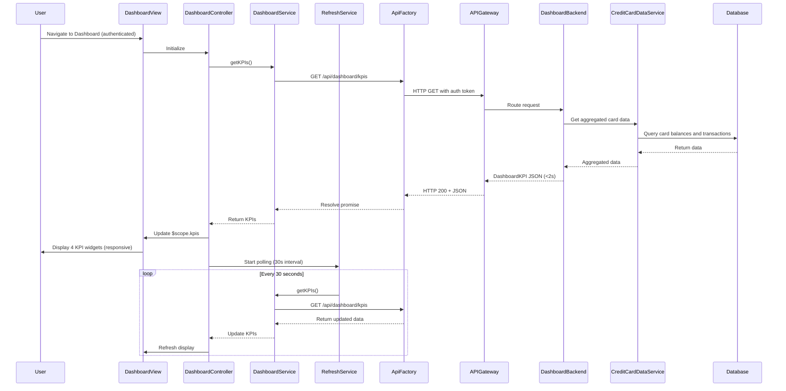

# Low-Level Design: QE-7875 - Credit Card Dashboard and KPI Monitoring

## a. Architecture Mapping

- **Dashboard Module** → AngularJS Module (`app.dashboard`)
- **Dashboard UI Layer** → AngularJS Controller (`DashboardController`) + HTML5 View Template
- **Dashboard Service** → AngularJS Service (`DashboardService`) for KPI data fetching and aggregation
- **KPI Widget** → AngularJS Directive (`kpiWidget`) for rendering individual KPI cards with Bootstrap
- **Real-time Refresh** → AngularJS Service (`RefreshService`) using `$interval` for polling
- **API Communication** → AngularJS Factory (`ApiFactory`) for REST API integration

**Recommended Folder Structure:**
```
app/
├── modules/
│   └── dashboard/
│       ├── dashboard.module.js
│       ├── controllers/
│       │   └── dashboard.controller.js
│       ├── services/
│       │   ├── dashboard.service.js
│       │   └── refresh.service.js
│       ├── directives/
│       │   └── kpi-widget.directive.js
│       └── views/
│           └── dashboard.html
├── shared/
│   └── factories/
│       └── api.factory.js
└── assets/
    └── css/
        └── dashboard.css
```

## b. Component Specifications

| Name | Artifact Type | Responsibility | Key Dependencies |
|------|---------------|----------------|------------------|
| `app.dashboard` | Module | Root module for dashboard feature, declares routes and dependencies | `ngRoute`, `app.shared` |
| `DashboardController` | Controller | Manages dashboard state, initiates KPI data load, handles refresh actions | `DashboardService`, `RefreshService`, `$scope` |
| `DashboardService` | Service | Fetches KPI data (monthly spend, credit limit, available credit, outstanding) from API | `ApiFactory`, `$q`, `$http` |
| `RefreshService` | Service | Implements polling mechanism using `$interval` for real-time KPI updates | `$interval`, `DashboardService` |
| `kpiWidget` | Directive | Renders responsive Bootstrap card for individual KPI with icon, label, value, and trend indicator | `$filter` |
| `ApiFactory` | Factory | Handles REST API calls to `/api/dashboard/kpis` with token-based authentication | `$http`, `$q` |

## c. Data Model

**DashboardKPI Model:**
```javascript
class DashboardKPI {
  monthlySpend: Number
  totalCreditLimit: Number
  availableCredit: Number
  outstandingAmount: Number
  creditUtilization: Number // Percentage
  numberOfCards: Number
  lastUpdated: Date
}
```

**KPIWidget Model:**
```javascript
class KPIWidget {
  label: String
  value: Number
  icon: String // Bootstrap icon class
  trend: String // 'up', 'down', 'neutral'
  trendValue: Number // Percentage change
  format: String // 'currency', 'number', 'percentage'
}
```

## d. Data Flow

User authenticates via User Authentication Service and navigates to dashboard → `DashboardController` initializes and calls `DashboardService.getKPIs()` → `DashboardService` invokes `ApiFactory` to GET `/api/dashboard/kpis` with auth token → API Gateway validates token and routes to Dashboard Service backend → Dashboard Service queries Credit Card Data Service for aggregated data (monthly spend, total credit limit, available credit, outstanding amounts) across all user's cards → Credit Card Data Service retrieves data from Database → Dashboard Service calculates KPIs server-side and returns JSON response (page load <2s) → `DashboardService` caches data and resolves promise → `DashboardController` updates `$scope.kpis` → `kpiWidget` directives render four Bootstrap cards displaying KPIs in responsive grid (col-md-3, col-sm-6, col-xs-12) → `RefreshService` polls API every 30 seconds for real-time updates → On data change, `$scope.kpis` updates and view re-renders automatically via AngularJS data binding.

## e. Primary Sequence Diagram



## f. Implementation Notes

- Use AngularJS DI to inject `DashboardService` and `RefreshService` into `DashboardController` for separation of concerns
- Implement responsive Bootstrap grid (col-md-3, col-sm-6, col-xs-12) for KPI widgets to support desktop/tablet/mobile
- Use `$interval` service in `RefreshService` for polling with configurable interval (default 30s) and cancel on scope destroy
- Apply `$http` interceptor pattern for automatic auth token injection and error handling
- Use AngularJS filters (`currency`, `number`) in `kpiWidget` directive for formatting KPI values

## g. Error Handling

Interceptor-based error handling with `$http` interceptor catching API failures, displaying Bootstrap alert notifications to user, and retry logic in `RefreshService`.

## h. Security Notes

Requires token-based authentication via existing SSO; auth token included in Authorization header for all API requests; KPI data filtered server-side by authenticated userId.