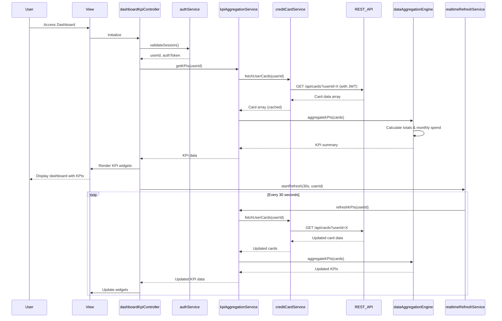

# Low-Level Design: QE-7876 - Dashboard and KPI Management

## a. Architecture Mapping

- **User Interface Dashboard** → AngularJS Controller (`dashboardKpiController`) + HTML5 View with Bootstrap
- **KPI Aggregation Service** → AngularJS Service (`kpiAggregationService`)
- **Data Aggregation Engine** → AngularJS Service (`dataAggregationEngine`)
- **Credit Card Data Service** → AngularJS Service with REST API (`creditCardService`)
- **Real-time Data Refresh Service** → AngularJS Service with $interval (`realtimeRefreshService`)
- **User Authentication Service** → AngularJS Service (`authService`)

**Folder Structure:**
```
app/
├── modules/dashboard/
│   ├── controllers/dashboardKpiController.js
│   ├── services/kpiAggregationService.js
│   ├── services/dataAggregationEngine.js
│   ├── services/creditCardService.js
│   ├── services/realtimeRefreshService.js
│   └── views/dashboard-kpi.html
├── shared/
│   ├── services/authService.js
│   └── directives/kpiWidgetDirective.js
└── assets/css/dashboard-kpi.css
```

## b. Component Specifications

| Component Name | Artifact Type | Responsibility | Key Dependencies |
|----------------|---------------|----------------|------------------|
| dashboardKpiController | Controller | Manages dashboard state, coordinates KPI display, handles refresh actions | kpiAggregationService, authService, $scope |
| kpiAggregationService | Service | Orchestrates KPI data retrieval, coordinates aggregation engine and data service | dataAggregationEngine, creditCardService |
| dataAggregationEngine | Service | Performs multi-card calculations (total credit limit, available credit, outstanding amounts, monthly spend) | None |
| creditCardService | Service | Fetches card data via REST API, implements caching for 2-second load time | $http, $q, $cacheFactory |
| realtimeRefreshService | Service | Implements periodic polling using $interval for real-time KPI updates | kpiAggregationService |
| authService | Service | Validates user session, provides authentication state, manages JWT tokens | $http, $window |
| kpiWidgetDirective | Directive | Renders individual KPI widgets with Bootstrap styling, displays metric values and trends | None |

## c. Data Model

**Card Data Model:**
```javascript
{
  cardId: String,
  userId: String,
  cardNumber: String,
  creditLimit: Number,
  currentBalance: Number,
  availableCredit: Number,
  outstandingAmount: Number
}
```

**KPI Aggregation Model:**
```javascript
{
  userId: String,
  monthlySpend: Number,
  totalCreditLimit: Number,
  totalAvailableCredit: Number,
  totalOutstanding: Number,
  cardCount: Number,
  lastRefreshed: Date
}
```

**User Session Model:**
```javascript
{
  userId: String,
  userName: String,
  authToken: String,
  sessionExpiry: Date
}
```

## d. Data Flow

User accesses dashboard → authService validates session and retrieves userId → dashboardKpiController initializes and calls kpiAggregationService.getKPIs() → kpiAggregationService requests card data from creditCardService via REST API → creditCardService fetches all user cards with cached response for performance → dataAggregationEngine performs multi-card calculations (sum credit limits, available credit, outstanding amounts, compute monthly spend) → realtimeRefreshService starts periodic polling (every 30 seconds) → Aggregated KPI data returned to controller → kpiWidgetDirective renders each KPI in responsive Bootstrap widgets → Real-time updates automatically refresh dashboard without page reload.

## e. Primary Sequence Diagram



## f. Implementation Notes

- Use AngularJS $interval in realtimeRefreshService for periodic polling; ensure proper cleanup with $scope.$on('$destroy')
- Implement Bootstrap responsive grid (col-md-3, col-sm-6, col-xs-12) for KPI widgets supporting mobile and desktop
- Cache card data in creditCardService using $cacheFactory with 2-minute TTL to meet 2-second load requirement
- ES6 const/let and arrow functions in services; use Array.reduce() for efficient multi-card aggregations in dataAggregationEngine
- REST API integration via $http with JWT token in Authorization header; promise-based error handling with .catch()

## g. Error Handling

HTTP interceptor captures API errors; kpiAggregationService wraps calls in try/catch; Bootstrap alert displays user-friendly error messages on failures.

## h. Security Notes

Requires token-based auth via existing SSO; authService manages JWT tokens; all API calls include Authorization header with bearer token.