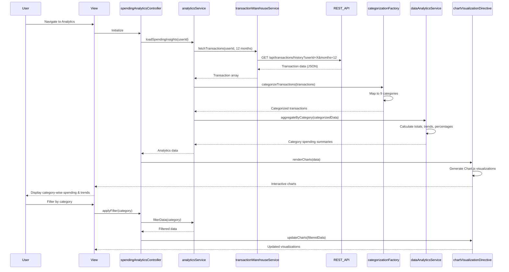

# Low-Level Design: QE-7877 - Analytics and Spending Insights

## a. Architecture Mapping

- **User Interface** → AngularJS Controller (`spendingAnalyticsController`) + HTML5 View
- **Analytics Service** → AngularJS Service (`analyticsService`)
- **Transaction Categorization Engine** → AngularJS Factory (`categorizationFactory`)
- **Data Analytics Service** → AngularJS Service (`dataAnalyticsService`)
- **Transaction Data Warehouse** → REST API integration via AngularJS Service (`transactionWarehouseService`)
- **Visualization Library** → AngularJS Directive wrapping Chart.js (`chartVisualizationDirective`)

**Folder Structure:**
```
app/
├── modules/analytics/
│   ├── controllers/spendingAnalyticsController.js
│   ├── services/analyticsService.js
│   ├── services/dataAnalyticsService.js
│   ├── services/transactionWarehouseService.js
│   ├── factories/categorizationFactory.js
│   ├── directives/chartVisualizationDirective.js
│   └── views/spending-analytics.html
├── shared/
│   └── constants/spendingCategories.js
└── assets/css/analytics.css
```

## b. Component Specifications

| Component Name | Artifact Type | Responsibility | Key Dependencies |
|----------------|---------------|----------------|------------------|
| spendingAnalyticsController | Controller | Manages analytics view, handles user interactions, coordinates chart rendering | analyticsService, $scope |
| analyticsService | Service | Orchestrates analytics data flow, coordinates categorization and aggregation | dataAnalyticsService, categorizationFactory, transactionWarehouseService |
| dataAnalyticsService | Service | Performs aggregations, trend calculations, category-wise spending summaries | None |
| transactionWarehouseService | Service | Fetches 12-month transaction history via REST API, implements caching | $http, $q, $cacheFactory |
| categorizationFactory | Factory | Maps transactions to 9 predefined categories, provides category metadata | spendingCategories constant |
| chartVisualizationDirective | Directive | Renders interactive charts using Chart.js, handles drill-down and filtering | analyticsService |
| spendingCategories | Constant | Defines 9 categories: Food & Dining, Fuel, Shopping, Travel, Entertainment, Utilities, Healthcare, Education, Miscellaneous | None |

## c. Data Model

**Transaction Model:**
```javascript
{
  transactionId: String,
  cardId: String,
  userId: String,
  amount: Number,
  transactionDate: Date,
  category: String, // One of 9 predefined categories
  merchantName: String,
  description: String
}
```

**Category Spending Model:**
```javascript
{
  categoryName: String,
  totalSpend: Number,
  transactionCount: Number,
  percentageOfTotal: Number,
  monthlyBreakdown: Array<{month: String, amount: Number}>
}
```

**Analytics Request Model:**
```javascript
{
  userId: String,
  startDate: Date,
  endDate: Date,
  cardIds: Array<String>,
  categories: Array<String> // Optional filter
}
```

## d. Data Flow

User navigates to analytics view → spendingAnalyticsController initializes and calls analyticsService.loadSpendingInsights() → analyticsService requests 12-month transaction data from transactionWarehouseService via REST API → categorizationFactory maps each transaction to one of 9 predefined categories → dataAnalyticsService aggregates spending by category, calculates monthly trends, and computes percentages → analyticsService returns category spending summaries to controller → chartVisualizationDirective receives data and renders interactive charts using Chart.js → User applies category filter or drills down → Controller updates filter parameters and refreshes charts with filtered data.

## e. Primary Sequence Diagram



## f. Implementation Notes

- Use AngularJS dependency injection to inject analyticsService and transactionWarehouseService into controller
- Implement Chart.js via custom directive for responsive, interactive visualizations with drill-down and filtering
- Cache transaction data in transactionWarehouseService using $cacheFactory with 5-minute TTL to meet 3-second rendering requirement
- ES6 arrow functions and const/let in services; use Array.reduce() for efficient category aggregations
- REST API integration via $http with promise-based error handling; pre-aggregate data server-side for 12-month history

## g. Error Handling

HTTP interceptor captures API failures; analyticsService wraps calls in try/catch; user notified via Bootstrap modal on data fetch errors.

## h. Security Notes

Requires token-based auth via existing SSO; transaction data API calls include JWT in Authorization header; sensitive data masked in UI.