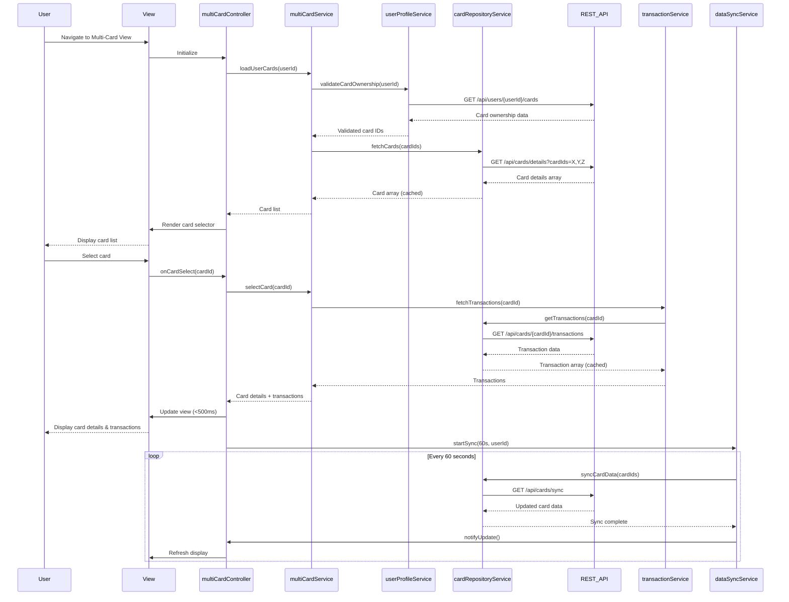

# Low-Level Design: QE-7878 - Multi-Card and Transaction Management

## a. Architecture Mapping

- **User Interface** → AngularJS Controller (`multiCardController`) + HTML5 View with Bootstrap
- **Multi-Card Management Service** → AngularJS Service (`multiCardService`)
- **Transaction Processing Service** → AngularJS Service (`transactionService`)
- **Credit Card Data Repository** → REST API integration via AngularJS Service (`cardRepositoryService`)
- **User Profile Service** → AngularJS Service (`userProfileService`)
- **Data Synchronization Service** → AngularJS Service with $interval (`dataSyncService`)

**Folder Structure:**
```
app/
├── modules/multi-card/
│   ├── controllers/multiCardController.js
│   ├── services/multiCardService.js
│   ├── services/transactionService.js
│   ├── services/cardRepositoryService.js
│   ├── services/dataSyncService.js
│   ├── directives/cardSwitcherDirective.js
│   ├── directives/transactionListDirective.js
│   └── views/multi-card.html
├── shared/
│   └── services/userProfileService.js
└── assets/css/multi-card.css
```

## b. Component Specifications

| Component Name | Artifact Type | Responsibility | Key Dependencies |
|----------------|---------------|----------------|------------------|
| multiCardController | Controller | Manages multi-card view, handles card selection, coordinates transaction display | multiCardService, $scope |
| multiCardService | Service | Orchestrates card retrieval, manages selected card state, coordinates transaction loading | cardRepositoryService, transactionService, userProfileService |
| transactionService | Service | Fetches transaction history, provides filtering and search capabilities | cardRepositoryService |
| cardRepositoryService | Service | Fetches card data and transactions via REST API, implements caching for sub-500ms switching | $http, $q, $cacheFactory |
| userProfileService | Service | Validates card ownership, retrieves user's card list | $http |
| dataSyncService | Service | Implements periodic synchronization of card data using $interval for real-time updates | multiCardService |
| cardSwitcherDirective | Directive | Renders card selector with Bootstrap dropdown, handles card switching events | None |
| transactionListDirective | Directive | Displays transaction list with filtering and search, Bootstrap table styling | transactionService |

## c. Data Model

**Card Model:**
```javascript
{
  cardId: String,
  userId: String,
  cardNumber: String,
  cardType: String,
  creditLimit: Number,
  currentBalance: Number,
  availableCredit: Number,
  outstandingAmount: Number,
  cardWiseSpend: Number
}
```

**Transaction Model:**
```javascript
{
  transactionId: String,
  cardId: String,
  amount: Number,
  transactionDate: Date,
  merchantName: String,
  category: String,
  status: String, // posted, pending
  description: String
}
```

**Multi-Card View Model:**
```javascript
{
  userId: String,
  cards: Array<Card>,
  selectedCardId: String,
  transactions: Array<Transaction>,
  filterCriteria: {searchTerm: String, dateRange: {start: Date, end: Date}}
}
```

## d. Data Flow

User navigates to multi-card view → multiCardController calls multiCardService.loadUserCards() → multiCardService requests card ownership validation from userProfileService → cardRepositoryService fetches all user cards via REST API → multiCardService returns card list to controller → cardSwitcherDirective renders card selector → User selects a card → Controller calls multiCardService.selectCard() → transactionService fetches transaction history for selected card from cardRepositoryService (cached, sub-500ms) → transactionListDirective displays transactions with filtering and search → dataSyncService polls for updates every 60 seconds → Real-time card data and transactions automatically synchronized.

## e. Primary Sequence Diagram



## f. Implementation Notes

- Use AngularJS $cacheFactory in cardRepositoryService to cache card and transaction data for 5 minutes, achieving sub-500ms card switching
- Implement Bootstrap dropdown for card selector in cardSwitcherDirective; use ng-repeat for dynamic card list
- ES6 Map in multiCardService for O(1) card lookup by cardId; use const/let and arrow functions throughout
- REST API integration via $http with promise chaining; use $q.all for parallel card data fetching (support 10+ cards)
- Transaction filtering and search implemented client-side using Array.filter() for instant response

## g. Error Handling

HTTP interceptor handles API failures; multiCardService catches errors and displays Bootstrap alert; dataSyncService retries on sync failures with exponential backoff.

## h. Security Notes

Requires token-based auth via existing SSO; userProfileService validates card ownership before data access; all API calls include JWT in Authorization header.