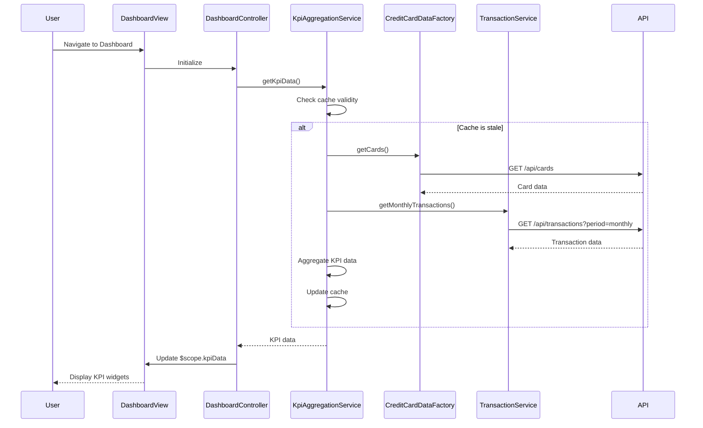

# Low-Level Design: QE-7879 - Dashboard and KPI Management

## a. Architecture Mapping

- **Dashboard UI Layer** → AngularJS Module `dashboardModule` with Controller `DashboardController` and View template `dashboard.html`
- **KPI Aggregation Service** → AngularJS Service `KpiAggregationService` for server-side API calls and data aggregation
- **Credit Card Data Service** → AngularJS Factory `CreditCardDataFactory` for credit card information retrieval
- **Transaction Data Service** → AngularJS Service `TransactionService` for transaction data and spend calculations
- **User Authentication Service** → AngularJS Service `AuthService` for authentication and session management

**Recommended Folder Structure:**
```
app/
├── modules/
│   └── dashboard/
│       ├── controllers/
│       │   └── DashboardController.js
│       ├── services/
│       │   ├── KpiAggregationService.js
│       │   ├── CreditCardDataFactory.js
│       │   └── TransactionService.js
│       ├── views/
│       │   └── dashboard.html
│       └── dashboard.module.js
├── shared/
│   └── services/
│       └── AuthService.js
└── assets/
    ├── css/
    └── js/
```

## b. Component Specifications

| Component Name | Artifact Type | Responsibility | Key Dependencies |
|----------------|---------------|----------------|------------------|
| dashboardModule | Module | Root module for dashboard feature, registers all dashboard components | angular, ngRoute, ngResource |
| DashboardController | Controller | Manages dashboard view state, fetches KPIs, handles user interactions | KpiAggregationService, $scope, $q |
| KpiAggregationService | Service | Aggregates KPI data from multiple sources, caches results for 5-minute intervals | $http, $q, CreditCardDataFactory, TransactionService |
| CreditCardDataFactory | Factory | Retrieves credit card balances, limits, and card information via REST API | $resource, API_CONFIG |
| TransactionService | Service | Fetches transaction data and calculates monthly spend | $http, $q, API_CONFIG |
| AuthService | Service | Manages user authentication, session validation, and role-based access control | $http, $window, $q |
| dashboard.html | View | Displays KPI widgets (monthly spend, credit limit, available credit, outstanding amount) with responsive Bootstrap grid | DashboardController |

## c. Data Model

**KpiData (JavaScript Object):**
```javascript
{
  monthlySpend: Number,
  totalCreditLimit: Number,
  availableCredit: Number,
  outstandingAmount: Number,
  lastUpdated: Date
}
```

**CreditCard (JavaScript Object):**
```javascript
{
  cardId: String,
  cardNumber: String,
  cardType: String,
  creditLimit: Number,
  availableCredit: Number,
  outstandingBalance: Number
}
```

**Transaction (JavaScript Object):**
```javascript
{
  transactionId: String,
  cardId: String,
  amount: Number,
  date: Date,
  category: String,
  description: String
}
```

## d. Data Flow

User navigates to the dashboard view, triggering `DashboardController` initialization. The controller invokes `KpiAggregationService.getKpiData()`, which checks cache validity (5-minute TTL). If cache is stale, the service concurrently calls `CreditCardDataFactory.getCards()` and `TransactionService.getMonthlyTransactions()` via REST APIs. Responses are aggregated to compute monthly spend, total credit limit, available credit, and outstanding amount. The aggregated KPI data is returned to the controller, which updates `$scope.kpiData`, triggering Angular's digest cycle to refresh the dashboard view with updated KPI widgets displayed in Bootstrap cards.

## e. Primary Sequence Diagram



## f. Implementation Notes

- Use AngularJS dependency injection to inject services into controllers and other services for loose coupling and testability.
- Implement caching in `KpiAggregationService` using a simple in-memory object with timestamp-based TTL (5 minutes) to reduce API calls.
- Use `$q.all()` for concurrent API calls to `CreditCardDataFactory` and `TransactionService` to minimize total load time.
- Apply Bootstrap 3.x responsive grid (col-xs, col-sm, col-md, col-lg) in `dashboard.html` for mobile and desktop compatibility.
- Use `$resource` or `$http` with promise-based error handling for all REST API interactions.

## g. Error Handling

HTTP interceptor-based error handling with user-friendly notifications via Angular toaster or Bootstrap alerts for API failures.

## h. Security Notes

Requires token-based authentication via existing SSO; all API calls include Authorization header with JWT token validated by AuthService.