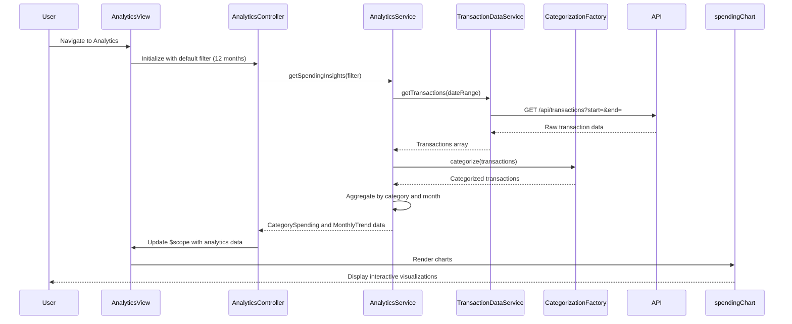

# Low-Level Design: QE-7880 - Analytics and Spending Insights

## a. Architecture Mapping

- **Analytics UI Component** → AngularJS Module `analyticsModule` with Controller `AnalyticsController` and Directive `spendingChart` for chart rendering
- **Data Analytics Service** → AngularJS Service `AnalyticsService` for trend computation, aggregation, and API integration
- **Transaction Data Service** → AngularJS Service `TransactionDataService` for raw transaction retrieval
- **Categorization Engine** → AngularJS Factory `CategorizationFactory` for transaction classification logic
- **Chart Visualization** → Custom AngularJS Directive `spendingChart` wrapping Chart.js or D3.js for interactive visualizations

**Recommended Folder Structure:**
```
app/
├── modules/
│   └── analytics/
│       ├── controllers/
│       │   └── AnalyticsController.js
│       ├── services/
│       │   ├── AnalyticsService.js
│       │   ├── TransactionDataService.js
│       │   └── CategorizationFactory.js
│       ├── directives/
│       │   └── spendingChart.directive.js
│       ├── views/
│       │   └── analytics.html
│       └── analytics.module.js
└── assets/
    ├── css/
    └── js/
```

## b. Component Specifications

| Component Name | Artifact Type | Responsibility | Key Dependencies |
|----------------|---------------|----------------|------------------|
| analyticsModule | Module | Root module for analytics feature, registers all analytics components | angular, ngRoute, chart.js |
| AnalyticsController | Controller | Manages analytics view state, fetches spending data, handles filtering and drill-down | AnalyticsService, $scope, $filter |
| AnalyticsService | Service | Aggregates transaction data by category and month, computes trends, caches results | $http, $q, TransactionDataService, CategorizationFactory |
| TransactionDataService | Service | Retrieves raw transaction data for specified date ranges via REST API | $http, $q, API_CONFIG |
| CategorizationFactory | Factory | Classifies transactions into 9 predefined categories using rule-based logic | $resource |
| spendingChart | Directive | Renders interactive charts (pie, bar, line) for category-wise and monthly spending visualization | Chart.js, $timeout |
| analytics.html | View | Displays category filters, spending breakdown, and chart visualizations with responsive layout | AnalyticsController, spendingChart |

## c. Data Model

**CategorySpending (JavaScript Object):**
```javascript
{
  category: String, // One of: Food & Dining, Fuel, Shopping, Travel, Entertainment, Utilities, Healthcare, Education, Miscellaneous
  totalAmount: Number,
  transactionCount: Number,
  percentage: Number
}
```

**MonthlyTrend (JavaScript Object):**
```javascript
{
  month: String, // Format: YYYY-MM
  totalSpend: Number,
  categoryBreakdown: Array<CategorySpending>
}
```

**Transaction (JavaScript Object):**
```javascript
{
  transactionId: String,
  cardId: String,
  amount: Number,
  date: Date,
  category: String,
  merchantName: String,
  description: String
}
```

**AnalyticsFilter (JavaScript Object):**
```javascript
{
  startDate: Date,
  endDate: Date,
  selectedCategories: Array<String>,
  cardId: String // Optional for card-specific filtering
}
```

## d. Data Flow

User accesses the analytics view, triggering `AnalyticsController` to call `AnalyticsService.getSpendingInsights(filter)` with default 12-month filter. The service invokes `TransactionDataService.getTransactions(dateRange)` to fetch raw transaction data via REST API. Retrieved transactions are passed to `CategorizationFactory.categorize(transactions)` for classification into 9 predefined categories. `AnalyticsService` aggregates categorized data by category and month, computes percentages and trends, then returns the result to the controller. The controller updates `$scope.categorySpending` and `$scope.monthlyTrends`, which trigger the `spendingChart` directive to render interactive visualizations (pie chart for category breakdown, line chart for monthly trends) using Chart.js, with smooth rendering optimized for mobile and desktop.

## e. Primary Sequence Diagram



## f. Implementation Notes

- Use AngularJS `$filter` service for client-side date range and category filtering to enable instant drill-down without additional API calls.
- Implement pre-aggregated data caching in `AnalyticsService` with 1-hour TTL to meet the 1-second query response NFR.
- Use Chart.js library wrapped in a custom AngularJS directive (`spendingChart`) for declarative chart rendering with two-way data binding.
- Apply lazy loading for historical data beyond 12 months to optimize initial load time and memory usage.
- Use ES6 Array methods (map, reduce, filter) in `AnalyticsService` for efficient data aggregation and transformation.

## g. Error Handling

Try/catch blocks in service methods with HTTP interceptor for API errors; user notifications via Bootstrap alerts for failed data retrieval.

## h. Security Notes

Standard input validation and secure API calls assumed; transaction data access restricted to authenticated user's own transactions via server-side authorization.