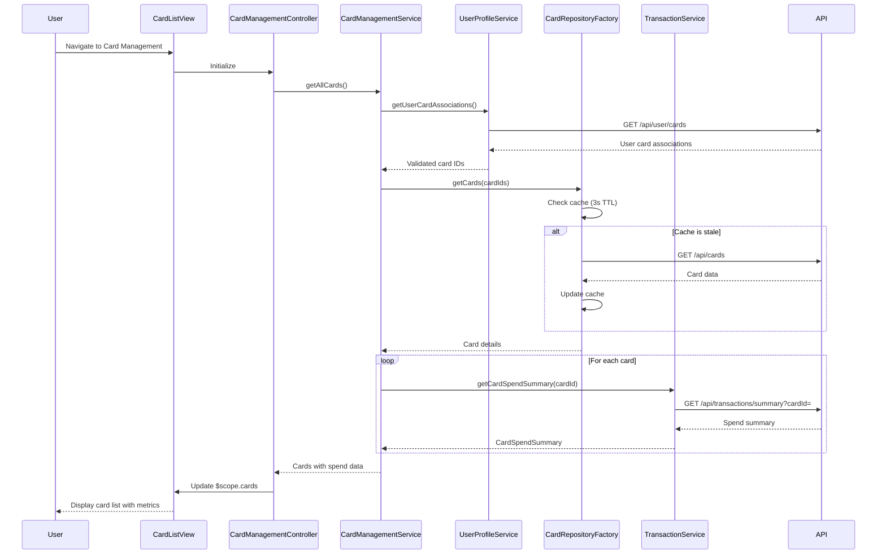

# Low-Level Design: QE-7881 - Multiple Credit Card Management

## a. Architecture Mapping

- **User Interface** → AngularJS Module `cardManagementModule` with Controller `CardManagementController` and View template `card-list.html`
- **Card Management Module** → AngularJS Service `CardManagementService` for card operations and business logic
- **Card Repository Service** → AngularJS Factory `CardRepositoryFactory` for card information retrieval and caching
- **Transaction Service** → AngularJS Service `TransactionService` for card-wise transaction data and spend analysis
- **User Profile Service** → AngularJS Service `UserProfileService` for card ownership validation

**Recommended Folder Structure:**
```
app/
├── modules/
│   └── card-management/
│       ├── controllers/
│       │   └── CardManagementController.js
│       ├── services/
│       │   ├── CardManagementService.js
│       │   ├── CardRepositoryFactory.js
│       │   └── TransactionService.js
│       ├── views/
│       │   ├── card-list.html
│       │   └── card-detail.html
│       └── card-management.module.js
├── shared/
│   └── services/
│       └── UserProfileService.js
└── assets/
    ├── css/
    └── js/
```

## b. Component Specifications

| Component Name | Artifact Type | Responsibility | Key Dependencies |
|----------------|---------------|----------------|------------------|
| cardManagementModule | Module | Root module for card management feature, registers all card-related components | angular, ngRoute, ngResource |
| CardManagementController | Controller | Manages card list and detail views, handles card selection, filtering, and status display | CardManagementService, $scope, $routeParams |
| CardManagementService | Service | Orchestrates card operations, aggregates card-wise spend data, manages card state | CardRepositoryFactory, TransactionService, $q |
| CardRepositoryFactory | Factory | Retrieves and caches card information (status, limits, details) with 3-second refresh cycle | $resource, $cacheFactory, API_CONFIG |
| TransactionService | Service | Fetches card-specific transaction data and calculates card-wise spend analysis | $http, $q, API_CONFIG |
| UserProfileService | Service | Validates card ownership and retrieves user-card associations | $http, $q, API_CONFIG |
| card-list.html | View | Displays all user cards in a responsive grid with status indicators, limits, and quick actions | CardManagementController |
| card-detail.html | View | Shows detailed view of a single card with spend analysis, transaction history, and metrics | CardManagementController |

## c. Data Model

**CreditCard (JavaScript Object):**
```javascript
{
  cardId: String,
  cardNumber: String, // Masked format: **** **** **** 1234
  cardType: String, // Visa, MasterCard, Amex, etc.
  cardHolderName: String,
  creditLimit: Number,
  availableCredit: Number,
  outstandingBalance: Number,
  status: String, // Active, Blocked, Expired
  expiryDate: Date,
  lastUpdated: Date
}
```

**CardSpendSummary (JavaScript Object):**
```javascript
{
  cardId: String,
  monthlySpend: Number,
  totalTransactions: Number,
  lastTransactionDate: Date,
  topCategory: String
}
```

**UserCardAssociation (JavaScript Object):**
```javascript
{
  userId: String,
  cardIds: Array<String>
}
```

## d. Data Flow

User navigates to the card management view, triggering `CardManagementController` initialization. The controller calls `CardManagementService.getAllCards()`, which first invokes `UserProfileService.getUserCardAssociations()` to validate card ownership. Once validated, the service calls `CardRepositoryFactory.getCards()`, which checks the Angular cache (3-second TTL). If cache is stale, it fetches card data via REST API and updates the cache. For each card, the service concurrently calls `TransactionService.getCardSpendSummary(cardId)` to retrieve card-wise spend analysis. Aggregated card data with spend summaries is returned to the controller, which updates `$scope.cards`, triggering the view to render the card list in a responsive Bootstrap grid with status indicators, limits, and spend metrics. User can click on a card to navigate to the detail view for deeper analysis.

## e. Primary Sequence Diagram



## f. Implementation Notes

- Use AngularJS `$cacheFactory` in `CardRepositoryFactory` to implement 3-second TTL caching for card data refresh.
- Implement pagination or virtual scrolling in `card-list.html` to handle display of unlimited cards while maintaining performance with 20+ cards.
- Use `$q.all()` for concurrent `getCardSpendSummary()` calls to minimize total load time when fetching spend data for multiple cards.
- Apply AngularJS `ng-repeat` with `track by cardId` for efficient DOM updates when card data refreshes.
- Use Bootstrap card components with responsive grid (col-md-4, col-sm-6, col-xs-12) for optimal layout across devices.

## g. Error Handling

HTTP interceptor-based error handling with user-friendly notifications via Angular toaster for API failures and card data retrieval errors.

## h. Security Notes

Requires token-based auth via existing SSO; card ownership validated server-side by UserProfileService before displaying any card data.