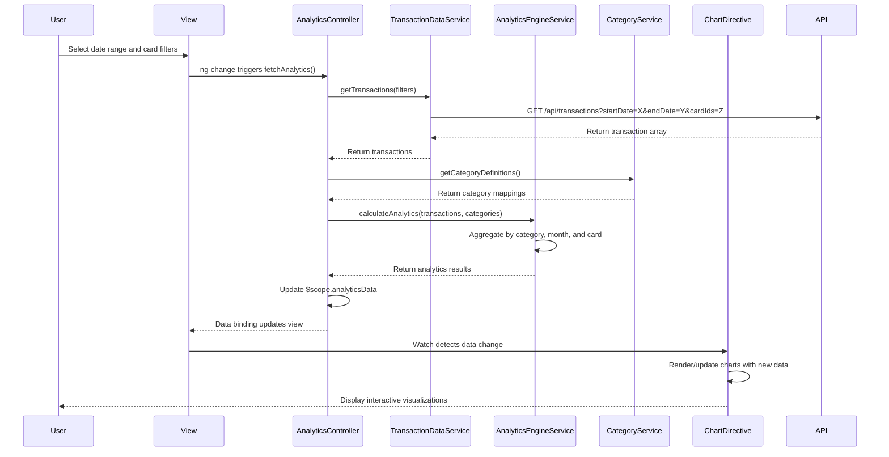

# Low-Level Design: QE-7882 - Spending Analytics and Insights

## a. Architecture Mapping

**Component to Artifact Mapping:**
- **User Interface** → AngularJS View (HTML templates with ng-directives) + CSS3/Bootstrap styling
- **Analytics Controller** → AngularJS Controller (`AnalyticsController`) managing scope and orchestrating service calls
- **Transaction Data Service** → AngularJS Service/Factory (`TransactionDataService`) for REST API calls to fetch transaction data
- **Analytics Engine** → AngularJS Service (`AnalyticsEngineService`) performing client-side aggregation and calculation logic
- **Category Classification Service** → AngularJS Service (`CategoryService`) providing category mapping and classification
- **Visualization Framework** → AngularJS Directive (`chartDirective`) wrapping Chart.js or D3.js for rendering interactive charts

**Recommended Folder Structure:**
```
app/
├── modules/
│   └── analytics/
│       ├── analytics.module.js
│       ├── controllers/
│       │   └── analytics.controller.js
│       ├── services/
│       │   ├── transaction-data.service.js
│       │   ├── analytics-engine.service.js
│       │   └── category.service.js
│       ├── directives/
│       │   └── chart.directive.js
│       └── views/
│           └── analytics.html
├── shared/
│   └── services/
└── assets/
    ├── css/
    └── js/
```

## b. Component Specifications

| Component Name | Artifact Type | Responsibility | Key Dependencies |
|----------------|---------------|----------------|------------------|
| AnalyticsController | Controller | Manages analytics view state, coordinates data fetching, triggers calculations, and updates chart data models | TransactionDataService, AnalyticsEngineService, CategoryService, $scope |
| TransactionDataService | Service/Factory | Fetches raw transaction data from REST API endpoints with filtering parameters | $http, $q |
| AnalyticsEngineService | Service | Aggregates transaction data by category, calculates monthly trends, and computes card-wise spending totals | CategoryService |
| CategoryService | Service | Provides category definitions, maps transactions to categories, and returns category metadata | None |
| chartDirective | Directive | Encapsulates chart rendering logic, binds to data model, and handles chart interactions and responsiveness | Chart.js or D3.js library |
| analytics.html | View | Displays category breakdown, monthly trends, and card-wise analysis with interactive chart elements | Bootstrap grid, chartDirective |

## c. Data Model

```javascript
// Transaction Model
const Transaction = {
  id: String,
  cardId: String,
  amount: Number,
  category: String,
  date: Date,
  description: String,
  merchantName: String
};

// Category Spending Model
const CategorySpending = {
  categoryName: String,
  totalAmount: Number,
  transactionCount: Number,
  percentage: Number
};

// Monthly Trend Model
const MonthlyTrend = {
  month: String,
  year: Number,
  totalSpend: Number,
  categoryBreakdown: Array<CategorySpending>
};

// Card-wise Spending Model
const CardSpending = {
  cardId: String,
  cardName: String,
  totalSpend: Number,
  categoryBreakdown: Array<CategorySpending>
};

// Analytics View Model
const AnalyticsViewModel = {
  categorySpending: Array<CategorySpending>,
  monthlyTrends: Array<MonthlyTrend>,
  cardWiseSpending: Array<CardSpending>,
  selectedDateRange: { startDate: Date, endDate: Date },
  selectedCards: Array<String>
};
```

## d. Data Flow

User selects date range and card filters on the analytics view, triggering AnalyticsController to call TransactionDataService which fetches filtered transaction data via REST API. The controller passes raw transactions to AnalyticsEngineService, which aggregates data by category using CategoryService mappings, calculates monthly trends, and computes card-wise totals. The aggregated results are bound to $scope, updating the view model. The chartDirective watches the data model and re-renders interactive charts (category pie chart, monthly line chart, card comparison bar chart) using Chart.js, providing users with visual insights into spending patterns.

## e. Primary Sequence Diagram



## f. Implementation Notes

- Use AngularJS module pattern with explicit dependency injection (`$inject` annotation) for minification safety
- Implement AnalyticsEngineService with ES6 Map/Reduce patterns for efficient client-side aggregation of transaction arrays
- Use $http service with promise chaining ($q) for REST API calls; cache category definitions in CategoryService using constant or value provider
- Wrap Chart.js in an AngularJS directive with isolated scope and two-way binding for chart data; implement $watch for reactive updates
- Apply Bootstrap grid system and CSS3 media queries for responsive chart containers; use ng-if for conditional rendering of empty states

## g. Error Handling

HTTP interceptor captures API errors; AnalyticsController displays user-friendly error messages via Bootstrap alerts; try/catch wraps aggregation logic with fallback to empty state.

## h. Security Notes

Requires token-based authentication via existing SSO; API endpoints validate user access to transaction data; standard XSS prevention via AngularJS built-in sanitization.