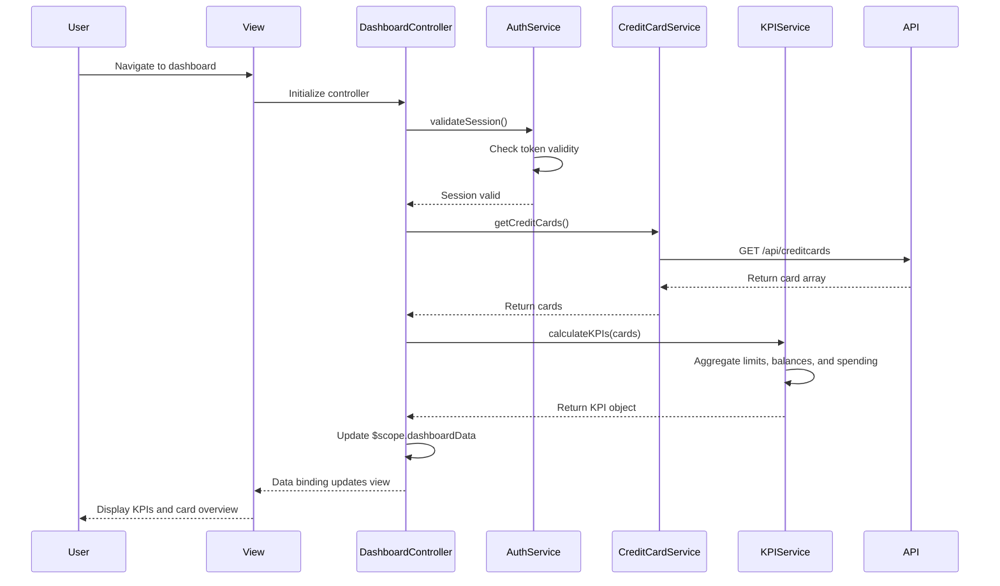

# Low-Level Design: QE-7883 - Credit Card Dashboard and KPI Overview

## a. Architecture Mapping

**Component to Artifact Mapping:**
- **User Interface** → AngularJS View (HTML templates with ng-directives) + CSS3/Bootstrap for responsive layout
- **Dashboard Controller** → AngularJS Controller (`DashboardController`) managing dashboard state and KPI data
- **Credit Card Data Service** → AngularJS Service/Factory (`CreditCardService`) for REST API calls to fetch card data
- **Authentication Service** → AngularJS Service (`AuthService`) handling user authentication and session management
- **KPI Calculation Engine** → AngularJS Service (`KPIService`) computing derived metrics from card data

**Recommended Folder Structure:**
```
app/
├── modules/
│   └── dashboard/
│       ├── dashboard.module.js
│       ├── controllers/
│       │   └── dashboard.controller.js
│       ├── services/
│       │   ├── credit-card.service.js
│       │   └── kpi.service.js
│       └── views/
│           └── dashboard.html
├── shared/
│   └── services/
│       └── auth.service.js
└── assets/
    ├── css/
    └── js/
```

## b. Component Specifications

| Component Name | Artifact Type | Responsibility | Key Dependencies |
|----------------|---------------|----------------|------------------|
| DashboardController | Controller | Orchestrates dashboard initialization, fetches card data, triggers KPI calculations, and manages view state | CreditCardService, KPIService, AuthService, $scope, $interval |
| CreditCardService | Service/Factory | Fetches credit card portfolio data from REST API and provides card details, balances, and limits | $http, $q |
| KPIService | Service | Calculates KPIs including monthly spend, total credit limit, available credit, and outstanding amounts from card data | None |
| AuthService | Service | Validates user authentication, manages session tokens, and enforces secure access to dashboard | $http, $window |
| dashboard.html | View | Displays KPI cards, multi-card overview, and responsive grid layout using Bootstrap components | Bootstrap grid, ng-repeat |

## c. Data Model

```javascript
// Credit Card Model
const CreditCard = {
  cardId: String,
  cardNumber: String,
  cardHolderName: String,
  cardType: String,
  creditLimit: Number,
  currentBalance: Number,
  availableCredit: Number,
  outstandingAmount: Number,
  lastUpdated: Date
};

// KPI Model
const DashboardKPI = {
  monthlySpend: Number,
  totalCreditLimit: Number,
  totalAvailableCredit: Number,
  totalOutstanding: Number
};

// Dashboard View Model
const DashboardViewModel = {
  cards: Array<CreditCard>,
  kpis: DashboardKPI,
  isLoading: Boolean,
  lastRefreshed: Date
};
```

## d. Data Flow

User navigates to the dashboard, triggering DashboardController initialization which first calls AuthService to validate session. Upon successful authentication, the controller invokes CreditCardService to fetch the user's credit card portfolio via REST API. The service returns an array of CreditCard objects, which the controller passes to KPIService for aggregation. KPIService calculates total credit limit, available credit, outstanding amounts, and monthly spend across all cards. The computed KPIs and card list are bound to $scope, updating the view with KPI cards and a multi-card grid. An $interval service periodically refreshes data for near-real-time updates.

## e. Primary Sequence Diagram



## f. Implementation Notes

- Use AngularJS module pattern with explicit dependency injection (`$inject` annotation) for minification safety
- Implement CreditCardService with $http and promise-based API calls; use $q.all for parallel requests if fetching additional card details
- KPIService uses ES6 Array.reduce() for efficient aggregation of card data into summary metrics
- Apply $interval in DashboardController for periodic data refresh (e.g., every 60 seconds) with automatic cleanup on $scope.$destroy
- Use Bootstrap grid (col-md-3, col-sm-6, col-xs-12) and CSS3 flexbox for responsive KPI card layout across devices

## g. Error Handling

HTTP interceptor captures API errors; DashboardController displays Bootstrap alert for authentication failures or data fetch errors; fallback to cached data if available.

## h. Security Notes

Requires token-based auth via existing SSO; AuthService validates session on dashboard load; API endpoints enforce user-specific data access control.