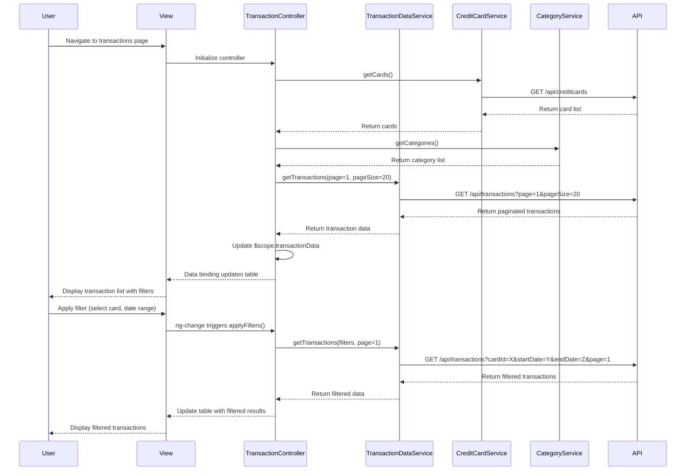

# Low-Level Design: QE-7884 - Credit Card Transaction Management

## a. Architecture Mapping

**Component to Artifact Mapping:**
- **User Interface** → AngularJS View (HTML templates with ng-directives) + CSS3/Bootstrap for table and filter UI
- **Transaction Controller** → AngularJS Controller (`TransactionController`) managing transaction list state and filter logic
- **Transaction Data Service** → AngularJS Service/Factory (`TransactionDataService`) for REST API calls to fetch transaction records
- **Credit Card Data Service** → AngularJS Service (`CreditCardService`) providing card list for filter dropdowns
- **Category Classification Service** → AngularJS Service (`CategoryService`) mapping transactions to predefined categories
- **Search and Filter Engine** → AngularJS Filter (`transactionFilter`) and controller logic for client-side filtering and search

**Recommended Folder Structure:**
```
app/
├── modules/
│   └── transactions/
│       ├── transactions.module.js
│       ├── controllers/
│       │   └── transaction.controller.js
│       ├── services/
│       │   ├── transaction-data.service.js
│       │   ├── credit-card.service.js
│       │   └── category.service.js
│       ├── filters/
│       │   └── transaction.filter.js
│       └── views/
│           └── transactions.html
├── shared/
│   └── services/
└── assets/
    ├── css/
    └── js/
```

## b. Component Specifications

| Component Name | Artifact Type | Responsibility | Key Dependencies |
|----------------|---------------|----------------|------------------|
| TransactionController | Controller | Manages transaction list, handles filter/search inputs, triggers pagination, and coordinates data fetching | TransactionDataService, CreditCardService, CategoryService, $scope |
| TransactionDataService | Service/Factory | Fetches paginated transaction data from REST API with query parameters for filtering and date range | $http, $q |
| CreditCardService | Service | Provides list of user's credit cards for card-wise filter dropdown | $http |
| CategoryService | Service | Returns category definitions and maps transaction merchant codes or descriptions to categories | None |
| transactionFilter | Filter | Implements client-side filtering logic for search term matching across transaction fields | None |
| transactions.html | View | Displays paginated transaction table with filter controls, search input, and transaction detail rows | Bootstrap table, ng-repeat, pagination directive |

## c. Data Model

```javascript
// Transaction Model
const Transaction = {
  transactionId: String,
  cardId: String,
  cardName: String,
  amount: Number,
  currency: String,
  category: String,
  merchantName: String,
  transactionDate: Date,
  description: String,
  status: String
};

// Filter Criteria Model
const TransactionFilter = {
  selectedCardId: String,
  selectedCategory: String,
  searchTerm: String,
  startDate: Date,
  endDate: Date
};

// Pagination Model
const Pagination = {
  currentPage: Number,
  pageSize: Number,
  totalRecords: Number,
  totalPages: Number
};

// Transaction View Model
const TransactionViewModel = {
  transactions: Array<Transaction>,
  filters: TransactionFilter,
  pagination: Pagination,
  cards: Array<{ cardId: String, cardName: String }>,
  categories: Array<String>,
  isLoading: Boolean
};
```

## d. Data Flow

User accesses the transaction management view, triggering TransactionController to fetch the initial paginated transaction list via TransactionDataService REST API call. The controller also loads card list from CreditCardService and category definitions from CategoryService to populate filter dropdowns. When the user applies filters (card selection, category, date range) or enters a search term, the controller updates the filter criteria and calls TransactionDataService with query parameters. The service returns filtered, paginated results which are bound to $scope, updating the transaction table. Client-side transactionFilter further refines displayed rows based on search term. Pagination controls trigger subsequent API calls with updated page numbers.

## e. Primary Sequence Diagram



## f. Implementation Notes

- Use AngularJS module pattern with explicit dependency injection (`$inject` annotation) for minification safety
- Implement TransactionDataService with $http for REST API calls; use query parameters for server-side filtering and pagination to handle large datasets efficiently
- Create custom AngularJS filter (transactionFilter) for client-side search term matching across transaction fields (merchant, description, amount)
- Use Bootstrap table component with responsive classes (table-responsive) and ng-repeat with track by transactionId for performance
- Implement pagination using AngularJS dirPagination directive or custom pagination component with ng-click handlers for page navigation

## g. Error Handling

HTTP interceptor captures API errors; TransactionController displays user-friendly error messages via Bootstrap alerts; try/catch wraps filter logic with fallback to unfiltered view.

## h. Security Notes

Requires token-based auth via existing SSO; API endpoints validate user access to transaction data; standard input validation and secure API calls assumed.