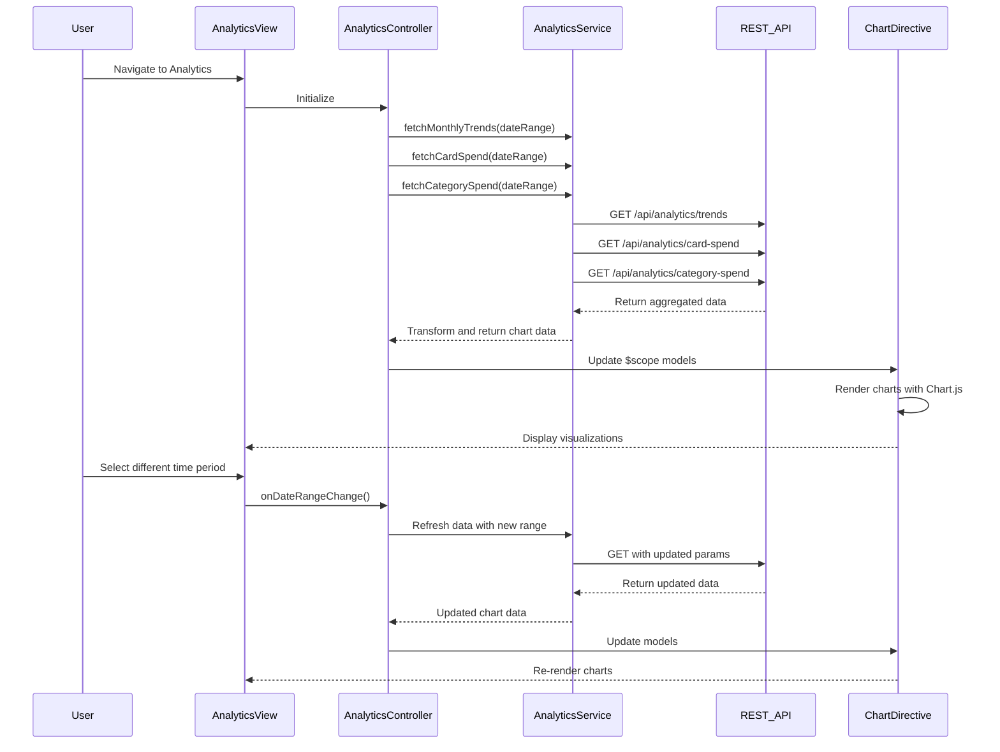

# Low-Level Design: QE-7909 - Spending Analytics and Insights

## a. Architecture Mapping

- **User Interface**: AngularJS Module `analyticsModule` with Controller `AnalyticsController` and Directives `spendTrendChart`, `cardSpendChart`, `categorySpendChart`
- **Analytics Service**: AngularJS Service `AnalyticsService` for data aggregation and API calls
- **Data Aggregation Engine**: Backend REST API endpoints consumed by `AnalyticsService`
- **Visualization Library**: Integration with Chart.js or D3.js via AngularJS Directives
- **Transaction and Categorization System**: Backend REST API providing categorized transaction data

**Folder Structure:**
```
app/
├── modules/
│   └── analytics/
│       ├── analytics.module.js
│       ├── controllers/
│       │   └── analytics.controller.js
│       ├── services/
│       │   └── analytics.service.js
│       ├── directives/
│       │   ├── spend-trend-chart.directive.js
│       │   ├── card-spend-chart.directive.js
│       │   └── category-spend-chart.directive.js
│       └── views/
│           └── analytics.html
```

## b. Component Specifications

| Name | Artifact Type | Responsibility | Key Dependencies |
|------|---------------|----------------|------------------|
| analyticsModule | Module | Register analytics components and configure routing | angular, ui.router, chart.js |
| AnalyticsController | Controller | Manage analytics view state, coordinate data fetching, handle user interactions | AnalyticsService, $scope |
| AnalyticsService | Service | Fetch analytics data from REST APIs, aggregate and transform data for visualization | $http, $q |
| spendTrendChart | Directive | Render monthly spend trends line/bar chart | Chart.js, AnalyticsService |
| cardSpendChart | Directive | Render card-wise spend comparison chart | Chart.js, AnalyticsService |
| categorySpendChart | Directive | Render category-wise spending breakdown pie/donut chart for 9 categories | Chart.js, AnalyticsService |

## c. Data Model

**SpendTrend:**
```javascript
{
  month: String,           // e.g., "2024-01"
  totalSpend: Number,      // Total spend for the month
  timestamp: Date
}
```

**CardSpend:**
```javascript
{
  cardId: String,
  cardName: String,
  totalSpend: Number,
  percentage: Number       // Percentage of total spend
}
```

**CategorySpend:**
```javascript
{
  category: String,        // One of: Food & Dining, Fuel, Shopping, Travel, Entertainment, Utilities, Healthcare, Education, Miscellaneous
  amount: Number,
  percentage: Number,
  transactionCount: Number
}
```

## d. Data Flow

User navigates to Analytics view → AnalyticsController initializes and calls AnalyticsService methods → Service makes parallel REST API calls to `/api/analytics/trends`, `/api/analytics/card-spend`, and `/api/analytics/category-spend` with date range parameters → Backend aggregates transaction data and returns JSON → Service transforms response data into chart-ready format → Controller updates $scope models → Chart directives watch model changes and re-render visualizations using Chart.js → User interacts with time-period selector → Controller triggers service refresh → Charts update reactively.

## e. Primary Sequence Diagram



## f. Implementation Notes

- Use AngularJS 1.x module pattern with dependency injection for all services and controllers
- Implement chart directives with isolated scope and two-way binding for data models
- Use $q.all() for parallel API calls to improve load time; cache results with $cacheFactory for 5 minutes
- Leverage ES6 arrow functions, const/let, and template literals in controllers and services
- Implement responsive chart sizing using Chart.js responsive options and CSS media queries

## g. Error Handling

HTTP interceptor captures API errors; AnalyticsService returns rejected promises; Controller displays user-friendly error messages via toast notifications.

## h. Security Notes

Requires token-based auth via existing SSO; all API calls include Authorization header with JWT token.