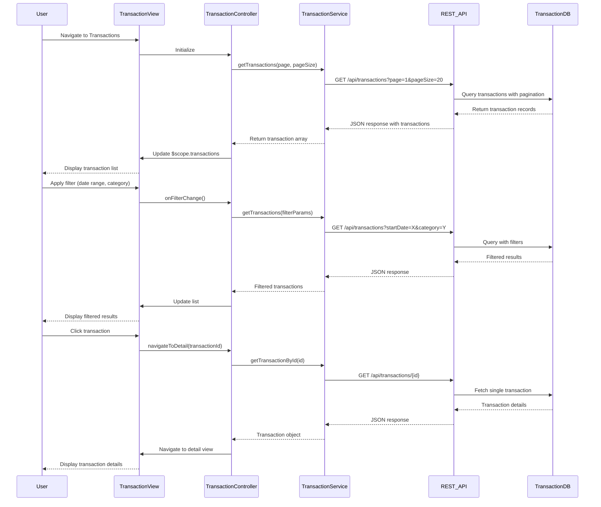

# Low-Level Design: QE-7910 - Transaction Management and Viewing

## a. Architecture Mapping

- **User Interface**: AngularJS Module `transactionModule` with Controller `TransactionController` and View `transaction-list.html`, `transaction-detail.html`
- **Transaction Service**: AngularJS Service `TransactionService` for API integration and data management
- **Search and Filter Engine**: AngularJS Filter `transactionFilter` and Controller logic for client-side filtering; backend API for server-side search
- **Transaction Database**: Backend REST API endpoints `/api/transactions` consumed by TransactionService
- **Card Management System**: Backend REST API `/api/cards` for card-transaction association

**Folder Structure:**
```
app/
├── modules/
│   └── transactions/
│       ├── transaction.module.js
│       ├── controllers/
│       │   ├── transaction-list.controller.js
│       │   └── transaction-detail.controller.js
│       ├── services/
│       │   └── transaction.service.js
│       ├── filters/
│       │   └── transaction.filter.js
│       └── views/
│           ├── transaction-list.html
│           └── transaction-detail.html
```

## b. Component Specifications

| Name | Artifact Type | Responsibility | Key Dependencies |
|------|---------------|----------------|------------------|
| transactionModule | Module | Register transaction components, configure routing for list and detail views | angular, ui.router |
| TransactionController | Controller | Manage transaction list state, handle search/filter, pagination, navigate to detail | TransactionService, $scope, $state |
| TransactionDetailController | Controller | Display single transaction details, handle back navigation | TransactionService, $stateParams |
| TransactionService | Service | Fetch transactions from REST API, cache data, provide search/filter methods | $http, $q, $cacheFactory |
| transactionFilter | Filter | Client-side filtering by date, amount, merchant, category | None |

## c. Data Model

**Transaction:**
```javascript
{
  transactionId: String,
  cardId: String,
  cardName: String,
  merchantName: String,
  amount: Number,
  currency: String,         // e.g., "USD"
  transactionDate: Date,
  category: String,         // e.g., "Food & Dining"
  description: String,
  status: String            // e.g., "Posted", "Pending"
}
```

**TransactionListRequest:**
```javascript
{
  cardId: String,           // Optional, filter by card
  startDate: Date,
  endDate: Date,
  category: String,         // Optional
  page: Number,
  pageSize: Number
}
```

## d. Data Flow

User navigates to Transactions view → TransactionController initializes and calls TransactionService.getTransactions() with pagination params → Service makes GET request to `/api/transactions?page=1&pageSize=20` → Backend queries Transaction Database and joins with Card Management System → Returns paginated JSON response → Service caches and returns data → Controller populates $scope.transactions array → View renders transaction list with ng-repeat → User applies search/filter → Controller updates filter criteria and calls service with new params → Service fetches filtered data → View updates → User clicks transaction → Controller navigates to detail view with transactionId → DetailController fetches full transaction via service → Detail view displays complete transaction information.

## e. Primary Sequence Diagram



## f. Implementation Notes

- Use ui-router for state management with list and detail states; pass transactionId via $stateParams
- Implement infinite scroll using ng-infinite-scroll directive or pagination with page controls
- Cache transaction list responses for 2 minutes using $cacheFactory; invalidate on filter change
- Use AngularJS built-in filters (date, currency) for formatting in views
- Implement debounce on search input (300ms) to reduce API calls during typing

## g. Error Handling

HTTP interceptor handles 4xx/5xx errors; TransactionService wraps API calls in try/catch; Controller displays error toast on failure.

## h. Security Notes

Requires token-based auth via existing SSO; API enforces user-level data isolation to show only authorized transactions.