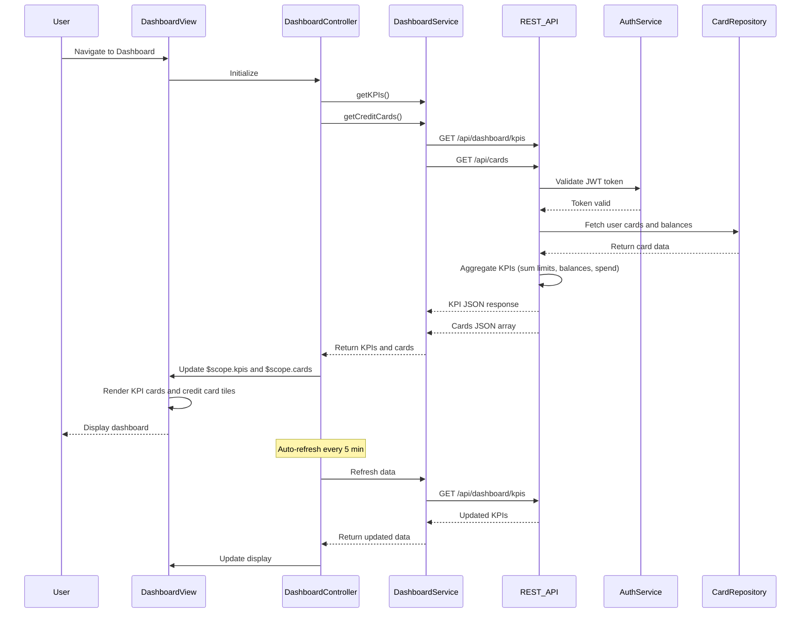

# Low-Level Design: QE-7911 - Credit Card Portfolio and KPI Dashboard

## a. Architecture Mapping

- **User Interface Layer**: AngularJS Module `dashboardModule` with Controller `DashboardController` and View `dashboard.html`
- **Dashboard Service**: AngularJS Service `DashboardService` for orchestrating API calls
- **KPI Aggregation Engine**: Backend REST API endpoint `/api/dashboard/kpis` consumed by DashboardService
- **Credit Card Data Repository**: Backend REST API `/api/cards` for card details
- **Authentication Service**: Existing SSO integration via HTTP interceptor

**Folder Structure:**
```
app/
├── modules/
│   └── dashboard/
│       ├── dashboard.module.js
│       ├── controllers/
│       │   └── dashboard.controller.js
│       ├── services/
│       │   └── dashboard.service.js
│       ├── directives/
│       │   ├── kpi-card.directive.js
│       │   └── credit-card-tile.directive.js
│       └── views/
│           └── dashboard.html
```

## b. Component Specifications

| Name | Artifact Type | Responsibility | Key Dependencies |
|------|---------------|----------------|------------------|
| dashboardModule | Module | Register dashboard components, configure routing | angular, ui.router |
| DashboardController | Controller | Initialize dashboard, fetch KPIs and card data, manage view state | DashboardService, $scope |
| DashboardService | Service | Fetch KPIs and credit card list from REST APIs, aggregate data | $http, $q |
| kpiCard | Directive | Reusable component to display individual KPI (title, value, icon) | None |
| creditCardTile | Directive | Display individual credit card with details (name, limit, balance) | None |

## c. Data Model

**KPI:**
```javascript
{
  monthlySpend: Number,
  totalCreditLimit: Number,
  availableCredit: Number,
  outstandingAmount: Number
}
```

**CreditCard:**
```javascript
{
  cardId: String,
  cardName: String,
  cardNumber: String,      // Masked, e.g., "**** **** **** 1234"
  cardType: String,        // e.g., "Visa", "MasterCard"
  creditLimit: Number,
  availableCredit: Number,
  outstandingBalance: Number,
  lastUpdated: Date
}
```

## d. Data Flow

User logs in and navigates to Dashboard → DashboardController initializes → Controller calls DashboardService.getKPIs() and DashboardService.getCreditCards() in parallel using $q.all() → Service makes GET requests to `/api/dashboard/kpis` and `/api/cards` → Backend authenticates user via JWT, queries Credit Card Data Repository, aggregates KPIs → Returns JSON responses → Service resolves promises and returns data → Controller updates $scope.kpis and $scope.cards → View renders KPI cards using kpiCard directive and credit card tiles using creditCardTile directive → User sees consolidated dashboard with all KPIs and cards → Dashboard auto-refreshes every 5 minutes via $interval.

## e. Primary Sequence Diagram



## f. Implementation Notes

- Use AngularJS 1.x with ES6 syntax (const, let, arrow functions) in controllers and services
- Implement responsive layout using Bootstrap grid (col-xs, col-sm, col-md) for mobile, tablet, desktop
- Use $q.all() to parallelize API calls for faster dashboard load; set 3-second timeout on requests
- Create reusable directives (kpiCard, creditCardTile) with isolated scope and attribute bindings
- Implement $interval for auto-refresh; clear interval on $scope.$destroy to prevent memory leaks

## g. Error Handling

HTTP interceptor catches API errors; DashboardService returns rejected promises; Controller displays error banner with retry button.

## h. Security Notes

Requires token-based auth via existing SSO; all API calls include Authorization header with JWT; card numbers are masked on backend before transmission.