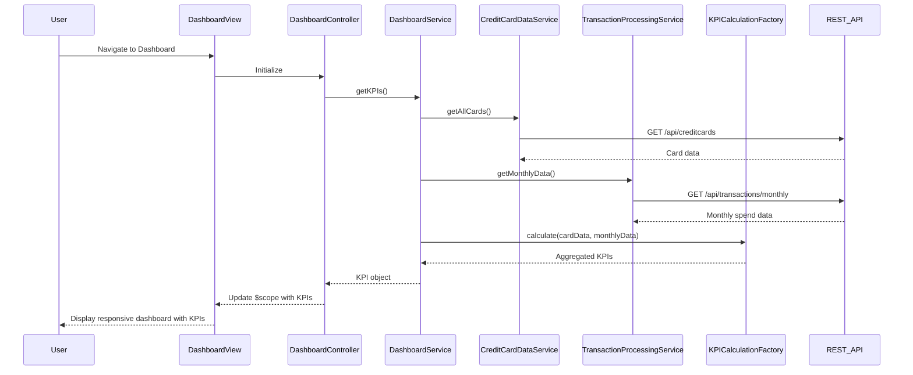

# Low-Level Design: Credit Card Dashboard and KPI Overview
**Epic ID:** QE-7912

## a. Architecture Mapping

- **Module:** `creditCardDashboard` - Main application module
- **Controller:** `DashboardController` - Manages dashboard view state and KPI display logic
- **Service:** `DashboardService` - Orchestrates data retrieval and KPI calculations
- **Service:** `CreditCardDataService` - Fetches credit card information via REST API
- **Service:** `TransactionProcessingService` - Retrieves monthly spend and outstanding amounts via REST API
- **Factory:** `KPICalculationFactory` - Aggregates and computes KPIs with 2-decimal precision

**Folder Structure:**
```
app/
├── modules/
│   └── dashboard/
│       ├── controllers/
│       │   └── dashboard.controller.js
│       ├── services/
│       │   ├── dashboard.service.js
│       │   ├── creditCardData.service.js
│       │   └── transactionProcessing.service.js
│       ├── factories/
│       │   └── kpiCalculation.factory.js
│       ├── views/
│       │   └── dashboard.html
│       └── styles/
│           └── dashboard.css
```

## b. Component Specifications

| Name | Artifact Type | Responsibility | Key Dependencies |
|------|---------------|----------------|------------------|
| DashboardController | Controller | Binds KPI data to view, handles user interactions, manages loading states | DashboardService, $scope |
| DashboardService | Service | Coordinates data retrieval from multiple services and triggers KPI calculation | CreditCardDataService, TransactionProcessingService, KPICalculationFactory, $q |
| CreditCardDataService | Service | Fetches credit card details (limits, balances) from REST API endpoint | $http, API_CONFIG |
| TransactionProcessingService | Service | Retrieves monthly spend and outstanding amounts from REST API endpoint | $http, API_CONFIG |
| KPICalculationFactory | Factory | Aggregates card data to compute total credit limit, available credit, outstanding amount, monthly spend with 2-decimal formatting | None |

## c. Data Model

**CreditCardKPI (JavaScript Object):**
```javascript
{
  totalCreditLimit: Number,      // Sum of all card limits
  availableCredit: Number,       // Total limit - outstanding amount
  outstandingAmount: Number,     // Sum of all outstanding balances
  monthlySpend: Number,          // Current month total spend
  lastUpdated: Date              // Timestamp of data refresh
}
```

**CreditCard (JavaScript Object):**
```javascript
{
  cardId: String,
  cardNumber: String,
  creditLimit: Number,
  currentBalance: Number,
  outstandingAmount: Number
}
```

## d. Data Flow

User navigates to dashboard → DashboardController initializes and calls DashboardService.getKPIs() → DashboardService invokes CreditCardDataService.getAllCards() and TransactionProcessingService.getMonthlyData() in parallel using $q.all() → Both services make REST API calls ($http) → Responses are passed to KPICalculationFactory.calculate() which aggregates totals and formats to 2 decimals → Calculated KPI object is returned to DashboardController → Controller binds KPI data to $scope → View renders responsive dashboard with Bootstrap grid displaying all KPIs.

## e. Primary Sequence Diagram



## f. Implementation Notes

- Use AngularJS dependency injection to inject all services into DashboardController and DashboardService
- Leverage $q.all() for parallel API calls to optimize page load time
- Apply Bootstrap responsive grid (col-xs-*, col-sm-*, col-md-*) for cross-device compatibility
- Use AngularJS filters (| number:2) in view templates to enforce 2-decimal currency formatting
- Implement $http interceptors for centralized API error handling and loading state management

## g. Error Handling

HTTP interceptor-based error handling with user-friendly notifications via toast/alert service for API failures.

## h. Security Notes

Standard input validation and secure API calls assumed; requires token-based auth via existing SSO.