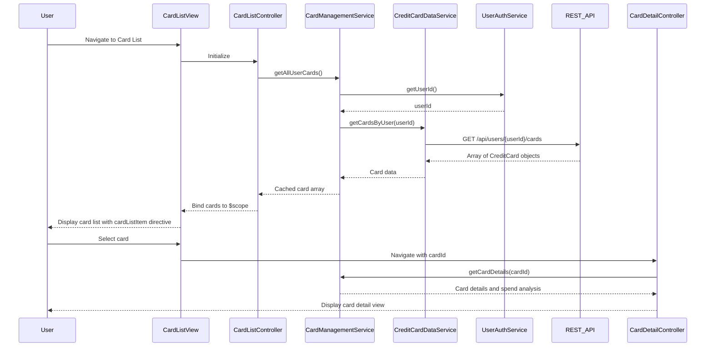

# Low-Level Design: Multiple Credit Card Management
**Epic ID:** QE-7913

## a. Architecture Mapping

- **Module:** `creditCardManagement` - Main module for card management features
- **Controller:** `CardListController` - Manages card list view and selection
- **Controller:** `CardDetailController` - Handles individual card detail view
- **Service:** `CardManagementService` - Orchestrates card data retrieval and filtering
- **Service:** `CreditCardDataService` - Fetches multiple card information via REST API
- **Service:** `UserAuthService` - Manages user authentication and session
- **Directive:** `cardListItem` - Reusable card display component

**Folder Structure:**
```
app/
├── modules/
│   └── cardManagement/
│       ├── controllers/
│       │   ├── cardList.controller.js
│       │   └── cardDetail.controller.js
│       ├── services/
│       │   ├── cardManagement.service.js
│       │   ├── creditCardData.service.js
│       │   └── userAuth.service.js
│       ├── directives/
│       │   └── cardListItem.directive.js
│       ├── views/
│       │   ├── cardList.html
│       │   └── cardDetail.html
│       └── styles/
│           └── cardManagement.css
```

## b. Component Specifications

| Name | Artifact Type | Responsibility | Key Dependencies |
|------|---------------|----------------|------------------|
| CardListController | Controller | Displays list of all user cards, handles card selection and navigation | CardManagementService, $scope, $state |
| CardDetailController | Controller | Shows individual card details and card-wise spend analysis | CardManagementService, $stateParams, $scope |
| CardManagementService | Service | Retrieves and caches card data for authenticated user, provides card filtering | CreditCardDataService, UserAuthService, $q |
| CreditCardDataService | Service | Fetches card information from REST API with user context | $http, API_CONFIG |
| UserAuthService | Service | Provides authenticated user ID and session token | $http, $window |
| cardListItem | Directive | Renders individual card summary with limit, balance, and outstanding amount | None |

## c. Data Model

**CreditCard (JavaScript Object):**
```javascript
{
  cardId: String,
  cardNumber: String,           // Masked format (e.g., **** **** **** 1234)
  cardType: String,             // Visa, MasterCard, etc.
  creditLimit: Number,
  currentBalance: Number,
  outstandingAmount: Number,
  availableCredit: Number,      // Calculated: creditLimit - outstandingAmount
  lastTransactionDate: Date
}
```

**CardSpendAnalysis (JavaScript Object):**
```javascript
{
  cardId: String,
  monthlySpend: Number,
  categoryBreakdown: Array,     // Array of {category: String, amount: Number}
  transactionCount: Number
}
```

## d. Data Flow

User authenticates → UserAuthService stores user session → User navigates to card list view → CardListController calls CardManagementService.getAllUserCards() → CardManagementService retrieves userId from UserAuthService and calls CreditCardDataService.getCardsByUser(userId) → CreditCardDataService makes REST API call GET /api/users/{userId}/cards → Card array is returned and cached in CardManagementService → CardListController binds cards to $scope → View renders card list using cardListItem directive → User selects card → CardDetailController loads card details and spend analysis via CardManagementService.getCardDetails(cardId) → Detailed view displays individual card information.

## e. Primary Sequence Diagram



## f. Implementation Notes

- Implement CardManagementService with in-memory caching to prevent redundant API calls for card list
- Use AngularJS $state (ui-router) for navigation between card list and detail views with cardId parameter
- Apply ng-repeat with track by cardId for efficient rendering of large card lists
- Use directive isolation scope for cardListItem to ensure reusability and encapsulation
- Implement lazy loading or pagination if card count exceeds 50 for optimal UI performance

## g. Error Handling

Try/catch blocks in service methods with $q.reject() for promise-based error propagation; user notifications via alert service.

## h. Security Notes

Requires token-based auth via existing SSO; card numbers are masked by backend API before transmission.