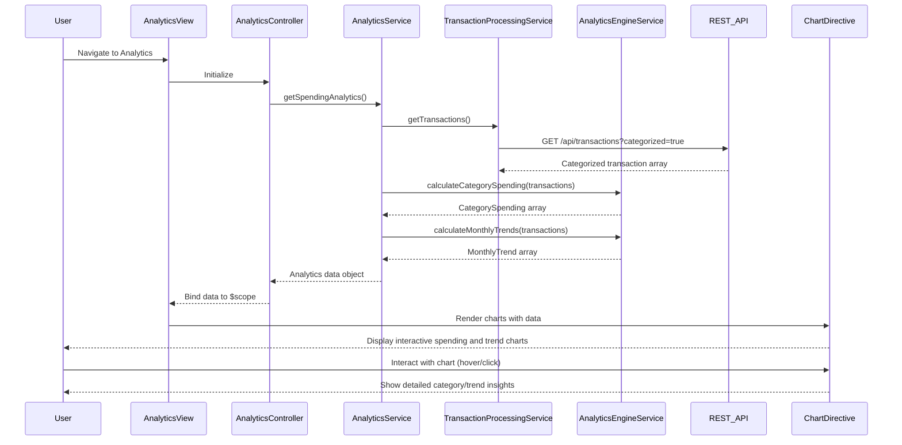

# Low-Level Design: Spending Analytics and Transaction Insights
**Epic ID:** QE-7914

## a. Architecture Mapping

- **Module:** `spendingAnalytics` - Main module for analytics features
- **Controller:** `AnalyticsController` - Manages analytics view state and user interactions
- **Service:** `AnalyticsService` - Orchestrates data retrieval and aggregation
- **Service:** `TransactionProcessingService` - Fetches categorized transaction data via REST API
- **Service:** `AnalyticsEngineService` - Performs trend calculations and pattern analysis
- **Factory:** `CategoryMapperFactory` - Maps transactions to 9 predefined categories
- **Directive:** `spendingChart` - Renders interactive category-wise spending chart
- **Directive:** `trendChart` - Displays monthly spend trend visualization

**Folder Structure:**
```
app/
├── modules/
│   └── analytics/
│       ├── controllers/
│       │   └── analytics.controller.js
│       ├── services/
│       │   ├── analytics.service.js
│       │   ├── transactionProcessing.service.js
│       │   └── analyticsEngine.service.js
│       ├── factories/
│       │   └── categoryMapper.factory.js
│       ├── directives/
│       │   ├── spendingChart.directive.js
│       │   └── trendChart.directive.js
│       ├── views/
│       │   └── analytics.html
│       └── styles/
│           └── analytics.css
```

## b. Component Specifications

| Name | Artifact Type | Responsibility | Key Dependencies |
|------|---------------|----------------|------------------|
| AnalyticsController | Controller | Manages analytics view, handles date range selection, binds chart data to view | AnalyticsService, $scope |
| AnalyticsService | Service | Coordinates transaction data retrieval and aggregation for analytics display | TransactionProcessingService, AnalyticsEngineService, $q |
| TransactionProcessingService | Service | Fetches categorized transaction data from REST API | $http, API_CONFIG |
| AnalyticsEngineService | Service | Calculates category-wise totals, monthly trends, and spending patterns | CategoryMapperFactory |
| CategoryMapperFactory | Factory | Validates and maps transactions to 9 predefined categories | None |
| spendingChart | Directive | Renders interactive pie/bar chart for category-wise spending using Chart.js or D3 | Chart library |
| trendChart | Directive | Displays line chart for monthly spend trends | Chart library |

## c. Data Model

**Transaction (JavaScript Object):**
```javascript
{
  transactionId: String,
  cardId: String,
  amount: Number,
  category: String,             // One of 9 predefined categories
  merchantName: String,
  transactionDate: Date,
  description: String
}
```

**CategorySpending (JavaScript Object):**
```javascript
{
  category: String,             // Food & Dining, Fuel, Shopping, Travel, Entertainment, Utilities, Healthcare, Education, Miscellaneous
  totalAmount: Number,
  transactionCount: Number,
  percentage: Number            // Percentage of total spend
}
```

**MonthlyTrend (JavaScript Object):**
```javascript
{
  month: String,                // YYYY-MM format
  totalSpend: Number,
  categoryBreakdown: Array      // Array of CategorySpending objects
}
```

## d. Data Flow

User navigates to analytics view → AnalyticsController initializes and calls AnalyticsService.getSpendingAnalytics() → AnalyticsService invokes TransactionProcessingService.getTransactions() to fetch categorized transaction data via REST API → AnalyticsEngineService.calculateCategorySpending() aggregates transactions by category using CategoryMapperFactory → AnalyticsEngineService.calculateMonthlyTrends() computes monthly spend patterns → Processed analytics data (CategorySpending array and MonthlyTrend array) is returned to AnalyticsController → Controller binds data to $scope → spendingChart and trendChart directives render interactive visualizations using Chart.js/D3 → User interacts with charts (hover, click) to view detailed insights.

## e. Primary Sequence Diagram



## f. Implementation Notes

- Use Chart.js or D3.js library integrated via AngularJS directive for interactive chart rendering with 2-second load target
- Implement AnalyticsEngineService with ES6 array methods (map, reduce, filter) for efficient data aggregation
- Cache transaction data in AnalyticsService to avoid redundant API calls during view interactions
- Use AngularJS $watch on date range filter to trigger re-calculation and chart updates
- Apply responsive chart configuration to ensure usability across desktop, tablet, and mobile devices

## g. Error Handling

HTTP interceptor-based error handling with try/catch in AnalyticsEngineService calculations; user notifications for API or rendering failures.

## h. Security Notes

Standard input validation and secure API calls assumed; transaction data requires user authentication token.