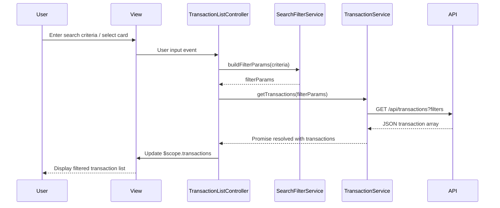

# Low-Level Design: Transaction Management and Viewing
**Epic ID:** QE-7921  
**Application Stack:** AngularJS 1.x, JavaScript ES6, HTML5, CSS3, Bootstrap, REST APIs, MVC Architecture

---

## a. Architecture Mapping

- **User Interface** → AngularJS View (HTML template with Bootstrap) + Directive for transaction list component
- **Transaction Controller** → AngularJS Controller managing view state and user interactions
- **Search and Filter Engine** → AngularJS Service with filter logic and query building
- **Transaction Service** → AngularJS Factory for REST API calls to transaction endpoints
- **Credit Card Service** → AngularJS Factory for REST API calls to credit card endpoints
- **Transaction Repository** → Backend REST API (consumed by factories)

**Recommended Folder Structure:**
```
app/
  modules/
    transactions/
      controllers/
      services/
      directives/
      views/
  shared/
    services/
    filters/
```

---

## b. Component Specifications

| Component Name | Artifact Type | Responsibility | Key Dependencies |
|---|---|---|---|
| TransactionListController | Controller | Manages transaction list state, pagination, user actions | TransactionService, SearchFilterService, $scope |
| TransactionDetailController | Controller | Displays single transaction details | TransactionService, $routeParams, $scope |
| TransactionService | Factory | Fetches transaction data from REST API | $http, $q |
| CreditCardService | Factory | Retrieves credit card details and validates ownership | $http, $q |
| SearchFilterService | Service | Processes search queries and applies filters (date, amount, merchant, category) | $filter |
| transactionListDirective | Directive | Renders transaction list with responsive layout | TransactionListController |
| transactionSearchDirective | Directive | Provides search and filter UI controls | SearchFilterService |

---

## c. Data Model

**Transaction Model:**
```javascript
{
  transactionId: String,
  cardId: String,
  date: Date,
  merchant: String,
  amount: Number,
  category: String,
  description: String,
  status: String // e.g., 'posted', 'pending'
}
```

**CreditCard Model:**
```javascript
{
  cardId: String,
  cardNumber: String, // masked
  cardType: String,
  cardholderName: String
}
```

**SearchFilter Model:**
```javascript
{
  dateFrom: Date,
  dateTo: Date,
  minAmount: Number,
  maxAmount: Number,
  merchant: String,
  category: String,
  cardId: String
}
```

---

## d. Data Flow

User selects a card or enters search criteria in the transaction view. The TransactionListController captures the input and invokes SearchFilterService to build query parameters. The TransactionService makes a GET request to the REST API endpoint `/api/transactions` with filter params. The API returns a JSON array of transaction objects. The controller updates $scope.transactions, triggering the transactionListDirective to render the filtered list in a responsive Bootstrap table. User clicks a transaction row, triggering navigation to the detail view where TransactionDetailController fetches full transaction data via TransactionService and displays it.

---

## e. Primary Sequence Diagram



---

## f. Implementation Notes

- Use AngularJS module pattern with dependency injection for all controllers, services, and factories
- Implement TransactionService and CreditCardService as factories using $http with promise-based API calls
- Apply AngularJS filters (date, currency) in views for consistent data formatting
- Use Bootstrap grid system and responsive utilities for mobile-first transaction list layout
- Implement client-side pagination using AngularJS ng-repeat with limitTo and custom pagination directive

---

## g. Error Handling

HTTP interceptor captures API errors; user-friendly messages displayed via Bootstrap alert directive with try/catch in service layer.

---

## h. Security Notes

Requires token-based auth via existing SSO; sensitive card data masked in API responses and views.