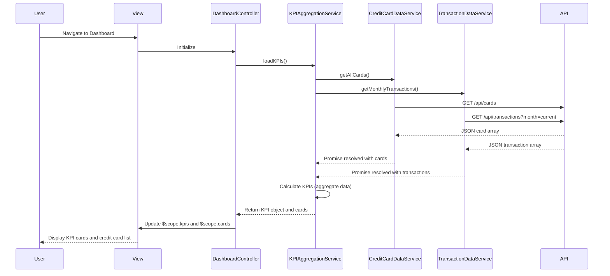

# Low-Level Design: Dashboard KPIs and Credit Card Overview
**Epic ID:** QE-7922  
**Application Stack:** AngularJS 1.x, JavaScript ES6, HTML5, CSS3, Bootstrap, REST APIs, MVC Architecture

---

## a. Architecture Mapping

- **User Interface Layer** → AngularJS View (HTML template with Bootstrap grid) + Directive for KPI cards
- **Dashboard Controller** → AngularJS Controller managing dashboard state and data binding
- **KPI Aggregation Service** → AngularJS Service performing client-side aggregation logic
- **Credit Card Data Service** → AngularJS Factory for REST API calls to credit card endpoints
- **Transaction Data Service** → AngularJS Factory for REST API calls to transaction endpoints
- **Data Store** → Backend REST API (consumed by factories)

**Recommended Folder Structure:**
```
app/
  modules/
    dashboard/
      controllers/
      services/
      directives/
      views/
  shared/
    services/
    directives/
```

---

## b. Component Specifications

| Component Name | Artifact Type | Responsibility | Key Dependencies |
|---|---|---|---|
| DashboardController | Controller | Orchestrates dashboard data loading, KPI display, and refresh actions | KPIAggregationService, CreditCardDataService, TransactionDataService, $scope |
| KPIAggregationService | Service | Aggregates data from multiple sources to calculate KPIs (monthly spend, total limit, available credit, outstanding) | None |
| CreditCardDataService | Factory | Fetches all credit card details and balances from REST API | $http, $q |
| TransactionDataService | Factory | Retrieves transaction data for monthly spend calculation | $http, $q |
| kpiCardDirective | Directive | Renders individual KPI card with icon, label, and value | None |
| creditCardListDirective | Directive | Displays responsive list of all user credit cards with key details | None |

---

## c. Data Model

**CreditCard Model:**
```javascript
{
  cardId: String,
  cardNumber: String, // masked
  cardType: String,
  cardholderName: String,
  creditLimit: Number,
  currentBalance: Number,
  availableCredit: Number,
  outstandingAmount: Number,
  status: String // e.g., 'active', 'blocked'
}
```

**KPI Model:**
```javascript
{
  monthlySpend: Number,
  totalCreditLimit: Number,
  totalAvailableCredit: Number,
  totalOutstanding: Number
}
```

**Transaction Model (for monthly spend):**
```javascript
{
  transactionId: String,
  cardId: String,
  date: Date,
  amount: Number
}
```

---

## d. Data Flow

User navigates to the dashboard. DashboardController initializes and calls KPIAggregationService.loadKPIs(). The service invokes CreditCardDataService.getAllCards() and TransactionDataService.getMonthlyTransactions() in parallel using $q.all(). Both factories make GET requests to their respective REST API endpoints (`/api/cards` and `/api/transactions?month=current`). Upon receiving responses, KPIAggregationService calculates total credit limit (sum of all card limits), available credit (sum of available credit per card), outstanding amount (sum of balances), and monthly spend (sum of current month transaction amounts). The aggregated KPI object is returned to DashboardController, which updates $scope.kpis and $scope.cards. The view renders KPI cards using kpiCardDirective and credit card list using creditCardListDirective with Bootstrap responsive layout.

---

## e. Primary Sequence Diagram



---

## f. Implementation Notes

- Use AngularJS module pattern with dependency injection for all controllers, services, and factories
- Implement parallel API calls using $q.all() to optimize dashboard load time
- Apply AngularJS currency filter for all monetary values in KPI cards
- Use Bootstrap grid (col-md-3, col-sm-6, col-xs-12) for responsive KPI card layout
- Implement auto-refresh using $interval service (e.g., every 5 minutes) with manual refresh button

---

## g. Error Handling

HTTP interceptor-based error handling with user notification via Bootstrap alert component; graceful degradation if one API fails.

---

## h. Security Notes

Requires token-based auth via existing SSO; card numbers masked in API responses and UI display.