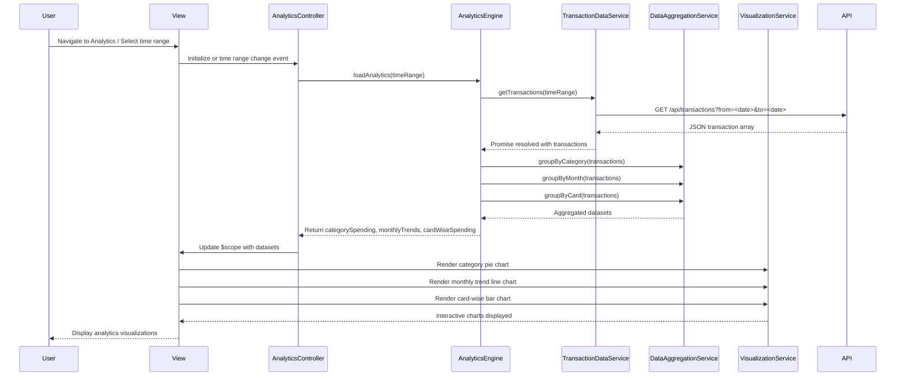

# Low-Level Design: Spending Analytics and Insights
**Epic ID:** QE-7923  
**Application Stack:** AngularJS 1.x, JavaScript ES6, HTML5, CSS3, Bootstrap, REST APIs, MVC Architecture

---

## a. Architecture Mapping

- **User Interface** → AngularJS View (HTML template with Bootstrap) + Directive for chart components
- **Analytics Controller** → AngularJS Controller managing analytics view state and user interactions
- **Analytics Engine** → AngularJS Service performing data aggregation, trend calculation, and category analysis
- **Transaction Data Service** → AngularJS Factory for REST API calls to transaction endpoints
- **Visualization Service** → AngularJS Service wrapping chart library (e.g., Chart.js or D3.js) for rendering
- **Data Aggregation Layer** → AngularJS Service for optimized data transformation and grouping

**Recommended Folder Structure:**
```
app/
  modules/
    analytics/
      controllers/
      services/
      directives/
      views/
  shared/
    services/
    directives/
```

---

## b. Component Specifications

| Component Name | Artifact Type | Responsibility | Key Dependencies |
|---|---|---|---|
| AnalyticsController | Controller | Manages analytics view state, time range selection, and chart data binding | AnalyticsEngine, TransactionDataService, $scope |
| AnalyticsEngine | Service | Calculates category-wise spending, monthly trends, and card-wise analysis from transaction data | DataAggregationService |
| TransactionDataService | Factory | Fetches transaction data from REST API for specified time range | $http, $q |
| DataAggregationService | Service | Groups and aggregates transaction data by category, month, and card | None |
| VisualizationService | Service | Wraps Chart.js library to render pie, bar, and line charts | Chart.js |
| categoryChartDirective | Directive | Renders category-wise spending pie chart | VisualizationService |
| trendChartDirective | Directive | Renders monthly spend trend line chart | VisualizationService |
| cardWiseChartDirective | Directive | Renders card-wise spend comparison bar chart | VisualizationService |

---

## c. Data Model

**Transaction Model:**
```javascript
{
  transactionId: String,
  cardId: String,
  date: Date,
  amount: Number,
  category: String, // One of: Food & Dining, Fuel, Shopping, Travel, Entertainment, Utilities, Healthcare, Education, Miscellaneous
  merchant: String
}
```

**CategorySpending Model:**
```javascript
{
  category: String,
  totalAmount: Number,
  transactionCount: Number,
  percentage: Number
}
```

**MonthlyTrend Model:**
```javascript
{
  month: String, // e.g., '2024-01'
  totalSpend: Number
}
```

**CardWiseSpending Model:**
```javascript
{
  cardId: String,
  cardName: String, // e.g., 'Visa *1234'
  totalSpend: Number
}
```

---

## d. Data Flow

User navigates to the analytics page and optionally selects a time range (default: last 12 months). AnalyticsController invokes AnalyticsEngine.loadAnalytics(timeRange). The engine calls TransactionDataService.getTransactions(timeRange) which makes a GET request to `/api/transactions?from=<date>&to=<date>`. The API returns a JSON array of transactions. DataAggregationService groups transactions by category, month, and card. AnalyticsEngine calculates totals, percentages, and trends, returning three datasets: categorySpending, monthlyTrends, and cardWiseSpending. AnalyticsController updates $scope with these datasets. The view triggers categoryChartDirective, trendChartDirective, and cardWiseChartDirective, each invoking VisualizationService to render interactive Chart.js visualizations (pie chart for categories, line chart for trends, bar chart for card-wise spending).

---

## e. Primary Sequence Diagram



---

## f. Implementation Notes

- Use AngularJS module pattern with dependency injection for all controllers, services, and directives
- Integrate Chart.js via VisualizationService; wrap chart initialization and update logic for reusability
- Implement DataAggregationService using ES6 Array methods (map, reduce, filter) for efficient grouping
- Use AngularJS $watch in chart directives to re-render charts when data changes
- Apply Bootstrap responsive grid for side-by-side chart layout on desktop, stacked on mobile

---

## g. Error Handling

HTTP interceptor captures API errors; display user-friendly message via Bootstrap alert with try/catch in service layer.

---

## h. Security Notes

Requires token-based auth via existing SSO; standard input validation and secure API calls assumed.