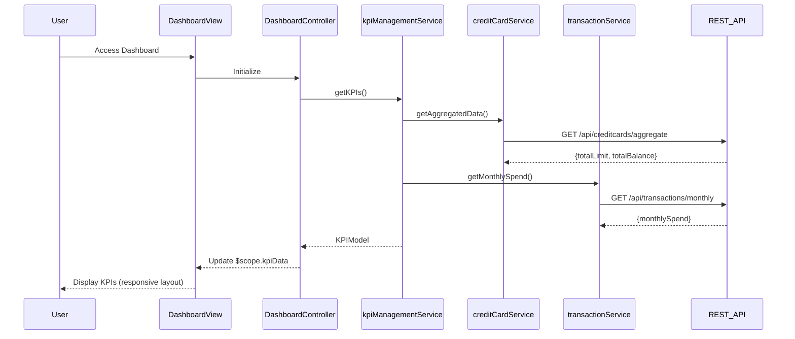

# Low-Level Design: Dashboard and KPI Management
**Epic ID:** QE-7942

## a. Architecture Mapping

- **Dashboard Interface** → AngularJS Module (`dashboardModule`) + Controller (`DashboardController`) + View Template (`dashboard.html`)
- **KPI Management Service** → AngularJS Service (`kpiManagementService`) using $http for REST API calls
- **User Authentication Service** → AngularJS Factory (`authFactory`) with token management
- **Credit Card Service Integration** → AngularJS Service (`creditCardService`) for aggregated card data
- **Transaction Service Integration** → AngularJS Service (`transactionService`) for spending calculations

**Recommended Folder Structure:**
```
app/
├── modules/dashboard/
│   ├── controllers/dashboardController.js
│   ├── services/kpiManagementService.js
│   ├── views/dashboard.html
├── shared/
│   ├── services/authFactory.js
│   ├── services/creditCardService.js
│   ├── services/transactionService.js
├── assets/css/dashboard.css
└── app.module.js
```

## b. Component Specifications

| Component Name | Artifact Type | Responsibility | Key Dependencies |
|----------------|---------------|----------------|------------------|
| dashboardModule | AngularJS Module | Root module for dashboard feature, configures routes and DI | ngRoute, ngResource |
| DashboardController | Controller | Manages dashboard view state, orchestrates KPI data retrieval, handles user interactions | kpiManagementService, $scope, $interval |
| kpiManagementService | Service | Aggregates KPI data from multiple sources, calculates consolidated metrics | creditCardService, transactionService, $http, $q |
| authFactory | Factory | Manages authentication tokens, validates user session | $http, $window |
| creditCardService | Service | Fetches aggregated credit card data via REST API | $http, authFactory |
| transactionService | Service | Retrieves spending data and calculates monthly totals via REST API | $http, authFactory |
| dashboard.html | View Template | Responsive UI displaying KPIs with Bootstrap grid, real-time data binding | Bootstrap 3.x, AngularJS directives |

## c. Data Model

```javascript
// KPI Model
class KPIModel {
  monthlySpend: Number,
  totalCreditLimit: Number,
  availableCredit: Number,
  outstandingAmount: Number,
  lastUpdated: Date
}

// Credit Card Summary Model
class CreditCardSummary {
  totalCards: Number,
  aggregatedLimit: Number,
  aggregatedBalance: Number
}

// Transaction Summary Model
class TransactionSummary {
  currentMonthSpend: Number,
  transactionCount: Number
}
```

## d. Data Flow

User authenticates via authFactory → DashboardController initializes and calls kpiManagementService.getKPIs() → kpiManagementService makes parallel REST API calls to creditCardService.getAggregatedData() and transactionService.getMonthlySpend() → Services return promises resolved with card summary and transaction summary → kpiManagementService calculates consolidated KPIs (availableCredit = totalCreditLimit - outstandingAmount) → Controller updates $scope.kpiData → View renders KPIs in responsive Bootstrap grid with two-way data binding → $interval refreshes data every 5 minutes for real-time updates.

## e. Primary Sequence Diagram



## f. Implementation Notes

- Use AngularJS 1.x dependency injection for all services and controllers; register via module.controller() and module.service()
- Implement $http interceptors in authFactory for automatic token injection in request headers
- Use $q.all() in kpiManagementService to parallelize creditCardService and transactionService API calls for performance
- Apply Bootstrap responsive grid (col-xs-*, col-sm-*, col-md-*) in dashboard.html for mobile/tablet/desktop support
- Use $interval service for 5-minute auto-refresh; cancel interval on $scope.$destroy to prevent memory leaks

## g. Error Handling

HTTP interceptor-based error handling with $http response interceptors; display user-friendly error messages via Bootstrap alerts on API failures.

## h. Security Notes

Requires token-based authentication via existing SSO; authFactory manages JWT tokens in session storage with automatic injection in API calls.