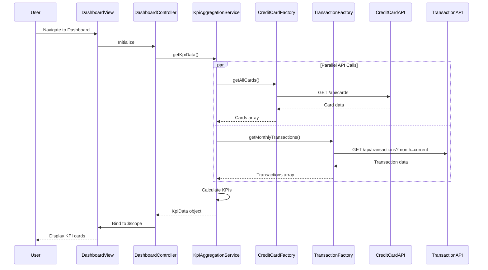

# Low-Level Design: Dashboard and KPI Management
**Epic ID:** QE-7942

## a. Architecture Mapping

- **Dashboard UI Component** → AngularJS Module (`dashboardModule`) + Controller (`DashboardController`)
- **KPI Aggregation Service** → AngularJS Service (`KpiAggregationService`)
- **Credit Card Service Integration** → AngularJS Factory (`CreditCardFactory`) for REST API calls
- **Transaction Service Integration** → AngularJS Factory (`TransactionFactory`) for REST API calls
- **User Authentication** → AngularJS Service (`AuthService`) with HTTP interceptor

**Recommended Folder Structure:**
```
app/
├── modules/dashboard/
│   ├── dashboard.module.js
│   ├── dashboard.controller.js
│   ├── dashboard.view.html
│   └── dashboard.css
├── services/
│   ├── kpi-aggregation.service.js
│   └── auth.service.js
├── factories/
│   ├── credit-card.factory.js
│   └── transaction.factory.js
└── shared/
    └── interceptors/auth.interceptor.js
```

## b. Component Specifications

| Name | Artifact Type | Responsibility | Key Dependencies |
|------|--------------|----------------|------------------|
| dashboardModule | Module | Registers dashboard feature components and routing | angular, ui.router |
| DashboardController | Controller | Manages dashboard view state, triggers KPI data fetch, handles real-time refresh | KpiAggregationService, $scope, $interval |
| KpiAggregationService | Service | Aggregates KPI data from multiple sources, calculates metrics | CreditCardFactory, TransactionFactory, $q |
| CreditCardFactory | Factory | Handles REST API calls to Credit Card Service for card data | $http, API_CONFIG |
| TransactionFactory | Factory | Handles REST API calls to Transaction Service for spending data | $http, API_CONFIG |
| AuthService | Service | Manages user authentication state and token handling | $http, $window, AuthInterceptor |
| AuthInterceptor | Factory | Intercepts HTTP requests to inject auth tokens | $q, $window |
| dashboard.view.html | View | Displays KPI cards (monthly spend, credit limit, available credit, outstanding) with responsive layout | Bootstrap grid, AngularJS directives |

## c. Data Model

**KpiData (JavaScript Object):**
```javascript
{
  monthlySpend: Number,        // Total spending for current month
  totalCreditLimit: Number,    // Sum of all card credit limits
  availableCredit: Number,     // Total available credit across cards
  outstandingAmount: Number,   // Total outstanding balance
  lastUpdated: Date            // Timestamp of last data refresh
}
```

**CreditCard (JavaScript Object):**
```javascript
{
  cardId: String,
  cardNumber: String,
  creditLimit: Number,
  outstandingBalance: Number
}
```

**Transaction (JavaScript Object):**
```javascript
{
  transactionId: String,
  cardId: String,
  amount: Number,
  date: Date,
  category: String
}
```

## d. Data Flow

User navigates to dashboard → `DashboardController` initializes and calls `KpiAggregationService.getKpiData()` → Service invokes `CreditCardFactory.getAllCards()` and `TransactionFactory.getMonthlyTransactions()` in parallel using `$q.all()` → REST API responses return card details and transaction data → Service calculates KPIs (sums credit limits, aggregates spending, computes available credit) → Aggregated `KpiData` object returned to controller → Controller binds data to `$scope` → View renders KPI cards using Bootstrap responsive grid → `$interval` service triggers refresh every 60 seconds to maintain real-time updates.

## e. Primary Sequence Diagram



## f. Implementation Notes

- Use AngularJS Dependency Injection for all services, factories, and controllers to ensure testability and modularity
- Implement ES6 classes for services where appropriate, transpile using Babel if needed
- Use `$q.all()` for parallel REST API calls to minimize latency and meet real-time refresh requirements
- Apply Bootstrap responsive grid classes (col-xs-*, col-sm-*, col-md-*, col-lg-*) to ensure dashboard responsiveness across devices
- Leverage `$interval` service for periodic KPI refresh (60-second interval) with cleanup on scope destroy to prevent memory leaks

## g. Error Handling

HTTP interceptor-based error handling with user-friendly notifications via Bootstrap alerts and retry logic for failed API calls.

## h. Security Notes

Requires token-based authentication via existing SSO; AuthInterceptor injects JWT tokens in all API requests.