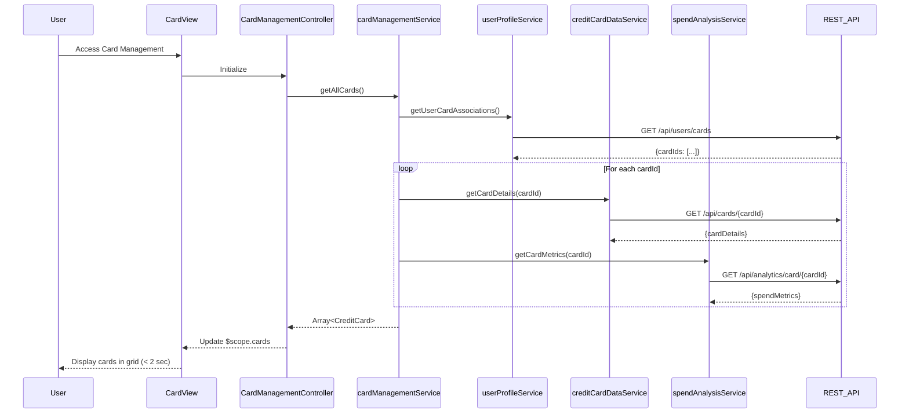

# Low-Level Design: Multiple Credit Card Management
**Epic ID:** QE-7943

## a. Architecture Mapping

- **User Interface** → AngularJS Module (`cardManagementModule`) + Controller (`CardManagementController`) + View Template (`card-management.html`)
- **Card Management Service** → AngularJS Service (`cardManagementService`) for orchestrating card operations
- **User Profile Service Integration** → AngularJS Service (`userProfileService`) for card ownership mapping
- **Credit Card Data Service Integration** → AngularJS Service (`creditCardDataService`) for card details retrieval
- **Spend Analysis Module** → AngularJS Service (`spendAnalysisService`) for card-wise metrics calculation

**Recommended Folder Structure:**
```
app/
├── modules/card-management/
│   ├── controllers/cardManagementController.js
│   ├── services/cardManagementService.js
│   ├── services/spendAnalysisService.js
│   ├── views/card-management.html
│   ├── directives/cardTile.directive.js
├── shared/
│   ├── services/userProfileService.js
│   ├── services/creditCardDataService.js
└── assets/css/card-management.css
```

## b. Component Specifications

| Component Name | Artifact Type | Responsibility | Key Dependencies |
|----------------|---------------|----------------|------------------|
| cardManagementModule | AngularJS Module | Root module for card management feature, configures routing | ngRoute |
| CardManagementController | Controller | Manages card list view state, handles card selection, coordinates data retrieval | cardManagementService, $scope |
| cardManagementService | Service | Orchestrates card data retrieval from multiple services, manages card list state | userProfileService, creditCardDataService, spendAnalysisService, $q |
| userProfileService | Service | Fetches user-card associations via REST API | $http |
| creditCardDataService | Service | Retrieves individual card details (limits, balances) via REST API | $http |
| spendAnalysisService | Service | Calculates card-wise spend metrics from transaction data | $http |
| cardTile.directive | Directive | Reusable card display component showing card details and metrics | None |
| card-management.html | View Template | Displays multiple cards in responsive grid layout | Bootstrap, cardTile directive |

## c. Data Model

```javascript
// Credit Card Model
class CreditCard {
  cardId: String,
  cardNumber: String,
  cardType: String,
  creditLimit: Number,
  outstandingBalance: Number,
  availableCredit: Number,
  expiryDate: String
}

// Card Spend Metrics Model
class CardSpendMetrics {
  cardId: String,
  monthlySpend: Number,
  yearlySpend: Number,
  transactionCount: Number
}

// User Card Association Model
class UserCardAssociation {
  userId: String,
  cardIds: Array<String>
}
```

## d. Data Flow

User accesses card management interface → CardManagementController calls cardManagementService.getAllCards() → cardManagementService first calls userProfileService.getUserCardAssociations() to get card IDs → For each card ID, service makes parallel calls to creditCardDataService.getCardDetails(cardId) and spendAnalysisService.getCardMetrics(cardId) using $q.all() → Services return card details and spend metrics → cardManagementService merges data into CreditCard objects with embedded metrics → Controller updates $scope.cards array → View renders cards using cardTile directive in Bootstrap responsive grid → User views all cards with individual details and performance metrics within 2 seconds.

## e. Primary Sequence Diagram



## f. Implementation Notes

- Use AngularJS custom directive (cardTile) with isolated scope for reusable card display component; pass card object via scope binding
- Implement $q.all() in cardManagementService to parallelize multiple card detail API calls for performance optimization
- Apply ng-repeat with track by cardId in view for efficient DOM rendering when card list updates
- Use Bootstrap grid system (col-md-4, col-sm-6, col-xs-12) for responsive card layout supporting 10+ cards
- Cache card data in service using $cacheFactory to reduce redundant API calls on view re-entry

## g. Error Handling

Try/catch blocks in service methods with $q.reject() for promise chain error propagation; display Bootstrap alert modals for API failures.

## h. Security Notes

Standard input validation and secure API calls assumed; card numbers displayed with masking (last 4 digits only).