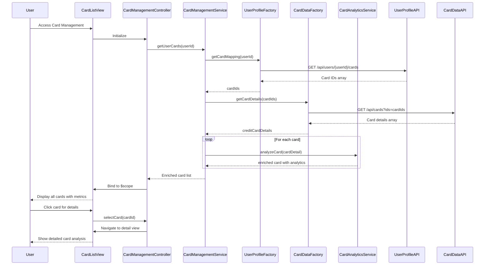

# Low-Level Design: Multiple Credit Card Management
**Epic ID:** QE-7943

## a. Architecture Mapping

- **User Interface** → AngularJS Module (`cardManagementModule`) + Controller (`CardManagementController`)
- **Card Management Module** → AngularJS Service (`CardManagementService`)
- **User Profile Service Integration** → AngularJS Factory (`UserProfileFactory`) for REST API calls
- **Credit Card Data Service Integration** → AngularJS Factory (`CardDataFactory`) for REST API calls
- **Card Analytics Engine** → AngularJS Service (`CardAnalyticsService`)

**Recommended Folder Structure:**
```
app/
├── modules/card-management/
│   ├── card-management.module.js
│   ├── card-management.controller.js
│   ├── card-list.view.html
│   ├── card-detail.view.html
│   └── card-management.css
├── services/
│   ├── card-management.service.js
│   └── card-analytics.service.js
├── factories/
│   ├── user-profile.factory.js
│   └── card-data.factory.js
└── directives/
    └── card-item.directive.js
```

## b. Component Specifications

| Name | Artifact Type | Responsibility | Key Dependencies |
|------|--------------|----------------|------------------|
| cardManagementModule | Module | Registers card management feature and routing for list/detail views | angular, ui.router |
| CardManagementController | Controller | Manages card list view state, handles card selection and navigation to detail view | CardManagementService, $scope, $state |
| CardManagementService | Service | Orchestrates card data retrieval and coordinates between profile and card data services | UserProfileFactory, CardDataFactory, $q |
| UserProfileFactory | Factory | Handles REST API calls to User Profile Service for user-card ownership mapping | $http, API_CONFIG |
| CardDataFactory | Factory | Handles REST API calls to Credit Card Data Service for card details and metrics | $http, API_CONFIG |
| CardAnalyticsService | Service | Processes card-wise spending analysis and calculates card-specific metrics | CardDataFactory, $filter |
| cardItemDirective | Directive | Reusable component to display individual card summary in list view | None |
| card-list.view.html | View | Displays all user cards in responsive grid layout with summary metrics | Bootstrap, cardItemDirective |
| card-detail.view.html | View | Displays detailed view of selected card with spend analysis and metrics | Bootstrap, AngularJS filters |

## c. Data Model

**UserCardMapping (JavaScript Object):**
```javascript
{
  userId: String,
  cardIds: Array<String>  // Array of card IDs owned by user
}
```

**CreditCardDetail (JavaScript Object):**
```javascript
{
  cardId: String,
  cardNumber: String,
  cardType: String,           // e.g., Visa, Mastercard
  creditLimit: Number,
  outstandingBalance: Number,
  availableCredit: Number,
  expiryDate: Date,
  cardholderName: String
}
```

**CardSpendAnalysis (JavaScript Object):**
```javascript
{
  cardId: String,
  monthlySpend: Number,
  categoryBreakdown: Object,  // Key-value pairs: category -> amount
  utilizationRate: Number     // (outstandingBalance / creditLimit) * 100
}
```

## d. Data Flow

User accesses card management interface → `CardManagementController` calls `CardManagementService.getUserCards()` → Service invokes `UserProfileFactory.getCardMapping()` to retrieve user's card IDs → Service then calls `CardDataFactory.getCardDetails()` for each card ID (batched if API supports) → Card details returned and enriched with analytics via `CardAnalyticsService.analyzeCard()` → Enriched card list bound to `$scope` → View renders card grid using `cardItemDirective` → User clicks card → Controller navigates to detail view using `$state.go('cardDetail', {cardId})` → Detail view displays comprehensive card metrics and spend analysis.

## e. Primary Sequence Diagram



## f. Implementation Notes

- Use AngularJS `ui.router` for state management between list and detail views with URL parameter passing for card selection
- Implement card item as reusable directive to ensure consistent rendering and reduce code duplication
- Batch API calls when fetching multiple card details to meet 2-second retrieval NFR; use `$q.all()` for parallel requests
- Apply lazy loading pattern for card analytics to improve initial page load performance
- Use AngularJS filters for formatting currency, dates, and percentages in views

## g. Error Handling

Centralized error handling via HTTP interceptor with try/catch blocks in service layer; user notifications via Bootstrap modals for critical errors.

## h. Security Notes

Standard input validation and secure API calls assumed; card data transmission over HTTPS with token-based authentication.