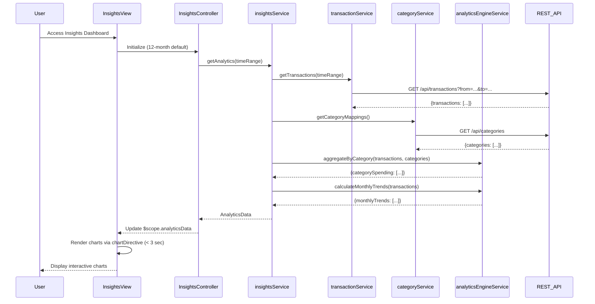

# Low-Level Design: Analytics and Spending Insights
**Epic ID:** QE-7944

## a. Architecture Mapping

- **User Interface** → AngularJS Module (`insightsModule`) + Controller (`InsightsController`) + View Template (`insights.html`)
- **Insights Service** → AngularJS Service (`insightsService`) for orchestrating analytics data
- **Transaction Service Integration** → AngularJS Service (`transactionService`) for transaction data retrieval
- **Category Classification Service Integration** → AngularJS Service (`categoryService`) for expense categorization
- **Analytics Engine Integration** → AngularJS Service (`analyticsEngineService`) for data aggregation and trend calculations
- **Chart Visualization** → AngularJS Directive (`chartDirective`) wrapping Chart.js library

**Recommended Folder Structure:**
```
app/
├── modules/insights/
│   ├── controllers/insightsController.js
│   ├── services/insightsService.js
│   ├── services/analyticsEngineService.js
│   ├── views/insights.html
│   ├── directives/chartDirective.js
├── shared/
│   ├── services/transactionService.js
│   ├── services/categoryService.js
└── assets/css/insights.css
```

## b. Component Specifications

| Component Name | Artifact Type | Responsibility | Key Dependencies |
|----------------|---------------|----------------|------------------|
| insightsModule | AngularJS Module | Root module for insights feature, configures routes and chart library | ngRoute, Chart.js |
| InsightsController | Controller | Manages insights view state, handles time period selection, coordinates chart rendering | insightsService, $scope, $filter |
| insightsService | Service | Orchestrates analytics data retrieval, aggregates spending by category and time | transactionService, categoryService, analyticsEngineService, $q |
| transactionService | Service | Fetches transaction data for specified time periods via REST API | $http |
| categoryService | Service | Provides category mappings for 9 predefined categories | $http |
| analyticsEngineService | Service | Performs data aggregation, calculates monthly trends for up to 12 months | $http |
| chartDirective | Directive | Wraps Chart.js for rendering interactive pie/bar/line charts | Chart.js library |
| insights.html | View Template | Displays category-wise and monthly trend charts with responsive layout | Bootstrap, chartDirective |

## c. Data Model

```javascript
// Category Spending Model
class CategorySpending {
  category: String, // One of 9: Food & Dining, Fuel, Shopping, Travel, Entertainment, Utilities, Healthcare, Education, Miscellaneous
  amount: Number,
  percentage: Number,
  transactionCount: Number
}

// Monthly Trend Model
class MonthlyTrend {
  month: String, // Format: YYYY-MM
  totalSpend: Number,
  categoryBreakdown: Array<CategorySpending>
}

// Analytics Data Model
class AnalyticsData {
  categorySpending: Array<CategorySpending>,
  monthlyTrends: Array<MonthlyTrend>,
  timeRange: { startDate: Date, endDate: Date }
}
```

## d. Data Flow

User accesses insights interface → InsightsController calls insightsService.getAnalytics(timeRange) with default 12-month range → insightsService calls transactionService.getTransactions(timeRange) to fetch raw transaction data → categoryService.getCategoryMappings() provides category classifications → analyticsEngineService.aggregateByCategory(transactions, categories) groups transactions into 9 categories and calculates totals → analyticsEngineService.calculateMonthlyTrends(transactions) aggregates spending by month → insightsService returns AnalyticsData object → Controller updates $scope.analyticsData → chartDirective renders interactive pie chart for category breakdown and line chart for monthly trends using Chart.js → Charts render within 3 seconds → User interacts with time period filters to refresh visualizations.

## e. Primary Sequence Diagram



## f. Implementation Notes

- Use Chart.js library wrapped in AngularJS directive with isolated scope; pass chart data and options via directive attributes
- Implement client-side aggregation in analyticsEngineService using ES6 Array.reduce() for category grouping and monthly totals
- Apply ng-if in view to conditionally render charts only after data is loaded to avoid empty chart flicker
- Use Bootstrap responsive utilities (hidden-xs, visible-md) to optimize chart layout for different screen sizes
- Implement date range picker using AngularJS date filter and ng-model for time period selection

## g. Error Handling

Interceptor-based error handling with user notification via Bootstrap toast/alert on API failures or chart rendering errors.

## h. Security Notes

Standard input validation and secure API calls assumed; transaction data filtered server-side by authenticated user context.