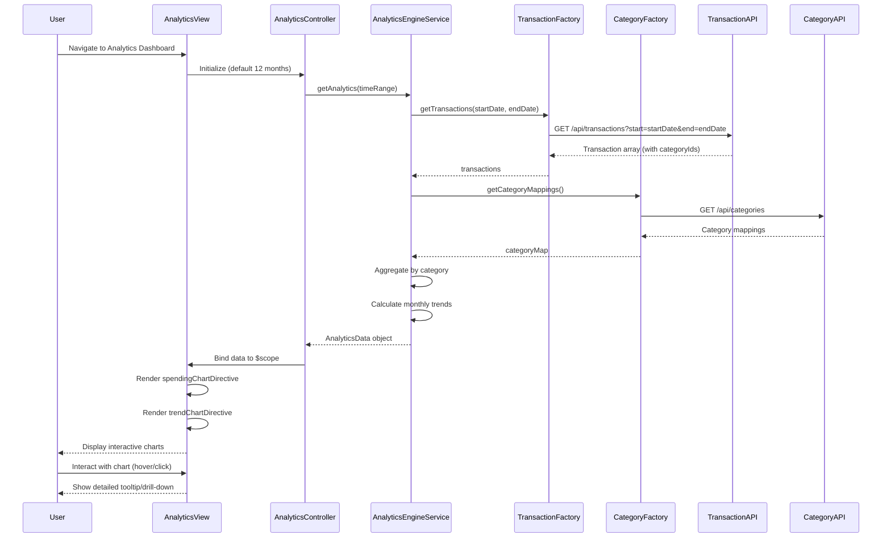

# Low-Level Design: Analytics and Spending Insights
**Epic ID:** QE-7944

## a. Architecture Mapping

- **User Dashboard** → AngularJS Module (`analyticsModule`) + Controller (`AnalyticsController`)
- **Analytics UI Component** → AngularJS Directive (`spendingChartDirective`) for interactive visualizations
- **Analytics Engine** → AngularJS Service (`AnalyticsEngineService`)
- **Transaction Service Integration** → AngularJS Factory (`TransactionFactory`) for REST API calls
- **Category Classification Service Integration** → AngularJS Factory (`CategoryFactory`) for REST API calls

**Recommended Folder Structure:**
```
app/
├── modules/analytics/
│   ├── analytics.module.js
│   ├── analytics.controller.js
│   ├── analytics.view.html
│   └── analytics.css
├── services/
│   └── analytics-engine.service.js
├── factories/
│   ├── transaction.factory.js
│   └── category.factory.js
├── directives/
│   ├── spending-chart.directive.js
│   └── trend-chart.directive.js
└── vendor/
    └── chart.js (or D3.js for visualizations)
```

## b. Component Specifications

| Name | Artifact Type | Responsibility | Key Dependencies |
|------|--------------|----------------|------------------|
| analyticsModule | Module | Registers analytics feature components and routing | angular, ui.router, chart.js |
| AnalyticsController | Controller | Manages analytics view state, handles time range selection, triggers data fetch | AnalyticsEngineService, $scope, $filter |
| AnalyticsEngineService | Service | Aggregates transaction data by category and time, calculates trends and insights | TransactionFactory, CategoryFactory, $q |
| TransactionFactory | Factory | Handles REST API calls to Transaction Service for transaction history | $http, API_CONFIG |
| CategoryFactory | Factory | Handles REST API calls to Category Classification Service for category mappings | $http, API_CONFIG |
| spendingChartDirective | Directive | Renders interactive category-wise spending pie/bar chart using Chart.js | chart.js, $timeout |
| trendChartDirective | Directive | Renders monthly spend trend line chart with interactive tooltips | chart.js, $timeout |
| analytics.view.html | View | Displays analytics dashboard with filters, category breakdown, and trend visualizations | Bootstrap, AngularJS directives |

## c. Data Model

**Transaction (JavaScript Object):**
```javascript
{
  transactionId: String,
  cardId: String,
  amount: Number,
  date: Date,
  categoryId: String,
  merchantName: String
}
```

**CategorySpending (JavaScript Object):**
```javascript
{
  categoryName: String,  // One of: Food & Dining, Fuel, Shopping, Travel, Entertainment, Utilities, Healthcare, Education, Miscellaneous
  totalAmount: Number,
  transactionCount: Number,
  percentage: Number     // Percentage of total spending
}
```

**MonthlyTrend (JavaScript Object):**
```javascript
{
  month: String,         // Format: YYYY-MM
  totalSpend: Number,
  categoryBreakdown: Array<CategorySpending>
}
```

**AnalyticsData (JavaScript Object):**
```javascript
{
  timeRange: String,     // e.g., "Last 12 months"
  categorySpending: Array<CategorySpending>,
  monthlyTrends: Array<MonthlyTrend>,
  totalSpending: Number
}
```

## d. Data Flow

User navigates to analytics dashboard → `AnalyticsController` initializes with default 12-month time range → Controller calls `AnalyticsEngineService.getAnalytics(timeRange)` → Service invokes `TransactionFactory.getTransactions(startDate, endDate)` to fetch transaction history → Transactions returned with pre-classified category IDs → Service aggregates data by category using array reduce operations → Service calculates monthly trends by grouping transactions by month → `AnalyticsData` object with category spending and monthly trends returned to controller → Controller binds data to `$scope` → View renders `spendingChartDirective` for category breakdown and `trendChartDirective` for monthly trends → User interacts with charts (hover, click) to explore detailed insights.

## e. Primary Sequence Diagram



## f. Implementation Notes

- Use Chart.js library for rendering interactive, responsive charts; integrate via AngularJS directives with two-way data binding
- Implement data aggregation logic in service layer using ES6 array methods (map, filter, reduce) for clean, functional code
- Cache category mappings in `CategoryFactory` to avoid redundant API calls; use AngularJS `$cacheFactory` for in-memory caching
- Apply AngularJS `$filter` service for date range filtering and currency formatting in views
- Ensure chart directives use `$timeout` for DOM manipulation to work within AngularJS digest cycle and avoid rendering issues

## g. Error Handling

HTTP interceptor-based error handling with try/catch in aggregation logic; user notifications via Bootstrap alerts for API failures.

## h. Security Notes

Standard input validation and secure API calls assumed; transaction data access controlled via token-based authentication.