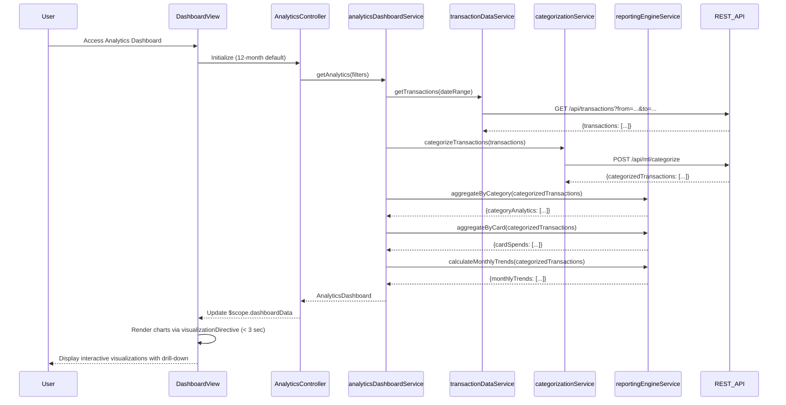

# Low-Level Design: Spending Analytics and Visualization
**Epic ID:** QE-7951

## a. Architecture Mapping

- **User Interface** → AngularJS Module (`analyticsModule`) + Controller (`AnalyticsController`) + View Template (`analytics-dashboard.html`)
- **Analytics Dashboard Service** → AngularJS Service (`analyticsDashboardService`) for orchestrating analytics operations
- **Transaction Data Service Integration** → AngularJS Service (`transactionDataService`) for raw transaction data retrieval
- **Transaction Categorization Service Integration** → AngularJS Service (`categorizationService`) for category classification
- **Analytics and Reporting Engine Integration** → AngularJS Service (`reportingEngineService`) for data processing and aggregation
- **Data Visualization Library** → AngularJS Directive (`visualizationDirective`) wrapping D3.js or Chart.js
- **Filter Component** → AngularJS Directive (`analyticsFilterDirective`) for interactive filtering

**Recommended Folder Structure:**
```
app/
├── modules/analytics/
│   ├── controllers/analyticsController.js
│   ├── services/analyticsDashboardService.js
│   ├── services/reportingEngineService.js
│   ├── views/analytics-dashboard.html
│   ├── directives/visualizationDirective.js
│   ├── directives/analyticsFilterDirective.js
├── shared/
│   ├── services/transactionDataService.js
│   ├── services/categorizationService.js
└── assets/css/analytics.css
```

## b. Component Specifications

| Component Name | Artifact Type | Responsibility | Key Dependencies |
|----------------|---------------|----------------|------------------|
| analyticsModule | AngularJS Module | Root module for analytics feature, configures routes and visualization library | ngRoute, D3.js/Chart.js |
| AnalyticsController | Controller | Manages analytics dashboard state, handles filter interactions, coordinates visualization rendering | analyticsDashboardService, $scope, $filter |
| analyticsDashboardService | Service | Orchestrates analytics data flow, aggregates spending by category and card | transactionDataService, categorizationService, reportingEngineService, $q |
| transactionDataService | Service | Fetches raw transaction data for up to 12 months via REST API | $http |
| categorizationService | Service | Classifies transactions into 9 categories with 95% accuracy via ML API | $http |
| reportingEngineService | Service | Aggregates data by category, card, and time period; calculates trends | $http |
| visualizationDirective | Directive | Renders interactive charts (pie, bar, line) with drill-down capability | D3.js or Chart.js |
| analyticsFilterDirective | Directive | Provides filtering UI for date range, category, and card selection | None |
| analytics-dashboard.html | View Template | Displays multiple visualizations in responsive grid with filter panel | Bootstrap, visualization directives |

## c. Data Model

```javascript
// Transaction Model
class Transaction {
  transactionId: String,
  cardId: String,
  amount: Number,
  date: Date,
  category: String, // One of 9 categories
  merchantName: String,
  description: String
}

// Category Analytics Model
class CategoryAnalytics {
  category: String,
  totalAmount: Number,
  percentage: Number,
  transactionCount: Number,
  cardBreakdown: Array<{cardId: String, amount: Number}>
}

// Monthly Trend Model
class MonthlyTrend {
  month: String,
  totalSpend: Number,
  categoryBreakdown: Array<{category: String, amount: Number}>
}

// Card Spend Model
class CardSpend {
  cardId: String,
  cardName: String,
  totalSpend: Number,
  categoryBreakdown: Array<{category: String, amount: Number}>
}

// Analytics Dashboard Model
class AnalyticsDashboard {
  categoryAnalytics: Array<CategoryAnalytics>,
  monthlyTrends: Array<MonthlyTrend>,
  cardSpends: Array<CardSpend>,
  dateRange: { startDate: Date, endDate: Date }
}
```

## d. Data Flow

User accesses analytics dashboard → AnalyticsController initializes with default 12-month range and calls analyticsDashboardService.getAnalytics(filters) → analyticsDashboardService calls transactionDataService.getTransactions(dateRange) to fetch raw transactions → categorizationService.categorizeTransactions(transactions) classifies each transaction into 9 categories using ML API with 95% accuracy → reportingEngineService.aggregateByCategory(categorizedTransactions) groups by category and calculates totals → reportingEngineService.aggregateByCard(categorizedTransactions) groups by card → reportingEngineService.calculateMonthlyTrends(categorizedTransactions) aggregates by month → Service returns AnalyticsDashboard object → Controller updates $scope.dashboardData → visualizationDirective renders interactive charts (category pie chart, monthly trend line chart, card-wise bar chart) within 3 seconds → User applies filters via analyticsFilterDirective → Controller calls service with updated filters → Visualizations re-render with drill-down capability.

## e. Primary Sequence Diagram



## f. Implementation Notes

- Use D3.js or Chart.js wrapped in AngularJS directive with two-way data binding for interactive visualizations; implement click handlers for drill-down
- Apply $q.all() in analyticsDashboardService to parallelize categorization and aggregation operations where possible
- Implement client-side caching using $cacheFactory for transaction data to reduce API calls on filter changes
- Use ng-repeat with track by transactionId for efficient rendering of large transaction lists
- Apply Bootstrap responsive grid and media queries to optimize chart layout for mobile, tablet, and desktop

## g. Error Handling

Interceptor-based error handling with $http response interceptors; display user-friendly error messages via Bootstrap modals on API or categorization failures.

## h. Security Notes

Standard input validation and secure API calls assumed; transaction data filtered server-side by authenticated user; ML categorization API requires valid auth token.